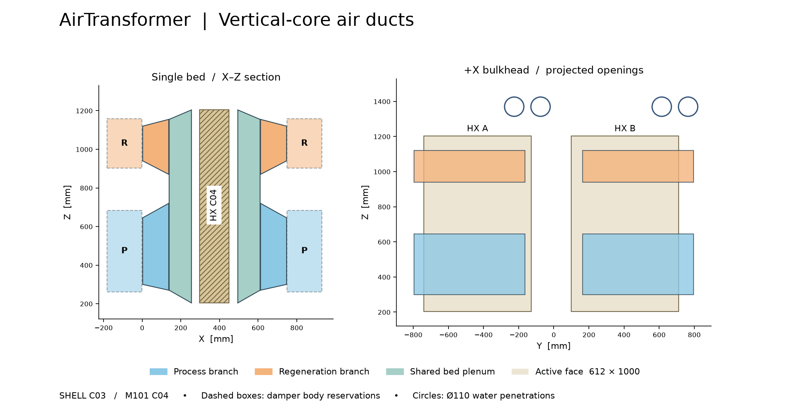

# 壳体 C03 · 双芯竖装斜向风道

**装配审查用几何候选，2026-11-05。** 输入为壳体 C02 和 M101 HX C04。下载 [C03_CAD.zip](C03_CAD.zip) 后解压。C03_DUCTS_AND_DAMPERS.step 单独显示风道与占位，C03_INSTALLED_LAYOUT.step 显示装入壳体后的相对位置。HX 在壳体装配中以翅片有效区和两侧密封基准环代表，详细几何见仓库 HX 目录。

每床在 −X 和 +X 两侧各设一个风室。每侧保留下层处理风 P、上层再生风 R，两条支道各自斜向扩展，经双孔连接板接到同一块竖直迎风面。前侧风道随前风箱拆卸。A、B 床各自封闭。同一床投入 P 时，其两侧 P 阀开、R 阀关；投入 R 时反之。控制联锁、切换过渡和泄漏试验待设备联调。

| 几何量（mm） | 取值 |
|---|---|
| P / R 风阀净口 | 630 × 345 / 630 × 180 |
| P / R 法兰和孔 | 706 × 421、32 × Ø9 / 706 × 256、28 × Ø9 |
| 风阀预留 | 8 个阀体（轴向深 180）和 8 个外置驱动占位（160 × 170 × 220） |
| 单侧从法兰内面到芯前孔板 | 135 支道 + 2 双孔板 + 115.5 共用风室 |
| P / R 支道出口 | 630 × 450 / 630 × 285 |
| 每芯风窗 | Y 向 612 × Z 向 1000，Z204–1204；A 中心 Y−434.4，B 中心 Y405.6 |
| 水口占位 | X750 隔板，4 × Ø110；Z1370，床内 Y 中距 150；Ø85 保温管径向余量 12.5 |

B 芯按 HX C04 与 A 同向，重排 B 床支撑孔、底盘避让口、两侧风窗和密封圈。四只三通阀位置作为水路布置参考。此次接管几何止于隔板外侧，至三通阀的连接和检修工具运动仍待布管设计。额定处理风 4870 m³/h 全部流过一床时，按几何净面积，P 口平均速度 6.22 m/s，芯面表观速度 2.21 m/s。共用风室深 115.5 mm，芯面速度分布、再生风量和压损需用 CFD 或样机测量确定。

建模脚本逐对检查新增实体与装配体的正体积干涉，另检查 12 段气流体积内的实体侵入，判据为 0.001 mm³。两项记录均为空。STEP 独立读回为 80 和 198 个实体。板件以截面投影 1.5 mm 建模，折弯展开、接缝、紧固方式、气密和风阀运动另行验证。

重建时先解压仓库中的 C02 壳体工程包和 HX C04 工程包。使用 Python 3.12、CadQuery 2.8 和 matplotlib。运行 `python build_ducts.py <C02的deliverables目录> <HX_C04版本目录>`，再运行 `python render_section.py`。各截面坐标和 STEP 回读结果见 verification.json。
