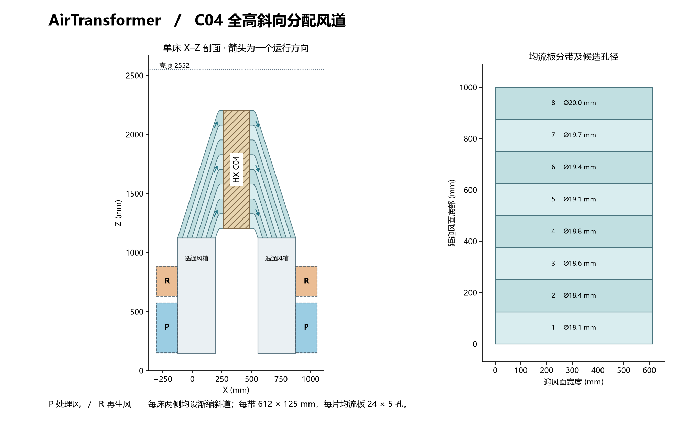

# AirTransformerShell C04 · 双向全高渐缩风道

[两份 STEP](C04_CAD.zip) 包含单面风道组件 C04_TAPER_CASSETTE.step 和双床装机几何 C04_INSTALLED.step。模型单位为 mm。状态为气流与接口审查候选。

## 风道及占位

每床两侧各有一个全宽选通箱。P 净口 630 × 345，R 净口 630 × 180，各自以原 706 mm 宽法兰、Ø9 孔阵列及 180 mm 深阀体预留。8 个阀体和 8 个执行器均有独立占位。运行时每床两端选同一风路，另一组阀关闭。两层阀口均位于芯体下方；本机的双床共四个选通箱。

阀箱顶部的 612 × 320 喉口在深度方向等分八路。每路由一对近似平行的斜导板送风，在出口转向 X 轴，对应 HX 上一条 612 × 125 的带区。斜段相对竖直约 17.7°。外壁从下至上收敛，八路依次通向各自带区，迎风面的最上与最下端均有独立路径。反向时，两侧镜像组件互换分配与集流功能。每路末端设一片 1.5 mm 穿孔板，每片含 120 个圆孔，长道孔径略大。出口导板投影约占面高 1.2%，导板与实际翅片前缘间保留混合距离。均流孔径为首轮试验候选。

| 装配接口 | C04 几何 |
|---|---|
| 主壳体 | X −131.1 至 +1312，Y ±852，Z 0–2552；外伸风阀与驱动另计 |
| 相对 C03 | 壳顶升高 800，−X 侧向外扩 79.1，HX 整体升高 1000 |
| HX A / B | 沿用 M101 C04，R=I，平移 (265, −802.175, 1150) / (265, 37.825, 1150) |
| 有效迎风面 | Z1204–2204，宽 612，高 1000 |
| 喉部 / 上层 / 下层 | 喉口 Z1124，上层 R 净口 Z665–845，下层 P 净口 Z190–535 |
| 水侧 | X750 隔板、4 × Ø110，管轴 Z2370，床内中距 150；四三通阀布置参考整体上移，支管及阀门检修运动待集成 |

壳体装机 STEP 用翅片有效区及密封座表示 HX，详细 HX STEP 见仓库 HX/M101_D952_P254_220_39x6_C04。阀体与驱动为静态外包络。斜导板换向区用 16 段近似光顺曲线，折弯、导板支撑、均流板可拆固定和密封工艺待详设。升高后的框架需要独立结构校核。

## 流量与压损

以单床处理风 4870 m³/h 为设计点，面平均风速 2.21 m/s。分路模型计入两侧导道长度、局部损失、壁面摩擦和两片均流板。净截面按 1.5 mm 导板扣除。空气密度 1.18 kg/m³、Cd=0.65、Darcy 摩擦因子 0.03、双侧合计局部 K=1.8 均为建模假设。每段以 Q² 缩放；芯体暂按设计点 60 Pa，等候实测湿、干曲线。

在等流量分配点，两侧导道与均流板合计约 **149 Pa**，不含阀箱、芯体、外部管道和阀叶。为估算阀口高度差，引入三维阀箱压力网络，分别从 P 口及 R 口输入流量，分配到 8 × 12 个面区。模型从压力损失推算流量，不能解析阀叶尾流、分离或孔板下游单孔射流。两侧几何镜像，模型的正反向对称是边界假设。

- 示例阀箱混合损失系数 4 m⁻¹、两口按相同的 4870 m³/h 比较，P 路约 **325 Pa**、R 路约 **276 Pa**，均含假设的芯体 60 Pa，均不含风阀、外部风管。系数改为 1–10 m⁻¹ 时，P 为 238–499 Pa，R 为 226–376 Pa。这些数值用于判断风机余压敏感性。
- R 路另列 2435 m³/h 的半流量比较点，系数 4 m⁻¹ 时约 69 Pa；再生设计流量须按实际工况定。
- 独立不均匀性筛查：在额定流量下施加上下 ±20 Pa 和左右 ±10 Pa 的入口至出口压差偏置，并扫描摩擦因子 0.018–0.05、Cd 0.58–0.72、芯体压降 0–120 Pa。48 组组合中，最小、最大分区流速分别为面均值的 **0.860 / 1.137**，最大 CV 为 **7.23%**。这是给定扰动范围内的结果；随湿度变化的局部 HX 阻力、阀叶遮挡及泄漏需要单独验证。

## 双向验收

建议在真实风阀、密封和芯体装齐后，分别运行 A/P、A/R、B/P、B/R。按各自规定流量，在当时迎风侧沿 8 带 × 12 列等面积扫描；测量截面位于孔板与翅片之间，使用区域平均或平面测速，避免用单孔射流中心值代替带区平均。同步记录总流量、阀前至阀后总压损、HX 前后静压差。以测得的全脸平均为基准，初拟各面区 0.8–1.2 倍、CV ≤10%，并同时满足整机风机工作点。局部偏流优先调对应带区孔板。上述指标供试验验收，实测结果尚待取得。

## 复现

Python 3.12、CadQuery 2.8、NumPy、SciPy、Matplotlib。依次运行 network.py、selector_flow.py、build_c04.py、render.py。为复现装机 STEP，将壳体 C02 工程包中 deliverables/native 的路径作为 build_c04.py 的唯一参数，以载入既有四只三通阀的 BRep。fit.json 记录静态实体干涉与两份 STEP 回读。flow_checks.json 与 selector_results.json 分别给出分区扰动和阀箱网络结果。版本基线为壳体 C03 提交 f391f9e 和 HX C04 提交 2ad2e87。
