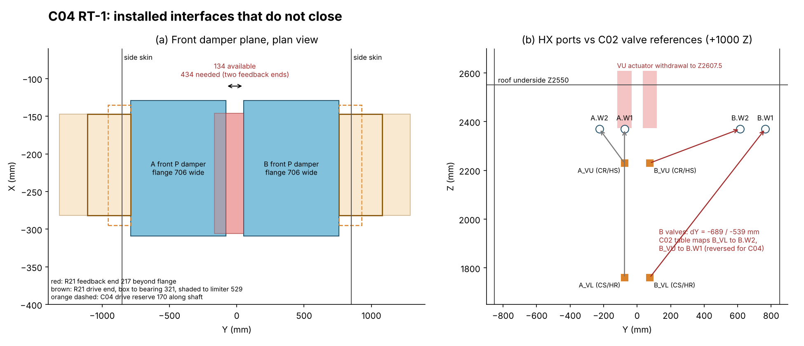

# AirTransformer C04 two-bed, one-stage module: RT-1 red-team review

Baseline: buildfly commit `cb6c2b5` (handoff `RED_TEAM_HANDOFF_EN.md`; geometry identical to `4d87530`). Scope: the simplified one-stage adsorption drying module with two adsorptive HX (one per bed). Units are mm, Pa and m³/h unless stated otherwise. Axes follow the handoff: X runs through the coil, Y across the beds, Z is vertical.

Labels: **[V]** computed here from the delivered files, reproducible with `tools/`. **[S]** taken from a delivered source. **[E]** first-principles estimate with stated inputs. **[I]** engineering inference. **[R]** recommendation. Nothing physical was done, no supplier was contacted and no CFD or FE model was run.

## 0. Dispositions

| Item | Disposition | Governing reason |
|---|---|---|
| Shell, ducts and frame | **Revise** | No load path for the four 80 kg cassettes or for the front dampers they carry (S1). The HX seat is a rigid flush contact with no gasket or clamp (S2). The common internal cavity and frame bracing are undefined (S5, S6). |
| M101 HX C04 | **Accept with conditions** as the installation baseline | The detailed 537-solid STEP fits both bays with zero clashes. Its bolt pattern, seal frame and fin window coincide with the shell datums. The conditions are a measured dry/wet Δp curve with the coating, frame flatness at the seal land and drain access (H2). |
| Air dampers (R21 at the eight C04 interfaces) | **Revise** for the two-bed shell. **Accept with conditions** on a single-bed article. | R21 end housings need ≥434 mm between the A and B flanges; C04 provides 134 mm (D1). The drive reserve and side-skin cut-outs are smaller than the R21 drive train (D2). Bed B needs an opposite-hand or unqualified orientation (D3). |
| Water changeover | **Revise** | The bed-B valve references are 539–689 mm from their ports, and the C02 table connects them to the wrong ports for the C04 HX orientation (W1). The upper actuator withdrawal passes through the roof (W2). There are no headers or branches, and no hydronic baseline exists for two HX (W3, W5). |
| Assembled two-bed machine | **Revise** | All of the above. |
| **Cold-flow build** | **Accept with named conditions** for a **single-bed (bed A) article on a test stand**. Not ready as the two-bed shell drawn in C04. | Bed B is a pure +840 Y translation of bed A in C04, so bed-A air-path evidence transfers. The exceptions are damper handedness and the bed-B water routing. Conditions C1–C8 are in §3. |

**Answer to the decision requested.** The C04 *air-path geometry* (selector boxes, eight inclined channels, balancing plates and HX seats) is suitable to build for a cold-flow test, provided it is built as one bed on its own supports with the conditions in §3. The two-bed machine cannot be released. Four interfaces must change first:
1. Damper spacing and handedness (D1–D3).
2. The bed-B valve placement and port mapping (W1).
3. Cassette and damper supports (S1).
4. The HX seal design (S2).

The largest technical uncertainty is the R-mode face distribution. The C04 selector model cannot resolve it (A1), and a first-principles screen indicates it may fail the proposed 0.80–1.20 gate. Test R mode first.

**Confidence.**
- High for the geometric findings (S1, S2, D1, D2, W1, W2). Each is a direct CAD measurement.
- Medium for the R-mode distribution risk (A1). The direction and order of magnitude follow from momentum arguments, but the magnitude needs CFD or a test.
- Medium-low for the structural frequencies (S6), because the end fixities are undefined.

**What would change these conclusions.**
- Moving the dampers onto external manifolds, or changing the bed pitch, would remove D1 and D2.
- A selector-box CFD or mock-up showing R-mode throat spread within ±5% would downgrade A1 to a monitoring item.
- A designed skin-diaphragm and fastening detail would close part of S6.

## 1. What was reproduced

| Check | Result |
|---|---|
| `network.py`, `selector_flow.py` rerun (Python 3.13, NumPy 2.5, SciPy 1.18) | All 76 and 936 numeric leaves match the committed `flow_checks.json` and `selector_results.json` exactly [V, `results/rerun_identity.json`] |
| `build_c04.py <C02 native>` rerun (CadQuery 2.8.0, OCP 7.9.3) | 28 and 188 solids. The installed clash list is empty at 0.001 mm³. Per-solid volumes and bounding boxes are identical to the committed STEPs (max difference 0.0) [V, `results/step_compare.json`]. File SHA-256 values differ because STEP headers carry timestamps, so record a geometry signature, not a file hash, as the reproduction criterion. |
| Detailed HX (537 solids) placed at A (265, −802.175, 1150) and B (265, 37.825, 1150), identity rotation | 0 clashes > 0.001 mm³ against all 176 installed host and cassette solids [V, `install_checks.json`]. Contacts are zero-volume and occur only at the intended faces: guide lands, cheeks, seat returns, beams, and OD85 pipe reserves at the X615 union face. |
| Port datums | Local (350, 726.85/576.85, 1220) + translation gives (615, −75.325/−225.325, 2370) for A and (615, 764.675/614.675, 2370) for B. Union end faces are at X615.0 [V]. The handoff table is correct. |
| Fin window | Fins at local X 31.65–183.65, Z 54–1054, Y 62.7–672.85 (306 fins, 0.133 mm, 2.0 pitch, planes normal to Y) → global X 296.65–448.65, Z 1204–2204. This equals `FIN_VOLUME_REF` [V]. The fins are vertical X–Z plates, so air can redistribute vertically inside the coil but not across Y. |
| Seal frame | HX frame plates are 8 mm at local X 0–8 and 212–220, Y 41.77–693.77 (652), Z 8–1084. The bars at Z 34–54 and 1054–1074 match the shell `SEAT_RETURN` (652 × 1040, Z 1184–2224). The seal land is 18.5 mm wide on each side [V]. |
| Feet and bolts | HX feet are 180 × 80 × 8. They have Ø17 at local (52, 15), an X-slot at (172, 15) and Y-slots at (52/172, 655). These coincide with the beam holes at global X 317/437 and local Y 15/655 [V]. Each foot bears 40 of its 80 mm width on the 50 mm beam, because the beam is centred on the hole 25 mm from the foot centre. That is adequate for about 100 kg. |
| R21 flange interface | The P101 (706 × 421, window 630 × 345, 32 × Ø9) and R101 (706 × 256, 630 × 180, 28 × Ø9) hole patterns equal the C04 `flange_cuts` pattern, with a maximum position deviation of 0.0 mm [V]. Flange face-to-face depth is 180 mm, which equals the C04 reservation. |

## 2. Findings

Each blocker row gives the affected file, part and state, the result against its criterion, the smallest correction and the evidence that closes it. The full list is in `C04_RT1_FINDINGS.csv`.

### 2.1 Shell, ducts and frame

**S1. No load path for the cassettes or front dampers. Blocker for the cold-flow article and for manufacture.**
- **Location.** `build_c04.py`, parts `BOTTOM`, `DUAL_VALVE_FLANGE` and `FLOOR`; all states.
- **Cassette.** Each cassette weighs 80.5 kg (1.5/2.5 mm sheet at 7.9 kg/dm³) and its centre of gravity is at Z 1238 [V, `masses.json`]. Its bottom is at Z 142.5, 38.5 mm above the floor top at Z 104, and no hanger, bracket or fastener is modelled.
- **Front dampers.** The front P and R dampers bolt to the outer face of the 2.5 mm flange and sit outside the front skin. Their R21 product mass is 114.7 + 63.3 = 178 kg steel-equivalent per bed, or about 107 kg at a 0.6 material factor [V/E, `damper_mass.json`], cantilevered about 90 mm and more from the flange. R21's own handoff requires "external dry support … real load paths" [S, `R21_REVIEW_TEXT_EN.md` line 14].
- **Correction.** Give each cassette two vertical angles or channels landing on the base sills, plus a lateral clip at the HX beam. Give each damper its own stand to the base, so the cassette flange carries only the seal.
- **Evidence.** Load-path drawing and the deflection at the seal under cassette plus damper weight, against the gasket compression allowance in S2.

**S2. The HX seat is a rigid flush contact: no gasket volume, no compression mechanism, and the extraction route slides across it. Blocker.**
- **Location.** `SEAT_RETURN` (5 mm plate at u 0–5) meets the HX frame face at X265 and X485 with zero gap [V]. No gasket, compression set or clamp exists, and both cassettes are unsupported (S1).
- **Leak estimate** [E, `flow_screen.json`]. A uniform mean gap g on the 3.38 m seal outline at 150 Pa leaks 11.7, 23.3 and 58.3 m³/h per face for g = 0.1, 0.2 and 0.5 mm. That is 0.24, 0.48 and 1.2% of the P flow, and it bypasses the coil through the shell cavity into the collector side.
- **Correction.** Use closed-cell EPDM or silicone, about 6 × 20 mm, compressed 25–35%. Clamp it with screws or toggles on the cassette land, and release it before the HX is moved. Alternatively, retract the cassette 5 mm on slotted brackets.
- **Evidence.** Measured compression, and a tracer or pressure-decay bypass test at the HX seat. Proposed criterion: ≤0.2% of P flow per bed.

**S3. The balancing plates cannot be reached without removing the HX, and the specified measurement plane is too shallow. Cold-flow condition.**
- **Location.** `BALANCE_BAND_xx` sits at u 12–13.5, between the guide lands, 12 mm from the HX frame face [V]. Tuning iterations, which are the reason the diameters are "first-round candidates", would each require HX removal.
- **Measurement plane.** The plate-to-fin distance is 12 + 31.65 = 43.65 mm, which is 2.2–2.4 hole diameters [V/E]. That lies inside the jet-merging zone and is too shallow for a vane or pitot traverse.
- **Correction.** Cut slide-in slots for the eight plates in one cheek, with a gasketed cover strip.
- **Measurement.** Measure patch velocity on the *leaving* face of the coil with a thin thermal-anemometer rake (≤10 mm), and cross-check with a 96-tap coil Δp map, since the coil is laminar (Re ≈ 570, §2.2).

**S4. No condensate drainage. Condition for the wet test.**
- The guides slope 17.7° from vertical into the selector boxes. Each box bottom (Z 142.5) forms a 46 mm sump below the P port. The cavity under the HX is open to the floor. No drain, trap or tray exists.
- **Correction.** Add a drain spigot at the low point of each box. The trap seal must hold at least the box static pressure: 300 Pa ≈ 31 mm water gauge, so use ≥ 60 mm. Add a drip tray with a drain under each HX frame.

**S5. The common cavity is undefined. Manufacturing gate.**
- All four cassettes, the rear dampers, the valve zone and both beds share one internal volume. The "X750 bulkhead" is a 750 × 240 gland strip per bed at Z 2280–2520 [V], not a partition. The four upper valves (Z 1740–2372) sit directly above the rear dampers (Z 152–883) with no drip containment.
- Duct seams and HX seats therefore leak into a volume whose pressure is set by accident, through the drive cut-outs. This creates a P→cavity→R path between beds.
- **Correction.** Vent the cavity deliberately to ambient through a defined opening. Specify the pressure hierarchy dry P > ambient > R (for example, process fan blowing through and regeneration fan drawing through). Add a drip tray or partition under the valve zone.

**S6. Frame racking and HX-support dynamics. Manufacturing gate; the cold-flow stand must be braced.** [E, `structure_screen.json`]
- **Frame.** C04 has roof rails along X only (Y −850 and 820), no top Y members, and no base cross members at the front or rear ends. The 50 × 50 × 3 corner posts are 2446 mm long; as cantilevers they give 8.55 N/mm each, or 34 N/mm for the bare frame. Racking therefore depends on skins that are not designed as diaphragms, and the front skin has two 720 × 984 openings.
- **HX support.** Each HX (about 80–110 kg wet) sits on four unbraced 40 × 40 × 3 risers of 996 mm, with its centre of gravity 625 mm above the riser tops and no top restraint. The first mode is 7–9 Hz with pinned tops and 14–16 Hz with fixed tops. That band includes 16 Hz (960 rpm fans) and transport excitation. The port spools through the gland strip are loaded by this motion.
- **Correction.** Brace each riser pair diagonally. Add a top lateral guide from the lifting-lug zone (local Z 1098–1134) to a roof member, slotted in Z for thermal growth. Add end base cross members and top Y members.

**S7. Service. The extraction route is clear, but the detailed sequence is open.** [V, sweeps]
- **Sweeps.** With only the outboard side skin removed, the full 537-solid HX translates 900 mm in −Y (bed A) or +Y (bed B) in 25 mm steps without touching any host solid. With only the roof removed, it lifts 1300 mm without obstruction. Toward −X, the front cassette blocks it at the first 50 mm step. The C02 method of front removal plus −X would require removing the whole 2.1 m front cassette.
- **Recommended route** [R]: the outboard ±Y slide on transfer rails at the beam top, Z 1150.
- **Open items.**
  - The rear-damper drives pass through the side skin, so they must come off first.
  - The X615 unions are reachable only from the roof or side.
  - The four M16 bolts pass through closed 50 × 50 × 3 RHS beams without crush tubes, with nuts inside the enclosed cavity.
  - The seal must be released first (S2).

**S8. Height, lifting and mass. Manufacturing gate.**
- Height is 2552 mm before feet or pallet. That exceeds a standard ISO container door (about 2.28 m) and many laboratory doors.
- No lifting points are defined.
- The estimated installed mass is about 1.4 t [E: host 425 kg + cassettes 322 kg + 2 × 95 kg HX + dampers + 60 kg water hardware], with a high centre of gravity.

### 2.2 M101 HX C04

**H1. Installation: verified clean** (§1).

**H2. Conditions of acceptance.**
1. **Δp curve.** Supply a dry and wet Δp curve with the actual coating. Screen [E]: fin gap 1.87 mm (bare) or 1.57 mm (0.15 mm coating per side), Re_gap ≈ 570 (laminar), plate friction 23–38 Pa plus tube-row form drag 15–37 Pa, giving 38–76 Pa at 2.21 m/s. The assumed 60 Pa is plausible. With a laminar coil, Δp ∝ Q^1.0–1.3, not Q², which changes the R half-flow balance (§2.5).
2. **Condensate bridging.** Check whether condensate bridges the 1.87 mm fin gap in wet operation. Bridging would raise the lower-band resistance and bias the face profile.
3. **Seal land.** Specify frame flatness over 652 × 1076 compatible with the S2 gasket.
4. **Drain stubs.** The header drain stubs (local Z 26–41) are inside the machine. Route them to an accessible point.

### 2.3 Air dampers (R21) at the C04 interfaces

**D1. The R21 end housings cannot fit at 840 mm bed pitch with any handedness. Blocker for the two-bed shell.** [V, `damper_extents.json`; figure (a)]
- **R21 extents.** In the R21 test frame (shaft = Y), the P and R product extends beyond the 706 mm flange as follows:
  - Feedback end: **217 mm** (G833P/R cover).
  - Drive end: **90** (rotor), **172** (BK2 coupling), **288** (P gear pair KHK SSG3-55), **320** (7206 bearing) and **528 mm** (mayr limiter).
  - The HBK torque transducer and its coupling are counted as test facility and excluded.
- **C04 space.** C04 leaves **134 mm** between the A and B flanges (Y −81.4 to 52.6), at all four positions (front and rear, P and R).
- **Required.** 434 mm if both feedback ends face inboard (shortfall **300**). If one drive end faces inboard, ≥537 mm to the bearing or 745 mm to the limiter.
- **Smallest corrections:**
  - (a) For the cold-flow article, build bed A only, with its feedback ends into the vacant B space. No change is needed.
  - (b) For the machine, choose one:
    - offset bed B's damper plane in X by ≥200 mm with a spool, so the housings pass;
    - increase the bed pitch to ≥1140 mm, which widens the shell by 300 mm;
    - mount the dampers on external P/R manifolds instead of directly on the selector boxes.
- **Evidence.** The installed R21 P and R STEP at all eight positions, with a full-stroke clash check and tool access.

**D2. The drive reserve and side-skin cut-outs are smaller than the R21 drive train.**
- **C04 reserves.** The drive reserve is 160 (X) × 170 (along shaft) × 220 (Z). The rear-drive side-skin cut-outs are 161 × 222.
- **R21 drive train.**
  - The P gear pair is 336 (Z) × 171 (X), located 229–288 mm beyond the flange.
  - The BK2 coupling pair (275 mm span in Z) crosses the side-skin plane, which is 64.6 mm beyond the flange edge.
  - The drive line runs ≥528 mm along the shaft before the actuator, which R21 still defines only as a placeholder.
- **Correction.** Size the cut-outs and reserves from the R21 STEP plus the selected actuator, covering 78 N·m normal and 120 N·m limiter for P, and 38 N·m for R [S].

**D3. Handedness.**
- C04 puts every drive outboard, so the bed-B dampers are the opposite hand of bed A.
- R21 is qualified in one orientation. The P O1′ note says gravity relative to the product must not be changed without qualification [S, R21 review line 37]. Rotating 180° about the flow axis inverts gravity (wet bay, film). Rotating 180° about Z reverses the pressure direction.
- **Correction.** Choose one: an opposite-hand R21 variant, a qualification statement from the damper owner, or a layout with both drives on the same side (only possible with D1(b)).

**D4. Fastening.**
- The damper flange bolts to a 2.5 mm box wall, and the nuts would sit inside the selector box, where they cannot be reached after closure.
- **Correction.** Use M8 weld studs (CD studs) on the box flange. Check flatness over 716 × 980 against the damper seal.

### 2.4 Water changeover

**W1. The bed-B valve references are stale and the C02 port mapping is reversed for the C04 HX. Blocker for integration.** [V, `install_checks.json`; figure (b)]

| Valve (function) | C02 table target | Required for C04 | AB face to port: ΔX / ΔY / ΔZ |
|---|---|---|---|
| A_VL (CS/HR) | A.W1 | A.W1 ✓ | 316 / 0 / −610 |
| A_VU (CR/HS) | A.W2 | A.W2 ✓ | 416 / +150 / −140 |
| B_VL (CS/HR) | **B.W2** | **B.W1** | 416 / **−689** / −610 |
| B_VU (CR/HS) | **B.W1** | **B.W2** | 516 / **−539** / −140 |

- **Cause.** C02 placed the B valves near the centreline because the B core was rotated 180°. C04 translated them by +1000 Z only.
- **Consequence.** Built to the C02 table, bed B would run cold W2→W1 and hot W1→W2, opposite to bed A and to the HX function labels.
- **Correction.** Re-place the B valve pair near Y 615–765 and re-tag `WATER_INTERFACES`. A plain +840 Y translation of the A pair is not possible: the valve branches reach ±110 from the valve origin, so B_VL's A-port would sit at Y 875, beyond the 850 skin. Either jog the pair inboard by ≥70 mm, or rotate the valves 90° about X so the branches point ±Z.

**W2. The upper actuator withdrawal passes through the roof.**
- The C02 `A_VU` and `B_VU` `ACTUATOR_WITHDRAWAL` volumes (+235 Z) reach Z 2607.5 after the +1000 shift. That is 57.5 mm through the roof underside, an intersection of 38,590 mm³ each [V].
- C04 imported the valve body and actuator but not the withdrawal volume, so the clash check could not see this.
- **Correction.** Add a local roof hatch over the valve zone, or lower the VU pair by ≥60 mm. Add the withdrawal volumes to the clash set.

**W3. Headers and branches are absent.**
- C04 represents no common headers. Translating the C02 headers by +1000 would put HS at Z 2663–2697, above the roof [V, `valve_bbox_c02.json`].
- Branch routing, header continuity, the union-release sequence and spool supports are undefined.
- The gland strip is not a bulkhead (S5).

**W4. Transition states. A 2-HX state table is needed.** The four three-way valves cannot isolate a bed. Per bed, VL is AB→W1 with A = CS and B = HR; VU is AB→W2 with A = CR and B = HS.

| VL / VU | Connection | Consequence |
|---|---|---|
| A / A | CS→W1→W2→CR | Cold (bed in P) |
| B / B | HS→W2→W1→HR | Hot (bed in R) |
| A / B | CS→W1 and HS→W2 | Two supplies meet in the coil; back-feed into the weaker supply header |
| B / A | W1→HR and W2→CR | Hot and cold returns are cross-connected through the coil |
| Either valve mid-stroke | VL: CS↔HR; VU: CR↔HS through the ball | Direct hot↔cold transfer for the stroke time, even with flow stops closed. RT01's own matrix records this for its state T2 [S]. |

- **Cross-transfer estimate** [E]. Assume Kv ≈ 2 at mid-stroke, a source Δp of 5–10 kPa (RT01) and a 9 s stroke (RT01, LRQ). Each stroke transfers about 0.5–0.7 L, or roughly 0.1–0.15 MJ at ΔT = 50 K. The mid-stroke Kv must be measured.
- **Plug penalty** [E, inherent to this port assignment]. W1 serves CS/HR and W2 serves CR/HS. At every switch, the roughly 11 L water plug in the coil (nominal domain 11.0 L [S]) plus the spools is therefore displaced into the *opposite* source's return. No valve ordering avoids this.
  - Size: 11 L × 4.19 kJ/(L·K) × 50 K ≈ 2.3 MJ per bed per cycle on each of the hot and cold sides.
  - Comparison: the HX metal sensible swing is 37 kJ/K × 50 K ≈ 1.9 MJ (Cu 32.8, Al 16.7, steel 21.3 kg [V]).
  - Trade-off for the hydronics owner [I]: a co-current assignment (W1 = CS/HS, W2 = CR/HR) lets the outlet valve lag the inlet by the plug transit time (≈20 s at 2 m³/h), returning the plug to its own source. The cost is the water/air flow arrangement in one mode.

**W5. No hydronic baseline exists for two HX.**
- RT01 reviews a two-bed, **four-HX** C05 candidate whose stated status is `PARTIAL_FAILED_LAYOUT_AND_HYDRAULIC_CANDIDATE` [S].
- It is a reference for functions (FS, XV, EV, RV, state logic). It is not a baseline for this module.
- **Correction.** Issue a two-HX P&ID with the four valves, one flow stop and one relief per bed, the state table above with timing, and fail positions.

### 2.5 Air distribution and fan duty

**A1. The selector-box model cannot distinguish P from R. The R port has low distribution authority. Highest-risk cold-flow item.**
- **Evidence that the model is blind** [V].
  - In `selector_results.json`, the 8 × 12 face fields for P-port and R-port feeds are **bit-identical** at every mixing coefficient (maximum difference 0.0). R at 4870 and 2435 differ by ≤1×10⁻⁵.
  - The network carries no jet momentum, so the inlet position cannot influence the face. The reported 0.860–1.137 and CV 7.23% come from imposed ±20/±10 Pa biases, not from the selector geometry.
- **Competing hypotheses.**
  - **H0 (model view).** The throat plenum is at uniform total pressure, and the face is set by the branch resistances (CV ≈ 0.1–0.3%).
  - **H1.** Port-jet momentum and separation at the port's upper edge skew the throat distribution. In supply mode, the outboard channels feeding the upper bands are starved.
  - **H2.** The supply-side and collector-side skews have opposite sign and partially cancel through the bed.
- **Authority screen** [E, `flow_screen.json`]. Define M = branch Δp (both cassettes, plates and HX = 209 Pa) / port dynamic head.
  - P: q = 22.9 Pa, M = 9.1.
  - R: q = 84.0 Pa at equal flow, M = 2.5, independent of flow if every term scales as Q². With a laminar HX at 2435 m³/h, M = 3.1.
  - Band deviation δ ≈ ½·c/M, where c is the fraction of the port dynamic head that survives as a total-pressure spread at the throat. For c = 0.3–1.0, δ is **1.6–5.5% for P** and **6–20% for R**.
  - Port-top-to-throat distance over box depth is 1.82 for P and **0.86 for R**. The R jet turns 90° less than one box depth below the throat, which favours c towards 1.
- **Discriminating observations.**
  - H1 predicts that R-mode CV exceeds P-mode CV by about 3–4× and that the minimum patch sits in band 8 (top) on the supply side.
  - H0 predicts CV below 1% in both modes.
  - H2 predicts reduced but same-signed skew.
- **Correction if H1 is confirmed.** Turning vanes at the R-port upper edge or a perforated splash baffle in front of the R port. Reserve fixing points now.
- **Gate before cutting metal.** Run a RANS CFD of one selector box with throat, P and R feeds (about one day). Alternatively, test a 1:1 mock-up of the box and its eight throat slots with a static/total rake.

**A2. Path losses and fan duty.** Independent band at 4870 m³/h, with K ranges per term in `flow_screen.json` [E]:

| Path | C04 model (mixing 4 m⁻¹; range 1–10 m⁻¹) | Independent estimate | Note |
|---|---|---|---|
| P, 4870 | 325 (238–499) | **219–278** | Plates: Idelchik gives 12–23 Pa per plate; the C04 law gives 28–42 Pa |
| R, 4870 | 276 (226–376) | **311–431** | The C04 ranking R < P is reversed. The R port's dynamic head is 3.7× that of P. |
| R, 2435 | 69 | **90–120** | Laminar HX assumed |

- Two dampers per path and the external ducts are additional.
- [R] Specify the P fan for at least 550 Pa total at 4870 m³/h plus external losses, with a variable-speed drive, until measured.
- The balancing differential is robust. The plates must offset 20.9 Pa (Blasius friction) or 26.8 Pa (C04 f = 0.03), and they supply 21.9 Pa (Idelchik) or 27.6 Pa (C04 law). The mismatch is ≤6 Pa against a 209 Pa branch, which is ≤1.5% of band flow [E].
- K = 1.8 for all minor losses on both sides is low. The slot discharge into the collector box alone is K = 1.0 at 33.6 Pa.

**A3. Cross-leakage and damper transitions.**
- **Leak paths.** P and R share each selector box, so every closed damper sees the P–R pressure difference.
- **Allowable leak** [E]. For a 0.2 g/kg outlet-humidity allowance with x_R − x_P = 30 g/kg, the allowed R→P leak is 0.67% of P (32.5 m³/h). At 300 Pa that equals 667 mm² of leak area, or a **0.30 mm mean gap** over one R damper's seal lines.
- **Transitions.**
  - Damper changeover must be break-before-make on each box.
  - The all-closed state dead-heads the fans, so it needs a fan ramp or bypass.
  - The carry-over at each switch is the bed's 0.82 m³ air volume. That is 0.6 s of P flow and about 27 g of water if R air at 30 g/kg is pushed into P.
- **Correction.** Write a damper state table with timing, and run a tracer-gas test (CO₂ or SF₆) for cross-leak and seat bypass.

**A4. Guides are structurally adequate in flow** [E].
- The Miller critical velocity for the 1.5 mm, 612 mm-span guides at a 36.6 mm gap is 49.6 m/s, against 7.55 m/s in service.
- Self-weight sag is ≤1.05 mm, and 10 Pa of net pressure adds 0.3 mm.
- The first plate mode is 9.6–21.7 Hz. Watch for drumming at fan blade-pass sub-harmonics.

## 3. Cold-flow build: conditions and plan

**Article.** Bed A only: two C04 cassettes, one M101 C04 HX, and four R21 dampers in the P and R configurations (or a documented interim damper with a measured leakage curve), on a braced test stand. Bed B adds no new air-path geometry in C04.

**Conditions.**

| # | Condition | Closes |
|---|---|---|
| C1 | Single-bed article on its own stand. Cassette supports and independent damper stands. | S1, D1 for the test |
| C2 | Gasketed, clamped HX seats with recorded compression; seat bypass ≤0.2% by tracer | S2 |
| C3 | Side-slot access to the eight plates per cassette; leaving-face rake plus coil Δp map | S3 |
| C4 | Drains with ≥60 mm traps at both box low points; drip tray under the HX | S4 |
| C5 | Pre-build selector-box CFD or mock-up (gate G0); fixing points for R-port vanes or baffle | A1 |
| C6 | Fan ≥550 Pa at 4870 m³/h plus external losses, with VFD; airway per ISO 5801 or ISO 5167 nozzle | A2 |
| C7 | Static taps up and downstream of each damper, at both box throats, and at the HX faces; tracer injection and sampling ports in P and R | A2, A3 |
| C8 | Damper break-before-make sequence written before the first run | A3 |

**Decision gates.**
- **G0 (before cutting sheet).** CFD or mock-up of the selector box.
  - If the R-mode throat channel spread is within ±5%, proceed as drawn.
  - If it is between ±5% and ±15%, fit the vanes or baffle and re-check.
  - If it exceeds ±15%, revisit the R-port position or size with the damper owner.
- **G1 (dry).** Run A/P and A/R in the intended directions, R first. Record flow, fan speed, density, total Δp, HX Δp, the 8 × 12 patches, bypass and cross-leak. Accept on the handoff gate (each patch 0.80–1.20 of the face mean, CV ≤10%) plus C2 and A3 leak limits.
- **G2 (tune).** Re-drill the plates through the side slots and repeat G1. Stop after two iterations. If the gate is still missed, the cause is geometric (return to A1 corrections).
- **G3 (wet).** Repeat with the wetted coil and compare Δp and the band profile, especially the lower bands. Check condensate carry-over at 2.21 m/s.

## 4. What still gates manufacture of the two-bed machine

1. D1–D3: damper spacing, drive space and handedness at all eight positions.
2. W1–W5: B-valve placement and mapping, actuator withdrawal, headers and branches, two-HX P&ID and state table.
3. S1, S5, S6, S8: cassette and damper load paths, cavity pressure and containment, frame bracing and HX top restraint, lifting and height.
4. S2 and S7: production seal design, and an extraction procedure with removable side panels, union access and bolt access.
5. A1–A3: measured face distribution and fan duty, and the cross-leak qualification from the single-bed test.
6. Sheet-metal detailing: bends, guide fixing to the cheeks, plate holders and seams. Not reviewed.

## 5. Reproduction

Extract the C02 CAD package, the HX import ZIP and both R21 parts into separate empty directories. Set the paths in `tools/run_all.sh` and run it. Every number in this review is in `results/`.

**Not reviewed.**
- HX PDF drawings, R21 drawings and factory pages.
- RT01 hydraulics beyond its README, state matrix and status.
- External ductwork, fans and controls hardware.
