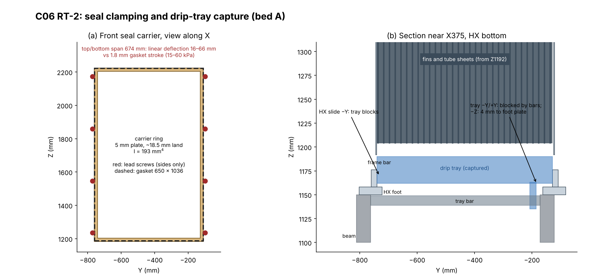

# AirTransformer C06 two-bed shell: RT-2 red-team review

Baseline: default branch `d2c9a68`. It contains:
- C06 integration `9342a08`;
- M101 RT1 port alignment `554db04`;
- hydronics HYD-R1 `0e6bbca`;
- dampers D01 `d2c9a68`.

C06 responds to RT-1 (`AirTransformerShell/revisions/C04/RT1_REVIEW/`). Units are mm, Pa and m³/h. Axes are as in C04.

Labels:
- **[V]** computed here from the delivered files, reproducible with `tools/`.
- **[S]** taken from a delivered source.
- **[E]** first-principles estimate with stated inputs.
- **[I]** inference.
- **[R]** recommendation.

No CFD, FE or physical test was run.

## 0. Disposition

**Decision requested: accept or return the coupled geometry for prototype detailing.**

**Return, narrowly.** Most of C06 is ready for detailing:
- the 1280 mm pitch;
- the eight D01 dampers;
- the HYD-R1 water bay;
- the port alignment;
- the plate access;
- the cassette bearers and the frame additions.

Five items need one more geometry iteration first, because each one defeats a cold-flow acceptance criterion or the HX withdrawal sequence:
1. **N1.** The seal carrier ring has almost no out-of-plane stiffness, and its eight screws are on the vertical sides only. The 674 mm top and bottom edges are not clamped.
2. **N2.** The gasket clamp force reacts through the cassette. The cassette is held only by its floor bearers, 1.56 m below the gasket centroid.
3. **N3.** Two zero-clearance interfaces lie in series with the gasket: the guide and cheek tips on the HX frame, and the carrier sliding on the cheeks. With realistic tolerances they give a coil bypass of 0.5–1.0% per face, against the 0.2% criterion.
4. **N4.** The new HX drip tray is captured between the HX feet, the bottom frame bars and the fins. The HX cannot slide out sideways with the tray installed, and the tray cannot be removed with the HX installed.
5. **N5.** The plate-access slots cut the outboard cheek almost through, leaving 6.3 mm of total ligament over 1000 mm. The forward strip that carries the carrier's sliding surface is effectively detached.

All five have small corrections (§3). I agree with holding cutting and two-bed manufacture.

| Item | Disposition |
|---|---|
| Shell C06 | **Return** for N1–N5. Accept the rest for detailing. |
| M101 C04 with the RT1 port alignment | **Accept.** Resolve the hot-mode port-function conflict with HYD-R1 (N7). |
| Dampers D01 at 1280 mm pitch | **Accept for detailing** with the D01 holds (right-hand qualification, actuator, G843) plus N8 (support ledges). |
| Water bay HYD-R1 at 1280 mm pitch | **Accept for detailing** with conditions: N7, relief sizing, the owner's acceptance of the longer headers, and the catch-tray drain route. |
| Single-bed cold-flow article | **Accept with conditions** C1–C8 (RT-1 §3) **plus N1–N6**. As drawn, C2 (seat bypass ≤0.2%) cannot be met and the withdrawal sequence cannot be completed. |
| Two-bed manufacture | **Hold** |

**Confidence.**
- High for N1, N2, N4 and N5. They are direct geometry facts: screw positions, contact inventory, sweep results and slot ligaments. N1 and N2 magnitudes follow from beam statics, using a stated range of gasket stiffness.
- Medium for N3's leak magnitude, which depends on the assumed gaps.
- The air-path risk A1 from RT-1 is unchanged: no CFD or mock-up yet, and no R-port vane provision.

**Evidence that would change this.**
- A supplied gasket with compression-load deflection (CLD) ≤5 kPa at 30%, which would shrink N1 and N2 by 3–12×. The top/bottom span would still exceed the compression stroke.
- A design intent that the carrier slides on a separate sealed guide not represented in the CAD.
- A tray that is in fact fixed to the HX.

## 1. What was reproduced

| Check | Result |
|---|---|
| `build_c06.py` in the repository layout (C04 sources adjacent, D01 extracted at `dampers/c04-d01`), CadQuery 2.8.0, OCP 7.9.3, Python 3.13 | 327 solids; zero intersections above 0.001 mm³; `shell_checks.json` identical [V]. The rebuilt `C06_SHEET_METAL.step` matches the delivered STEP solid by solid: 327 of 327, with a maximum volume or bounding-box difference of 0.0 [V, `results/c06_step_compare.json`]. |
| `integrate.py` with the M101 single-core STEP, the HYD-R1 directory and D01 | `integration_checks.json` identical in content. Counts: 43 water solids, 327 shell leaves, 7212 D01 leaves, 1074 HX solids. All static pairs pass. The eight D01 full-rotation-box hits are on the sleeves and side panels, as stated. `interfaces.csv` is byte-identical [V]. |
| `verify_motion.py` | 600 segmented bounds, 9 candidates, 0 intersections. Identical [V]. |
| Detailed HX at A (265, −802.175, 1150) and B (265, 477.825, 1150) against all 327 rebuilt shell solids | 0 clashes [V, `c06_checks.json`] |
| D01 rear drive lines through the closed side-panel cut-outs | All 28 (ARP) and 22 (ARR) installed D01 leaves outboard of Y −850 project inside the cut-outs. The panel can be threaded off once the actuators are removed (N10) [V, `drive_panel.json`]. |

**Credit and corrections from the owner responses.**
- The HX owner found that both C04 W1 gland bores broke through the strip edge, leaving a 213.7° arc. RT-1 missed this. C06 adopts the 55 mm tab.
- The hydronics owner correctly notes that RT-1's 0.5–0.7 L per stroke silently assumed about 4–4.5 s of effective overlap. The point is now moot, because the three-way valves have been replaced.

## 2. RT-1 findings: status in C06

| RT-1 | C06 status | Note |
|---|---|---|
| S1 load path | **Partly closed** | Vertical paths now exist [V]: each cassette has two bearers on a floor plate sandwiched over base cross members, and each damper has a portal. Lateral and overturning restraint of the cassette is still absent (N2). The damper pads carry only the outer flange (N8). |
| S2 HX seat | **Replaced by N1–N3** | Gasket 6.0 → 4.2 mm (30%) with a retractable carrier, as RT-1 asked. The clamping system does not deliver uniform compression. |
| S3 plate access, measurement | **Closed / new N5, N11** | 32 slide-in plates and covers are present. The slots leave 0.6 mm ligaments. There are no static taps at the HX faces. |
| S4 drainage | **Partly** (N6) | Sloped sumps and 20 mm drains are present. They are untrapped, with only 74 mm to ground, and the HX tray nozzle discharges into the cavity. |
| S5 cavity | **Partly** | Vent slots in the rear skin (6 × 210 × 9 per bed) are a defined cavity vent. The water catch-tray drain (X1210, Y−700, Z1118) is still undefined above the A discharge sleeves. |
| S6 frame and HX dynamics | **Partly** (N9) | Added: end base and roof members, Y-direction riser braces, top forks (restraining Y only) and side tension straps. The HX remains unrestrained in X at the top, with no X–Z bracing: 7.6–17.7 Hz [E]. The end planes have no diagonal. |
| S7 service | **Open** (N4, N10) | The side and vertical routes are clear only after removing the forks and the captured tray. |
| S8 envelope | **Open** | Shell 1750 (X, including front portals) × 2156 × 2552. With the D01 actuator reserves the width is 3543 (Y −1565.9 to +1977.1) [V]. |
| D1–D4 dampers | **Closed geometrically** | At 1280 mm pitch the A/B product bounds are 130.4 mm apart, and only one inboard feedback cover can be withdrawn at a time [S, V]. The cut-outs are sized from the rotation bounds. M8 weld studs are used. D3 remains a qualification hold. |
| W1–W5 water | **Closed geometrically** by HYD-R1 | Eight fail-closed two-way valves, routes rebuilt from the four ports, the highest pull reservation 68 mm below the roof, a two-HX P&ID and 256 states enumerated. The integration has zero clashes [V]. New conflict: N7. |
| A1–A3 air | **Open** | Guides, selector boxes and ports are unchanged. The break-before-make damper table exists (D01). There is no CFD or mock-up (gate G0) and no R-port vane fixing points (condition C5). |

## 3. New findings

The full list, with closing evidence, is in `C06_RT2_FINDINGS.csv`.

**N1. The seal carrier ring is not stiff enough to compress the gasket away from its screws. Blocker for C2 and for the seal function.** [V/E, `c06_screens.json`]
- **Geometry.** `SLIDING_SEAL_CARRIER` is the C04 `SEAT_RETURN` ring moved 4.2 mm: a 5 mm plate with an 18.5–19.25 mm land, giving I ≈ 193 mm⁴ out of plane. The eight lead screws sit at Y ±337, Z 1235/1547/1859/2173, on the two vertical sides only.
- **Load.** The gasket is 650 × 1036 × 16 mm, 0.0529 m². At a CLD of 15–60 kPa (closed-cell sponge at 30%), the line load is 0.24–0.94 N/mm.
- **Linear deflection.**
  - Top and bottom edges (674 mm unsupported): **16–66 mm**.
  - Sides (312 mm between screws): 0.75–3.0 mm.
  - Even treating the ring corners as fully fixed (÷5), the top and bottom spans give 3.3–13 mm, against a **1.8 mm** compression stroke. The top and bottom edges and the corners will not seal.
- **Correction.** Make the carrier a closed stiff frame, for example a folded channel or 25 × 25 × 2 RHS with I ≥ 2 × 10⁴ mm⁴. Clamp it at ≥12 points, including mid-span top and bottom, and give it hard compression stops at 4.2 mm.
- **Evidence.** Pressure-sensitive film or feeler map of the installed gasket at all four edges and corners, then a seat-bypass tracer test.

**N2. The clamp reaction overturns the cassette. Blocker.** [V/E]
- **Load path.** The screws react on cheek-mounted lugs, so the gasket force pushes each cassette away from the HX. The contact inventory finds only two cassette-to-structure contacts, the bearers on the floor at Z 104 [V, `AF_cassette_contacts_with_structure`]. The cassette top (Z 2224) is free.
- **Magnitude.** The gasket force is 0.79–3.18 kN per face, acting at Z 1704. That gives **1.2–5.0 kN·m** about the bearers and a **5.9–23.5 kN** force couple at the 211 mm bearer spacing. The cassette weighs 0.79 kN and is made of 1.5–2.5 mm sheet.
- **Correction.** Close the force loop locally. Tie the F and R carriers to each other with removable rods outside the HX envelope, at about cy − 355 and cy + 392. The HX occupies cy − 340.5 (hairpins) to cy + 376 (headers) over Z 1235–2173 [V], so the clearance is about 10 mm. Alternatively, react the screws on a stiff frame mounted on the HX beams and top cross. The cassette then carries only its own weight.

**N3. Two zero-clearance interfaces are in series with the gasket. Blocker for C2 and for HX insertion.** [V/E]
- **Tips.** The guide tips (GUIDE_00/04/08) and both cheeks end exactly on the HX frame face (distance 0.000).
- **Carrier fit.** The carrier window equals the cheek and guide 0/8 outer faces (distance 0.000), so it is a nominal zero-clearance sliding fit.
- **Leak path.** The channel interior → tip gap → annulus inside the gasket → carrier clearance → cavity.
- **Leak estimate** [E]. Over a 3.23 m perimeter at 150 Pa:
  - 0.3/0.3 mm gaps: 0.49% of P per face.
  - 0.5/0.5 mm: 0.81%.
  - 1.0/0.5 mm: 1.02%.
- **Tolerance.** With rigid tips at nominal zero, any HX frame bow or placement error either stops gasket seating or opens the gap.
- **Correction.**
  - Set the guide and cheek tips back ≥3 mm from the frame face. The 31.65 mm frame recess already mixes the bands, so this costs no distribution.
  - Seal the carrier to the cassette with a wiper lip or a short EPDM bellows.
  - Close the gasket's inner edge on the frame bar.

**N4. The drip tray is captured, so the stated withdrawal sequence cannot be completed. Blocker for open decision 2.** [V, sweeps]
- **Sweeps.** With the side panel and strap removed, the HX's ±Y slide is obstructed by the forks, `HX_TRAY`, `HX_TRAY_NOZZLE` and the pan pads. With the forks and the tray set removed, it is clear to 900 mm on both beds. The +Z lift is clear to 1300 mm once the roof, `HX_TOP_CROSS` and the forks are removed.
- **Tray removal with the HX in place.**
  - −Y is blocked at 5 mm by the HX foot plate and bottom frame bar.
  - +Y is blocked at 5 mm by the other bar.
  - −Z is blocked at 5 mm by the foot plate, which is 4 mm below the tray.
  - Along X, the tray lies between the 8 mm frame plates.
- The nozzle reaches Z 1135. If the tray were dragged with the HX, the nozzle would strike the outboard beam (top at Z 1150).
- **Correction.** Fix the tray to the HX bottom bars so it is withdrawn with the core. Replace the rigid nozzle with a hose and dry-break coupling above Z 1150.
- **Evidence.** A rerun sweep with the tray as part of the core.

**N5. The plate slots leave the forward cheek strip almost detached. DFM blocker; quick fix.** [V, `panel_cheek.json`]
- Material across the u 10.5–15 slot band of the outboard cheek is 42.5 mm³, equivalent to **6.3 mm of total ligament** (7 × 0.6 + 2 × 1.05 mm). The inboard cheek has 6760 mm³ in the same band.
- The 10.5 mm forward strip carries the carrier's sliding surface and the tip contact at the HX frame.
- **Correction.** Make the forward strip a separate formed angle (for example 10 × 15 × 1.5) fastened to the nine guide lands, or step the slots to leave ≥10 mm ligaments.
- **Plate retention.** Each plate sits in a 4.5 mm slot for a 1.5 mm plate, with no holder along its 612 mm length. Add guide-mounted clips.

**N6. Drains are untrapped, have no space for traps, and the HX tray nozzle has no outlet. Cold-flow condition.** [V/E]
- The four box drains are Ø20 and end at Z 74, which is 74 mm above ground [V]. A trap holding 300 Pa needs about 62 mm of seal plus its own height, and there is no room for it under the floor.
- An untrapped drain passes 10.8–15.3 m³/h at 150–300 Pa, or 0.22–0.31% of P each. Across six openings that is up to about 1.9% of P [E].
- The HX tray nozzles discharge at Z 1135 into the under-HX cavity, which has no floor drain [V].
- **Correction.** Route the drains horizontally to external traps, or raise the machine on a plinth of ≥150 mm. Hose the tray nozzles through a floor penetration. Cap the drains in dry tests.

**N7. The HX and hydronics registers disagree on the hot-mode port functions. Interface blocker for live water.** [S]
- HX `RT1_PORT_ALIGNMENT/INSTALLED_PORTS.csv` and its README: hot water enters W2 and leaves W1 (W1 = CS/HR).
- HYD-R1 and C06 `interfaces.csv`: W1 is supply and W2 is return in both modes (W1 = CS/HS).
- **Correction.** Issue one function table, signed off by the HX owner (including venting of the top headers in both modes), and update the other register. HYD-R1 already flags the regeneration-performance comparison.

**N8. Damper weight still reaches the 2.5 mm flange. Front portals stand free.** [V/E]
- The support pads reach X −393 to −343 (front) and 1090 to 1141 (rear). They contact only the last ≈13 mm of each damper at the outer flange (AFP spans X −356.1 to −146.1).
- With the centre of gravity mid-body, about **50%** of each damper's weight goes through the D01 adapter studs into the 2.5 mm box wall. That contradicts D01's rule ("不能把阀重交给2.5 mm法兰", do not give the valve weight to the 2.5 mm flange). It is about 30–55 kg per P damper, by the RT-1 steel-equivalent estimate.
- The front portals stand on the ground at X −438 to −378, outside the machine base, and connect to the machine only through the dampers.
- **Correction.** Extend the ledges under the inner flange or the body, and tie the front portals to the machine base so the machine and its dampers form one skid.

**N9. Residual structure.** [V/E]
- **HX X direction.** The riser braces are 30 mm (X) bars in the Y–Z plane, and the forks are 4 mm (Y) plates. Both restrain Y only. In X the HX (80–110 kg, centre of gravity 625 mm above the riser tops) sits on unbraced 40 × 40 × 3 risers at **7.6–17.7 Hz** for pinned or fixed ends, before any gasket contribution. That band includes fan speeds near 960 rpm.
- **End planes.** The end planes (Y–Z, at front and rear) have no diagonal. With fixed post bases and rigid beams, two end frames give about 140 N/mm, which is 11 mm of sway at 0.1 g for a 1.5 t machine [E].
- **Side straps.** They are tension-only, one per side and on opposite diagonals, and are removed for HX service.
- **Top cross.** `HX_TOP_CROSS` ends 4 mm short of both side panels and is held only by contact under the roof rails.
- **Correction.** Add an X-direction fork or pin at the HX lugs, X–Z bracing between the riser pairs, end-plane diagonals, and a temporary service brace.

**N10. The service sequence is longer than "remove the side panel".** [V]
- The rear actuator reserves are 250 mm in X, larger than the 187 mm side-panel cut-outs. Both rear actuators on that side must come off, and the 1439 × 2446 panel must then be threaded 464 mm outward over two drive lines.
- Plate tuning also needs the side panel off, because the outboard gap to the panel is about 108 mm against 612 mm plates.
- **Correction.** Split each side panel at about Z 1000. All cut-outs lie at Z ≤ 848, and the HX window spans Z 1150–2400. The upper panel, which needs a matching strap detail, then opens without touching the dampers.

**N11. Instrumentation gap.** Static taps exist in the boxes (P chamber, R chamber, throat, tracer points). There are none in the HX frame recess, so the HX Δp required at G1 is not directly measurable. Add two taps per face through the inboard cheek forward strip.

## 4. Cold-flow article: what changes from RT-1

The single-bed article remains the right first build, and C06 now supplies most of the C1–C8 hardware. Before cutting sheet for it:
1. Apply N1–N3 (one redesign of the carrier and tip interface).
2. Apply N4 (tray carried by the core).
3. Apply N5 (forward strip).
4. Apply N6 (trapped drains).

Gate G0 (selector-box CFD or mock-up with R first) and the R-port vane fixing points (C5) are still outstanding. No C06 face-distribution or fan-duty evidence exists yet, as the handoff states.

## 5. Reproduction

Extract the C06 package, D01 (at `dampers/c04-d01`), HYD-R1 and the HX import ZIP into a repository-layout copy. Run `build_c06.py`, `integrate.py` and `verify_motion.py`, then `tools/run_all.sh` from this folder. All numbers come from `results/`.

**Not reviewed.** D01 internal motion and R21 inherited holds, the HYD-R1 hydraulics beyond its tables, and the external ducts, fans and controls.
