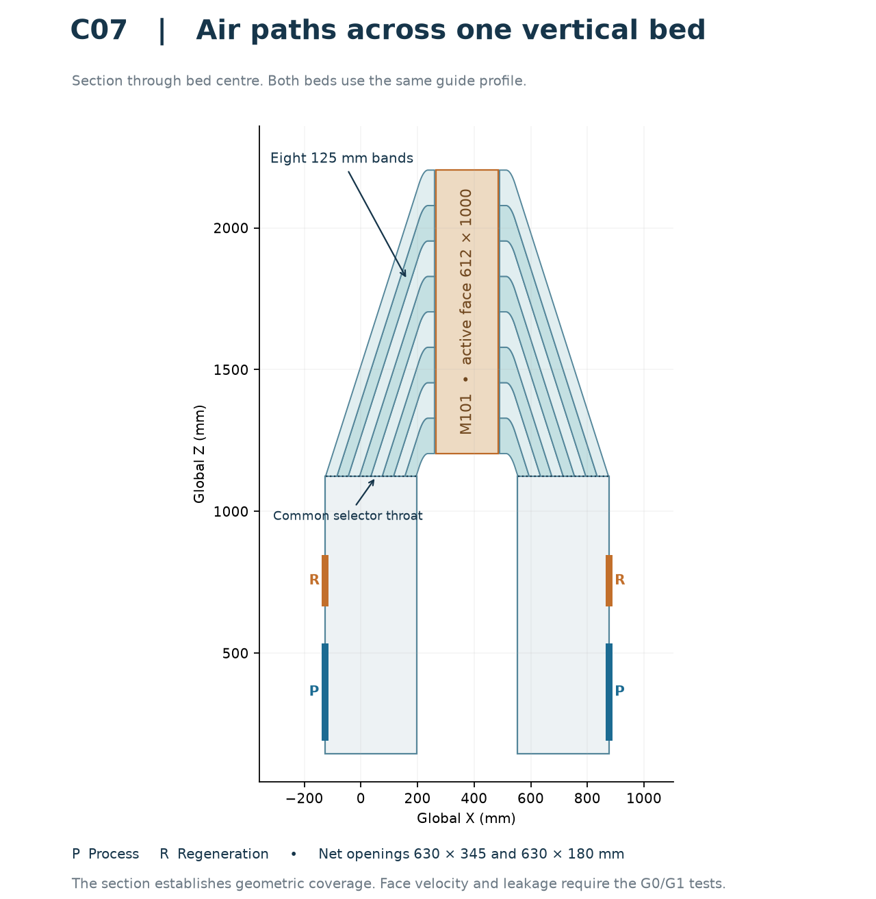
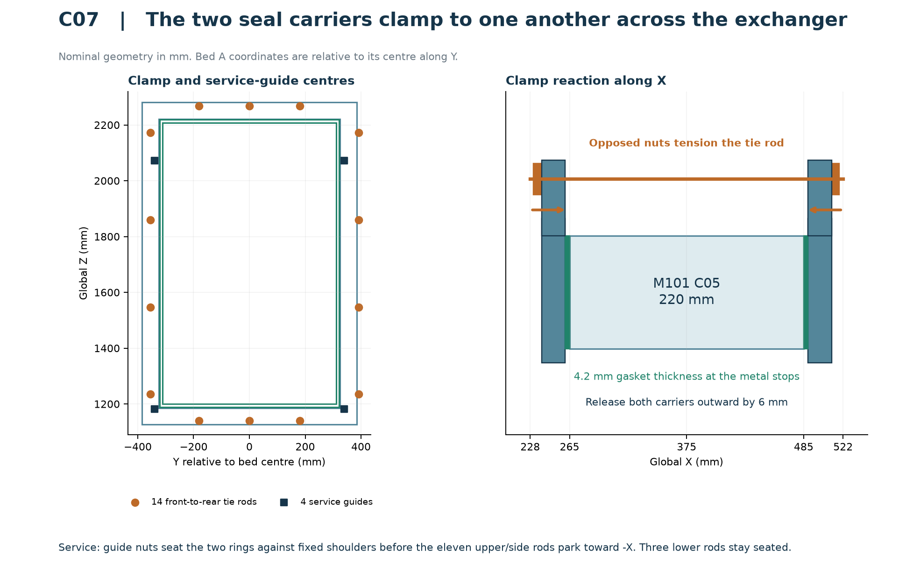

# AirTransformer C07 — two-bed shell and duct handoff

**Requested decision.** Review the integrated geometry for prototype detailing. Keep sheet cutting, live water and two-bed manufacture on hold. The next air experiment is the regeneration inlet of bed A's selector box. Both modes reach the entire coil footprint in the CAD. The velocity distribution still requires measurement or resolved-flow analysis.

## Delivered configuration

Open `C07_INSTALLED_MACHINE.step` from `C07_CAD_REVIEW_PACKAGE.zip` for the machine at the common project origin. `C07_SHELL.step` isolates the shell and its service fittings. All dimensions below are in mm. X is airflow depth and the water-bay direction, Y spans the beds, and Z is vertical.

| Package | Integration instruction |
| --- | --- |
| Shell C07 | 1280 bed pitch. Y centres −434.4 and +845.6. Beds use the same eight-channel diagonal distributor at each vertical face. Front/rear duct faces X −129.1 / +879.1. Net widths and heights are 630 × 345 for process and 630 × 180 for regeneration. |
| [M101 HX C05](../../../HX/M101_D952_P254_220_39x6_C05) | 549 solids per core. Install with translation (265, −802.175, 1150) on A and (265, 477.825, 1150) on B. Keep the attached tray, spigot and both upper vent provisions. Suppress the superseded C06 shell trays. |
| [D01 dampers](../../../dampers/c04-d01) and [D02 supports](../../../dampers/c06-d02) | Eight D01 dampers with their installed interfaces. The export excludes the obsolete D01 HOST. Use the 149 D02 support parts once. C07 removes all 16 superseded C06 pads and retains the portal members. |
| [L2-E water bay, R2](../../../hydronics/C06_RT2_HYD_R2) | Working assembly uses 44 solids: retain C06's pitch-adjusted water bay, replace the four bed trees and valve tray, and add the tray outlet. The bay has eight two-way valves. Keep tools and withdrawal volumes as separate verification bodies. |
| Baselines | [C06 red-team findings](../C06/RT2_REVIEW/C06_RT2_REVIEW.md) and [C04 single-bed conditions](../C04/RT1_REVIEW/C04_RT1_REVIEW.md). The C07 package includes source, nominal checks, input identities and STEP hashes. |



The rear-facing unions all have X 615, Z 2370 and face +X. The shell, HX owner and water owner records agree on the following configuration.

| Bed | W1 supply Y | W2 return Y | Cold selection | Hot selection |
| --- | ---: | ---: | --- | --- |
| A | −75.325 | −225.325 | A_XV_CS to W1, W2 to A_XV_CR | A_XV_HS to W1, W2 to A_XV_HR |
| B | +1204.675 | +1054.675 | B_XV_CS to W1, W2 to B_XV_CR | B_XV_HS to W1, W2 to B_XV_HR |

`port_reconciliation.json` checks the signed HX table SHA-256, four positions, union specifications, vectors, duties and selectors against the original water register. W1 → W2 in both modes is the owner's conditional prototype configuration. Before live water, qualify pressure-rated vents, trapped-volume relief, filling/purging, valve sequencing and thermal performance including the stopped-and-replumbed hot-direction comparison. The water-owner package preserves its historical request for HX signoff. The successor signed record is in the C05 HX package.

## Geometry returned against RT2



| Finding | Implemented in C07 | Evidence or remaining acceptance |
| --- | --- | --- |
| N1. Flexible perimeter | Each face now has a closed 60 × 20 × 3 steel section, a continuous 2 mm backing plate, 14 hard stops and 14 through-tie locations shared with the opposite face. Top and bottom each have three direct clamp points. | The full-height gasket has 37,632 mm² of nominal footprint. A 6 mm gasket compresses to 4.2 mm. At an assumed compression stress of 15–60 kPa the total is 0.56–2.26 kN per face. The nominal section has I = 27,652 mm⁴. Under 0.72 N/mm on a simply supported 400 mm segment, deflection is 0.043 mm (E = 200 GPa). This beam estimate omits joints, ring corners, local flange crushing and load scatter. Measure pressure film and seat flatness under load. |
| N2. Cassette tipping | Fourteen Ø8 longitudinal rods per bed react the front carrier directly into the rear carrier, gasket and HX lands. Three rods pass below the core and three above. Four dedicated parked-position guides per face carry the released ring. | In operation, leave 2.05 mm nominal daylight at each service push nut and 6.0 mm to the opposing service stop. Check with a feeler before tightening the primary ties. Set primary preload from the gasket supplier's curve and pressure film. Qualify thread engagement and bearing on a fabricated assembly. |
| N3. Serial leak paths | Set both metal cheeks and nine guide tips back 5 mm from each HX face. A bonded, continuously folded EPDM diaphragm joins the carrier lip to a welded, fixed duct collar. Broad turned-in end flanges provide a continuous attachment face. | The neutral and released profiles preserve the straight-side meridian lengths. The axial stroke is 6 mm. Control the collar-to-carrier fit, bond line, corner geometry and distortion. Cycle a sample under both pressure signs and test the complete joint by tracer. |
| N4. Captured condensate tray | HX C05 carries the tray and short spigot. C07 provides a detachable hose, removable coupling, floor bore and dedicated external trap. Spigot tip Z1159 gives 9 mm to the Z1150 bearer tops. | The detailed-core sweep includes the pan, tabs and spigot. Trial the actual dry-break, roller/handling fixture, hoses and cables. Inspect tab fixation and residual water at the low edge of the HX pan. |
| N5. Slotted cheek weakness | Shifted the plate plane 40 mm from the HX face. Eight 113 mm access slots at 125 mm pitch leave 12 mm ligaments. The slots carry no seal sliding load. Each plate seats between formed guide clips and retains the 120-hole pattern and diameter of its C04 band. | The 1.5 mm plate fits a 2.3 mm slot between keepers. Each plate is individually replaceable. Check cut-edge tolerance, flatness, burr removal, cover fasteners and gasket compression on the article. |
| N6. Drain paths | Six independent trapped drains on a 210 mm plinth: both selector low points and the HX tray on each bed. The water-bay tray has a separate rear drain through a Ø46 shell bore at Y −700, Z 1068.475. | Trap bore Ø18. Axis elevations −151 at the U and −43 at the spill outlet give 90 mm conservative water seal, about 0.88 kPa. Prime or independently cap each drain for dry leakage tests. Specify a suitable hose radius, maintain head and slope, and conduct a pour/pressure test. Fit a removable seal between the separate Ø26 water-bay tail and its Ø46 bore, or blank the bore during dry testing. Provide a separate open receptor for wet work. |
| N7. Conflicting hot direction | Reconciled all four signed HX port functions to HYD R2. The four HX vents and four external tree vents/tool reservations have separate provenance. | Owner thermal, pressure and purge qualifications remain open. Keep the +X water plumbing accessible. |
| N8. Damper support | D02 gives each damper four shimmed body-bearing points and ties the portals to the skid. The 2.5 mm wall serves as the air seal. | Check 32 points with actual damper weight, coplanarity, shims, fixation, measured seal compression and portal/skid deflection. D02's straight-beam estimates use assumed stiffness. |
| N9. Restraint | Ø12 removable X-restraint pins use the C05 upper lug slots. Two riser X–Z braces per bed, front/rear end-plane diagonals, roof-cross cleats and a permanent centre-aisle service diagonal connect the frame. | Detail joints, floor attachment, anchors and lifting. Qualify both assembled and service states by structural calculation or modal/load test. Stand-alone bed A needs its own fully braced stand. |
| N10. Access | The upper and lower side panels split at Z1000. Remove the joint lap and the upper panel independently of the damper actuators. | Nominal upper-panel and plate withdrawal checks are in `access_paths.json`. Check actual site clearance, tool reach and safe handling of the upper panel. |
| N11 and G0. Air testing | Two short side-hole static probes per HX face, eight total. Each regeneration inlet chamber has four blind vane attachment positions on each cheek. | Confirm tap coefficient by a reference static rake and seal the feedthroughs. Vanes themselves are test parts. Determine the required turning angle and position from the regeneration test first. |

## What the integrated checks cover

| Check | Delivered result |
| --- | --- |
| STEP readback | 494 valid single-solid shell items. The assembled STEP contains 8,997 named occurrences: 494 shell, 7,212 D01, 149 D02, 44 water and 2 × 549 HX. It excludes the old D01 host. |
| Static fit and service reservations | No positive overlap above 0.001 mm³ in the shell self-check or in the 24 groups enumerated in `integration.json`. The groups include cross-module installed geometry, water-actuator/vent tool reservations, and damper service boxes. |
| D01 rotation | 600 owner-supplied continuous segment bounds checked against 1,785 stationary shell, support, water and HX occurrences. The nine broad-phase candidates give zero positive intersections at the same threshold. |
| Independent contact checks | Four nominal gasket footprints are completely supported. All 56 metal stop pads bear over 48 mm² each. Each face has 21,489 mm² moving-side and 23,100 mm² fixed-side supported diaphragm bonding area. At the parked position each service guide has nominal nut/shoulder bearing of 78.43/133.13 mm². |
| Service motion | Both detailed cores have a clear continuous 900 mm outboard route with the tray attached. The common gland and separated water spools also have checked paths. All 32 individual balancing plates, 22 rod parking operations and both upper skins clear the retained assembly. The representative metal and rubber release check evaluates seven nominal positions at 1 mm increments. |

The core-sweep run leaves the gland at its more inboard X750–752 limit. Its service position is X810–812. The moving HX ends at X615, so the two gland positions clear the entire transverse core sweep by at least 135 mm in X. The separate water test moves the real gland, spools and collars against the retained island and damper geometry.

The [independent review](RT3_INDEPENDENT_REVIEW_EN.md) names the STEP hash, separate evidence scripts and remaining qualification decisions. Inspection and service volumes remain outside the installed product STEP.

## Service order for one bed

1. Isolate and drain the selected bed. Support the core and upper panel independently. Keep the centre service brace and D02 stands in place. Remove the upper-panel lap/seal, removable side strap and upper panel. The lower skin and damper drives stay in place.
2. Release the shared water gland and park it 60 mm toward +X, at X810–812. Disconnect both X615–805 detachable water spools with their loose Ø70 collars at X632 and X780. Remove A.W2 then A.W1 toward −Y, or B.W1 then B.W2 toward +Y. The nominal lateral clearance check uses 930 mm. The X805-onward bed trees, their vents and the valve island stay in place. Provide releasable gland mounts and check thread disengagement, tools and temporary parking with the purchased unions. Remove the entire condensate hose-side coupling and tail. Protect the two integral HX vents during handling. Remove the face probes, top restraint pins and removable forks. The attached tray, spigot and HX terminal fittings travel with the core.
3. Support each carrier on its four permanent guide studs. Unload primary tie nuts evenly on opposite faces. Remove the primary tie nuts and washers. Advance the four service push nuts on each face evenly across 2.05 mm of daylight and 6 mm of stroke until the rail seats on all four fixed shoulders. Check seating and secure the parked position before pulling the core.
4. Park the eight side and three upper rods on that bed 280 mm toward −X. Leave the three lower rods below the core. Their positions are explicit in the sweep model. Shift the core and captive tray 900 mm toward −Y on A or +Y on B. Use a rated receiving stand; retain positive support throughout the outer stroke. Reverse the sequence and verify seal compression, operational nut clearance, connected vents and trap priming before return to duty.
5. To tune one balancing plate, remove the relevant upper skin/strap and the small cover and gasket at its cassette. Pull the selected plate 800 mm outboard. The core, carriers and dampers can stay installed.

## Cold-flow acceptance and release limits

| Condition | Required action |
| --- | --- |
| C1 | Build bed A only on its own braced stand. Independently support the cassettes and the dampers. Qualify anchors, service loads, bearing contacts and lift arrangements. |
| C2 | Record four-edge pressure film/feeler maps. Measure seat bypass by tracer at ≤0.2% of nominal process flow per bed, equivalent to 9.74 m³/h at 4,870 m³/h. |
| C3 | Survey the full coil with an 8 × 12 grid and HX pressure taps. Test both duties, regeneration first. Require every patch to be 0.80–1.20 of the face mean and CV ≤10%. |
| C4 | Wet-prime the traps, test both pressure signs, inspect floor discharge and pour-test the HX drain. Check carryover in the wet run. |
| C5 / G0 | Before cutting, use selector-box CFD resolving inlet momentum or a full-size mock-up. Measure the eight-channel throat spread. Up to ±5%: proceed to the article. Between ±5% and ±15%: fit the reserved vanes and repeat. Above ±15%: revisit the regeneration port geometry with the damper owner. |
| C6 | Provide the controlled test fan for ≥550 Pa at 4,870 m³/h plus external duct losses, with a calibrated airflow station. Confirm the actual fan curve. |
| C7 | Use the retained taps at the two chambers and throats, the new HX taps, static probes across each damper, and tracer injection/sampling on both air circuits. Commission all channels. The RT1 R→P cross-leak criterion is 32.5 m³/h at the stated humidity basis. |
| C8 | For a single-bed changeover, unload the fan or open the test bypass, command both active dampers shut, verify both closed feedbacks, then open both target dampers. Verify both open before loading the fan. On a timeout or contradictory feedback hold the fan unloaded and inhibit the next open command. Use the 11-state D01 break-before-make table. Update its T3 reference to the eight HYD R2 two-way valves, prove zero flow and set timeouts from measured actuator travel. |

G1 is the dry face map and leakage test. G2 allows two plate-tuning iterations with repeat measurement. G3 repeats the tests wet, including the lower bands. No C07 CFD, physical face map, leakage measurement, finite-element result or manufactured-assembly test has been obtained. D01 mirror-hand qualification, G843 clamp and actuator choice remain open. Cutting requires G0 and the physical preparation conditions. Two-bed manufacture additionally requires all discipline qualification and structural, water and service closure.

## Reproduce the checks

Use a clean checkout with Python 3.11+ and CadQuery 2.8. Extract the C07 ZIP into this directory. From the repository root, run the commands in order. `prepare_inputs.py` checks existing copies against the archives and extracts the water owner's material only into its own directory.

```sh
python AirTransformerShell/revisions/C07/prepare_inputs.py
python AirTransformerShell/revisions/C07/build_c07.py
python AirTransformerShell/revisions/C07/integrate_c07.py
python AirTransformerShell/revisions/C07/integrate_c07.py service
python AirTransformerShell/revisions/C07/verify_access.py
python AirTransformerShell/revisions/C07/verify_seal_stroke.py
python AirTransformerShell/revisions/C07/verify_motion.py dampers/c04-d01
python AirTransformerShell/revisions/C07/export_machine.py
```

Compare the named occurrence counts and intersections against the delivered JSON. STEP headers can record different timestamps on re-export. For the three owner archives and the delivered STEP files, use the byte hashes in `MANIFEST_SHA256.json`.
