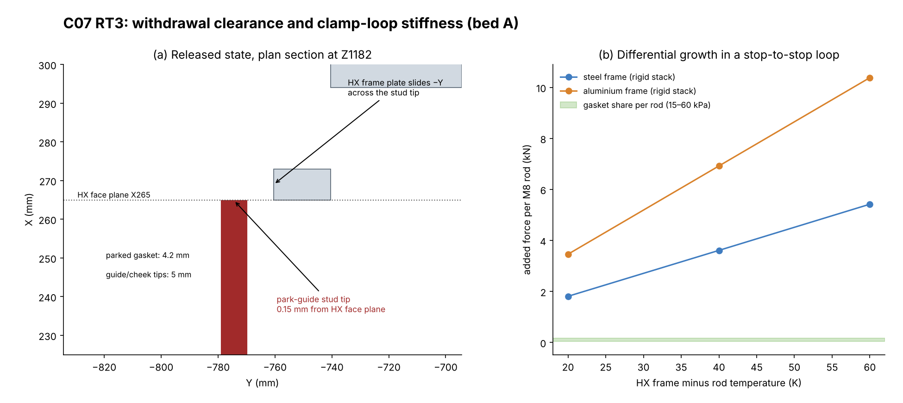

# AirTransformer C07 two-bed shell and ducts: RT3 independent review

Frozen baseline: `2272676750f015f71027b0715c1a8355cf80c4f5`. It contains:
- C07 shell integration;
- HX M101 C05 `42d4388`;
- hydronics R2 `ae8d3c2`;
- D02 supports `257769d`;
- D01 and C06 as committed.

The reference documents are the C07 `RED_TEAM_HANDOFF_EN.md` and the internal `RT3_INDEPENDENT_REVIEW_EN.md`. The internal review is treated as evidence to check independently. Units are mm, N and Pa.

Labels:
- **[V]** computed here, reproducible with `tools/`.
- **[S]** taken from a delivered source.
- **[E]** first-principles estimate with stated inputs.
- **[R]** recommendation.

No CFD, FE or physical test was run.

## 0. Verdicts

| Decision | Verdict | Governing evidence |
|---|---|---|
| **Prototype detailing** | **Accept with named conditions D1–D4** | All eleven RT2 returns are implemented and reproduce. The remaining items are detail-level changes. |
| **Bed-A cold flow** (build and run the single-bed air article) | **Accept with conditions** | G0 must come first (no CFD or mock-up exists). Then C1–C8 plus D1–D3. The thermal item D2b does not arise without hot water. |
| **Cutting** | **Hold** | G0 is not done. D1 (stud tips) and D3 (stop datum) must be in the drawings before sheet is cut. |
| **Two-bed manufacture** | **Hold** | Bed-B mirror-hand qualification, actuator and G843 (D01), structural and modal qualification (N9), and every bed-A G1–G3 result are outstanding. |
| **Live water** | **Hold** | HX and hydronics purge, vent, relief and hot-direction qualification remain open [S]. The clamp loop must also accommodate thermal growth first (D2b). |

**Conditions for prototype detailing**
- **D1. Shorten the park-guide studs.** All 16 stud tips end **0.15 mm** from the HX face plane. During the 900 mm withdrawal, the outboard frame plates slide past four of them per bed at that clearance [V]. Start each stud at u ≥ 5 mm, matching the tip setback; the carrier still engages the rail.
- **D2. Specify the tie-rod preload and give the rods compliance.**
  - (a) The design rod share is **40–161 N**. Ordinary M8 tightening (5–25 N·m) would put **44–219 kN** per bed through 672 mm² of stops, or 65–326 MPa [E].
  - (b) The stop-to-stop loop is rigid (34 kN/mm per rod). A 20–60 K difference between the HX frame and the rods adds **1.8–5.4 kN per rod** for a steel frame, or 3.5–10.4 kN for aluminium. That is a rigid-stack bound [E]. Use disc-spring stacks and a torque or stretch specification.
- **D3. Locate the carrier from the HX.** All 56 stops sit **0.5 mm** from the land edge and 0.5 mm from the gasket [V]. The carrier is positioned only by cassette-mounted studs and rods (±0.6–0.65 mm bore clearance), which do not engage the HX [V]. The chain runs HX feet → beams → base → floor → bearers → cassette → studs, with no datum. Add two dowels per face into the HX frame, or widen the stop margin to ≥3 mm.
- **D4. Damper actuator mass limit.** The P actuator must be ≤16.3 kg and the R actuator ≤12.6 kg (D02 basis, reproduced). Otherwise give the actuator its own support.

**Confidence.**
- High for D1, D3 and the reproduction. These are direct CAD measurements.
- Medium for D2. Its magnitudes are bounds that depend on the real stack compliance and on temperatures; the direction is not in doubt.
- The air-distribution risk (RT1 A1) is unchanged.

**Evidence that would change this.**
- A design intent that the studs are trimmed at assembly.
- A measured HX-frame-to-rod temperature difference below 5 K.
- A G0 result at or below ±5%.

## 1. Reproduction (frozen commit, clean worktree)

All steps used CadQuery 2.8.0, OCP 7.9.3 and Python 3.13.

| Step | Result |
|---|---|
| Delivered STEP hashes | `C07_SHELL.step` is `c0fcd1f3…f6ec94` and `C07_INSTALLED_MACHINE.step` is `da50e681…c9ff98`, both equal to `MANIFEST_SHA256.json` [V]. |
| The eight handoff commands, in order | All ran. `build_c07.py` gives 494 parts with zero clashes. The rebuilt shell STEP equals the delivered one solid by solid: 494/494, maximum volume or bounding-box difference 0.0 [V, `c07_step_compare.json`]. |
| Delivered JSON and CSV versus the rerun | 13 of 13 files are identical once SHA fields are excluded [V, `c07_rerun_identity.json`]. They are `integration`, `service`, `access_paths`, `seal_stroke`, `motion_shell`, `machine_readback` (8997 occurrences), `port_reconciliation`, `shell_intersections`, `rt3_contacts`, `rt3_water_access`, `tie_rods`, `traps` and `static_taps`. |
| Internal RT3 scripts | `rt3_contact_check.py` and `rt3_water_access.py` reproduce their JSON exactly. |

**Independent checks, by a different method.**
- **Stepwise withdrawal sweep.** Exact solid intersections at every 25 mm over 900 mm, with the published service state. Zero intersections on both beds, and zero D01 bounding-box candidates [V, `c07_sweep.json`].
- **D02 bearing contacts.** 32/32 shoes have 120.0 mm² of metal contact [V, `d02_contacts.json`].
- **D01 damper centre of gravity.** AFP 99.89 kg at Y −581.2, AFR 56.00 kg at Y −528.8. The drive-side pair carries 0.745 and 0.657, and the inner pair 0.496 and 0.493. These match D02 [V, `damper_cg.json`].

## 2. RT2 N1–N11 against the C07 model

| RT2 | C07 implementation, checked | Disposition | Residual |
|---|---|---|---|
| **N1** carrier stiffness | The carrier is a closed 60 × 20 × 3 rail (I = 27,652 mm⁴) with a 2 mm lip and 14 stops per face. Three clamp points each at top and bottom. The gasket footprint is 37,632 mm² and fully supported [V, reproduced]. Deflection is ≤0.04 mm on a 400 mm span. | **Closed in geometry** | Stop and gasket edge margins are 0.5 mm with no HX datum (**D3**). |
| **N2** reaction path | 14 Ø8 × 294 rods per bed. The carrier's only links to the cassette are the bonded diaphragm and the park studs (2.05 mm nut daylight), so the cassette carries no clamp load [V]. | **Closed** | Preload specification and thermal compliance (**D2**). |
| **N3** serial leak | Cheeks and nine tips set back 5.0 mm [V]. Bonded EPDM diaphragm to a fixed collar. The diaphragm keeps its meridian length over the 6 mm stroke [S, reproduced in `seal_stroke`]. | **Closed in geometry** | Fit-up, bond and corner tracer test (C2). |
| **N4** captive tray | The HX C05 carries the tray and spigot; the spigot tip at Z 1159 is 9 mm above the beams. Both stepwise sweeps are clear with the tray attached [V]. | **Closed** | **D1** (0.15 mm stud tips). The parked gasket is 4.2 mm from the frame, so the transfer rails must hold X to within about ±2 mm over 900 mm. The three lower rods remain 6 mm below the feet. |
| **N5** cheek ligaments | Plates moved to u 40. 113 mm slots at 125 mm pitch leave 12 mm webs [S, V]. Plate withdrawal of 800 mm is clear [V, reproduced]. | **Closed** | **Air basis changed:** u 40 is mid-blend, where the guides are inclined **47°** (0° at the C04 plate plane, u 12.75). Plate-to-fin distance goes from 43.65 to 71.65 mm. Vertical hole ligaments are **1.0–1.3 mm** for bands 7–8 (21 mm pitch, Ø19.7–20.0), below the 1.5 mm sheet thickness. |
| **N6** drains | Six separate traps on a 210 mm plinth, each with a 90 mm seal (883 Pa) [V]. A separate Ø46 bore takes the water-bay tray drain. | **Closed in geometry** | The seal holds 1.6× at the 550 Pa duty but only **0.89–1.23×** at a typical shut-off of 1.3–1.8 × duty (715–990 Pa) [E]. Interlock or deepen the traps. The plinth raises the installed height to **2762 mm** [V]. |
| **N7** port functions | The HX-signed table and the R2 register match: W1 is supply and W2 is return in both modes [V, `port_reconciliation`]. | **Closed for prototype** | Live-water qualification holds (purge, vents, relief, hot-direction comparison). |
| **N8** damper support | Four shimmed points per damper under both flanges. 32 × 120 mm², and the centre of gravity reproduced [V]. | **Closed in geometry** | **D4.** The drive-side pair carries 74% (P). Bearing points are measured and shimmed. |
| **N9** restraint | Ø12 X-pins in the 13.2 × 21.2 lug slots (±0.6 mm), riser X–Z braces, end-plane diagonals, roof cleats and a centre service brace [S, V contacts]. | **Largely closed** | Each end plane has one 12 × 40 diagonal: Euler 2.0 kN, so it acts in tension only, with the two ends of opposite hand. Racking in Y relies on whichever end is in tension, which twists the frame in plan. The centre brace is 16 × 38 (4.4 kN). Qualify by FE or modal test in both the assembled and service states. |
| **N10** service access | Side panel split at Z1000, with lap and seal. Upper skin and plate paths are clear [V, reproduced]. | **Closed** | Site clearance, handling of the upper panel. |
| **N11** taps and vanes | 8 recess probes and 16 R-vane bosses [S]. | **Closed in geometry** | The supply-side probe sits 44 mm (x/d ≈ 2.3) behind the plate, where the jets run at 7.7 m/s (q ≈ 34.5 Pa). A 10–30% q bias is 6–17% of a 60 Pa HX Δp [E]. Calibrate against a rake, as the handoff states. |

**What the internal RT3 review got right.** Every quantitative claim I checked reproduces: gasket coverage, the 56 stop contacts, park-bearing areas, the water-access sweeps, the tray route and the port reconciliation. It did not report the 0.15 mm stud-tip clearance (D1), the 0.5 mm stop edge margin with no datum (D3), or the thermal and preload behaviour of the rigid rod loop (D2).

## 3. Service items specifically requested

**Parked seal carriers.**
- At the 6 mm park, the stud shoulders bear 133.13 mm² and the push nuts 78.43 mm² per guide. The released stroke is clear at all seven sampled positions [V, reproduced].
- In the released state, the clearances to the moving core are:
  - 0.15 mm to the stud tips (D1);
  - 4.2 mm to the gasket;
  - 5.0 mm to the tips;
  - 6.0 mm to the carrier;
  - 6.0 mm (in Z) to the lower rods;
  - 9–10 mm to the collar and diaphragm (in Z) [V, `c07_checks.json`].

**Two spools, with the vented trees retained.**
- With the gland parked at X 810–812, each X 615–805 spool and its two Ø70 loose collars clear 930 mm of lateral travel. The X805-onward trees and vents stay in place [V, reproduced].
- The model assumes separable union faces. Confirm that the purchased unions disengage axially within the 5 mm gland gap and the fixed X615–805 length.

**Captive-tray withdrawal.** It passes in both the stepwise check and the delivered clipped-box method, subject to D1.

**D02 bearing points and bracing.** See N8 and N9 above.

## 4. Air path and C1–C8

The guides, selector boxes and ports are unchanged since C04, so RT1 A1–A3 still apply. The R-port distribution authority is M ≈ 2.5, against 9.1 for P. No C07 CFD, mock-up, face map or fan curve exists. The plate relocation (N5) changes the balancing basis, which strengthens the case for G0.

| Gate | C07 status |
|---|---|
| C1 single-bed stand | Not built. Bed A needs its own braced stand (N9). |
| C2 seat bypass ≤0.2% (9.74 m³/h) | Hardware is defined. Needs D3, then pressure-film and tracer measurement. |
| C3 8 × 12 face map, R first | Taps are provided. Calibrate the supply-side probes (N11). |
| C4 wet drains | Traps are provided. Fix the shut-off margin (N6). |
| C5 / G0 | **Not done.** Vane bosses are reserved. This blocks cutting. |
| C6 fan ≥550 Pa with airway | Not provided. Check the trap seal against fan shut-off. |
| C7 instrumentation | Defined; needs commissioning. |
| C8 break-before-make | D01 table plus an update to the R2 T3 permissive. Timing not measured. |

## 5. Reproduction

Create a clean worktree at the frozen commit and run the eight handoff commands. Then, from this folder, run `tools/run_all.sh`. It reruns the internal scripts, the identity comparison and the independent checks. All numbers come from `results/`.

**Not reviewed.** D01 internals, R21 holds, HX thermal and pressure design, R2 hydraulics, and the external ducts and fans.
