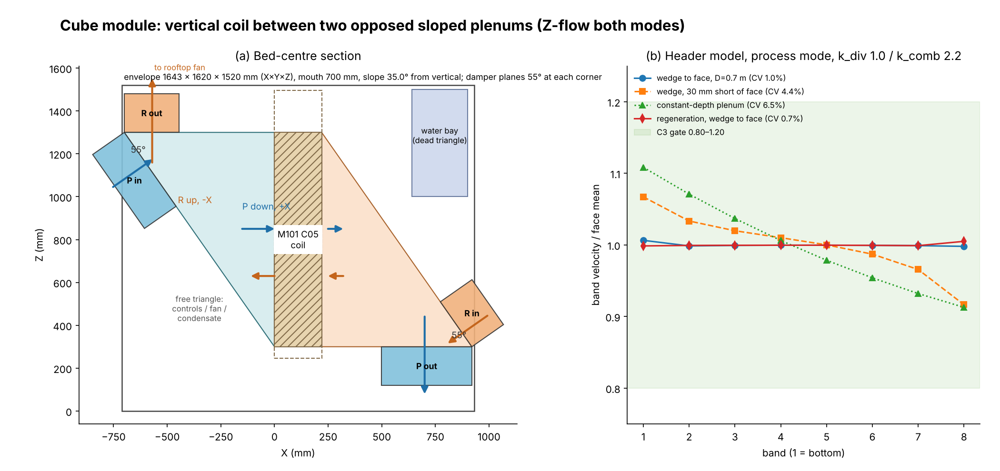

# Two-bed module topology reset: cube, vertical coil, two opposed sloped plenums

This is a red-team concept input for shell2's next revision, dated 6 November 2026. It is not a shell revision or a fabrication release. It responds to the owner's direction:
- follow the 4-bed shell topology;
- process outdoor air enters at the top, descends through a converging slope, crosses the whole HX face in +X, and leaves at the floor;
- regeneration outdoor air enters at the bottom, ascends, converges, crosses in −X, and leaves at the top;
- the module is a cube.

Labels:
- **[V]** computed here and reproducible with `tools/`.
- **[S]** taken from a delivered source.
- **[E]** estimate.
- **[R]** recommendation.



## 1. What the reviews missed

The owner is right: C04–C07 solve the wrong problem. RT1, RT2 and RT3 audited each revision inside its own architecture and never challenged that architecture. Each round therefore added parts to treat symptoms the topology itself creates:

| Symptom we reviewed | Root cause in the topology | The reviews' response | What common sense says |
|---|---|---|---|
| The module grew from 2.55 m to 2.76 m (plinth), plus a 3.5 m width over the damper actuators | Air enters selector boxes **below** the coil and climbs about 1 m through 32 inclined channels | Flagged as a manufacturing gate (S8, N6b) | An outdoor-air unit with a 1.25 m coil should be roughly 1.5–1.6 m in every direction |
| R-port distribution authority M ≈ 2.5 (A1) | Two ports stacked on one box face, with the R jet turning 90° less than one box depth below the throat | CFD gate G0 and vane bosses | Feed each plenum along its own axis, across its full width |
| 32 balancing plates, cheek slots, guide tips, keepers, 1 mm ligaments | Discrete channels need balancing because the plenum does not balance itself | Slots, clips and the plate plane were reviewed in detail | A tapered (wedge) plenum is a self-balancing manifold |
| Internal path loss of 219–315 Pa | Two 90° turns, eight slots, plates and a box expansion on each side | Fan specified at ≥550 Pa | Fewer turns and lower velocities |

The decisive question ("why does the air enter below the coil?") should have been asked in RT1 §0. It was not. I withdraw RT3's "accept for prototype detailing". C04–C07 should be treated as superseded for the air path and shell, while keeping the interface work that carries over (§5).

## 2. Topology (owner direction, applied to the vertical M101 C05 coil)

The 4-bed host in the hydronics RT01 context [S, `HOST_CONTEXT.json`] had:
- an upper plenum, with the P inlet damper on its −X face and the R outlet damper on its roof;
- a lower plenum, with the P outlet at +X and the R inlet on the outboard side, above a sloped hopper floor;
- horizontal coil pairs, through which air flowed vertically;
- an envelope of about 1.85 × 1.7 × 1.53 m.

With one vertical coil per bed, the same vertical sense becomes a **Z-flow manifold**:

| | Front plenum (−X of the coil) | Rear plenum (+X of the coil) |
|---|---|---|
| Shape | Wedge, **open at the top**, depth D at the mouth, closing to the coil land at the bottom edge of the active face | Wedge, **open at the bottom**, depth D at the mouth, closing to the coil land at the top edge |
| Process (P) | Inlet distributor: enters at the top, descends and converges | Collector: crosses the coil in **+X**, then descends and leaves at the floor |
| Regeneration (R) | Collector: crosses the coil in **−X**, then ascends and leaves at the top | Inlet distributor: enters at the bottom, ascends and converges |
| Dampers (4-bed corner positions, two independent dampers) | P in on the **front slope** and R out on the **roof**, meeting at the top outer corner | P out on the **floor** and R in on the **rear slope**, meeting at the bottom outer corner |

**Damper positions follow the 4-bed diverter** (owner direction, 6 November 2026). The original design put two plates on two faces of the plenum, switched by one actuator. Because a single plate could not be guaranteed to seal, it became two independent dampers, but the positions were kept. In the vertical-coil version:
- At each plenum, the P damper and the smaller R damper sit on the **two faces that meet at the outer corner**.
- The R damper on the roof leaves room for a future rooftop fan to extract the regeneration air.
- The dihedral between the two damper planes is **90° − atan(D/H) = 55°** for D/H = 0.7 (59° at 0.6, 63° at 0.5). With the coils horizontal in the 4-bed, the plenum was flat and the angle was about 77°. The steep wedge closes it, but the airflow topology is the same.
- The arrangement is point-symmetric. The P inlet (top, on the slope) and the R inlet (bottom, on the slope) are images of each other, as are the R outlet (roof) and the P outlet (floor). Both distributor inlets therefore see the same slope-entry geometry, and both collector outlets leave along the plenum axis.
- If a sealing two-plate diverter is qualified later, both openings still share the corner edge, so it can return without changing the shell.

The same two wedges serve both modes. Each wedge acts as a distributor in one mode and a collector in the other, so P and R get the same distribution quality. Regeneration is counter-current, as D01 already assumes (P +X, R −X) [S]. Buoyancy assists both streams: the hot regeneration air rises, and the cooled, dried process air descends.

## 3. Sizing and checks

**Envelope** [V, `cube_concept.json`]. Mouth D = 700 mm, bed pitch 800 mm, coil active face Z 300–1300.
- The shell envelope is **1643 (X) × 1620 (Y) × 1520 (Z) mm**. The plenum roof and floor sit at the coil's active top and bottom (Z 1300 and 300), so the corner dampers add no height.
- The two slope damper bodies project 147.5 mm beyond the front face (top corner) and the rear face (bottom corner). Including those bodies the size is 1915 × 1620 × 1520 mm. Actuators are not included.
- C07 by comparison is 1750 × 2156 × 2762, and 3543 wide over the actuator reserves.
- The slope is 35° from vertical.

**Geometric fit** [V]. The two detailed 549-solid C05 coils have **zero intersections** with the skeleton:
- The slopes meet the frame lands at the apex lines; that is the seal line.
- The nearest damper body is 279 mm from the coil.
- The two dampers at each corner meet only along the shared corner edge.
- The coil's terminal pipes and unions lie in the **dead triangle above the rear slope**, which also holds the water-bay reserve, 290 mm from the core.
- The front-bottom dead triangle is free for controls, a fan or condensate equipment.

**Velocities.** Mouth velocity is 3.16 m/s for P at 4870 m³/h and 1.58 m/s for R at 2435 m³/h. The coil face runs at 2.21 m/s.

**Face distribution** [V, `zflow.json`; 1-D Z-manifold header model]. Inputs are dividing regain k_d 0.6–1.0, combining loss k_c 1.8–2.2, wall friction, and a coil of 60 Pa at 2.21 m/s (part laminar).

| Plenum (D = 0.6–0.7 m) | Process: min–max of mean, CV | Regeneration |
|---|---|---|
| Wedge closing on the coil land | 0.979–1.088, 0.6–1.3% | 0.989–1.062, 0.4–0.9% |
| Constant depth (no slope) | 0.873–1.170, 4.9–8.8% | — |
| Wedge stopped 30 mm short of the face | CV 3.3–4.8% | CV 2.3–3.3% |

The slope is the balancing device. Header velocity stays nearly constant, so neither regain nor mixing loss builds up along the height. This holds only if the sloped wall reaches the coil land at the end of the active face. That becomes a hard detail requirement: no apex gap.

The model does not resolve the inlet jet.
- With the corner positions, the P inlet on the front slope discharges along the slope's inward normal: toward the coil and 35° upward. It runs at about 6.2 m/s (q ≈ 23 Pa) into the roof corner, then turns down over the face.
- The R inlet on the rear slope is the mirror image.
- The collector outlets (R through the roof, P through the floor) leave along the plenum axis and are insensitive.
- The top or bottom band could be over- or under-fed, of order 5–15% [E]. The sign is not predictable from a header model.

G0′ for this topology is therefore one slope inlet: one corner damper discharging into a full-width wedge. If needed, an inlet turning-vane cassette fits inside the slope damper's inner flange.

**Path loss** [E, `cube_screens.json`]. The cube process path is **94–143 Pa** including both dampers. On the same basis, the selector-box path is 233–315 Pa. The cube saves 90–221 Pa, or **0.2–0.5 kW of fan shaft power** per running fan at η 0.6.

## 4. What remains hard (decisions for the owners)

1. **Damper end housings (topology-independent).** The corner layout keeps each damper's shaft along Y. Bed A's and bed B's dampers sit at the same corner positions, and side-by-side 706 mm dampers leave 94 mm between beds at an 800 mm pitch. Two inboard R21/D01 feedback ends need 434 mm [V, RT1 D1]. Options:
   - (a) A single-ended damper, with drive and feedback at the same outboard end (damper owner). **Recommended**, because it keeps the cube.
   - (b) Rotate bed B 180° about Z, so the mouths alternate front and rear between beds. This contradicts the same-orientation water directive.
   - (c) A bed pitch of ≥1140 mm, which makes the module 1.64 × 2.3 × 1.52 m and no longer a cube.
2. **Damper orientation.** The roof and floor dampers lie flat (vertical flow). The slope dampers are inclined 55° from horizontal (flow 35° from horizontal). All shafts stay horizontal. The R21 P cold-test orientation O1′ already puts the P flow axis vertical [S, `R21_COORDINATE_FRAMES.json`], but D01 is qualified for horizontal flow. The damper owner must confirm the wet bay, film retention and drainage in both orientation types (flat, and 55° slope) for each damper size: P on the slope and floor, R on the roof and slope.
3. **Weather and water.**
   - The top P intake needs a rain hood and mist eliminator.
   - The bottom R intake needs a free inlet area under the unit (legs or a skirt, about 300 mm).
   - The front plenum's low point is the apex at the coil bottom land: give it a drained trough.
   - Rear-plenum condensate falls toward the P-out and R-in dampers: put a drained pan ahead of them.
   - The C05 tray stays.
4. **Fans and pressure hierarchy.** Put the R exhaust fan on top as a draw-through, so the R side is negative and leaks inward (as in the 4-bed, with a fan on top). Put the P fan as a blow-through at the top intake, giving P > ambient > R. Cross-leak through the closed damper at each mouth is still a tracer-test item.
5. **Coil service.** Lateral ±Y withdrawal through the outboard side, as in C07. The two wedges and the dead triangles do not obstruct it, but this has not been swept for the cube.

## 5. What carries over from C04–C07

| Keep | Drop |
|---|---|
| M101 C05 coil, tray, vents and the W1→W2 function table (signed) | Selector boxes, the 8-channel guide stacks, the 32 balancing plates, slots and keepers |
| The seal approach: stiff carrier, gasket on the 20 mm lands, a closed force loop, plus RT3 D1–D3 (stud setback, preload with disc springs, an HX datum) | The 210 mm plinth and 2.76 m height; the stacked P/R ports on one box face |
| HYD-R2 eight two-way valve bay, relocated into the top-rear dead triangle (shorter spools) | C06/C07 discharge sleeves and the inner rear damper bay |
| D01 dampers at the 4-bed corner positions (subject to §4.1–4.2), with D02-style point bearings re-laid for the roof, floor and 55° slope positions | Face probes in the plate jets; the C07 R-vane bosses (replaced by an optional vane cassette in each slope damper's inner flange) |
| C1–C8 test logic: bed-A article first, a pressure-film and tracer seat test, 8 × 12 face map, regeneration tested first | G0 as defined in RT1 (replaced by the one-mouth G0 above) |

## 6. Next steps

1. **Shell2.** Issue C08 on this topology. The parameters are D, the bed pitch, the apex detail at the land, the mouth transitions and the dead-triangle allocation. Carry the §5 keep list and RT3 D1–D3.
2. **Damper owner.** Decide §4.1 (recommend a single-ended damper) and §4.2 (flat and 55° slope orientations). Confirm whether a sealing two-plate, single-actuator diverter at the shared corner edge is worth requalifying later.
3. **G0′.** A one-plenum mock-up or CFD: a full-width wedge with a 700 mm mouth, the P damper discharging through the slope at the top corner, the C05 coil as a porous zone. The R inlet is its point-symmetric image at a smaller damper size. Accept on the C3 gate (0.80–1.20, CV ≤10%). The header model predicts a CV of about 1% before mouth effects.
4. **Hydronics and HX.** Re-route the four spools into the rear dead triangle. Check the vent high points with the coil's terminal pipes now below the module roof.

## 7. Reproduction

From this folder, with CadQuery 2.8:

```sh
python tools/zflow_manifold.py results/zflow.json
python tools/cube_concept.py <M101_D952_P254_220_39x6_C05.step> results 700 800
python tools/cube_screens.py results/cube_concept.json results/cube_screens.json
python tools/figure_cube.py results/cube_concept.json results/zflow.json fig_cube.png
```

The C05 STEP comes from `HX/M101_D952_P254_220_39x6_C05/M101_C05_RT2_CAD.zip`, as the gzip member inside it. `cube_concept.py` writes `CUBE_CONCEPT_SKELETON.step` (shell skeleton only). With `--step` it writes `CUBE_CONCEPT_WITH_CORES.step`, about 860 MB, which is not committed.
