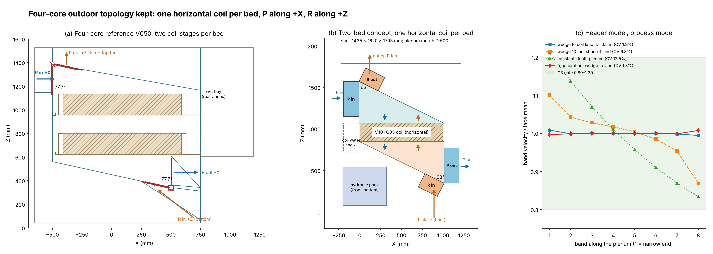

# Two-bed module topology reset: keep the four-core layout, with one horizontal coil per bed

Revision 4, 6 November 2026. This is a red-team concept input for shell2's next revision. It is not a shell revision or a fabrication release.

The basis is the archived four-core outdoor sheet metal, [`references/four-core-outdoor/V050_SM_M2_IN1_R1_OUTDOOR_SHEET_METAL_ONLY.stp`](../../../../references/four-core-outdoor/V050_SM_M2_IN1_R1_OUTDOOR_SHEET_METAL_ONLY.stp) (SHA-256 `d20fbdc7…6f6ae`, 521 occurrences), together with the owner's corrections of the same day.

Labels:
- **[V]** computed here and reproducible with `tools/`.
- **[S]** taken from a cited source.
- **[E]** estimate.
- **[R]** recommendation.



## 0. Recommendation

**Return to horizontal coils. Keep the four-core topology unchanged, with one M101 C05 coil per bed instead of two stages.** [R]

| Stream | Path |
|---|---|
| Process (P) in | Through a **vertical damper on the upper plenum's front end wall**, flowing **+X** |
| Process (P) through the coil | Down through the coil |
| Process (P) out | Through a **vertical damper on the lower plenum's rear end wall**, flowing **+X** |
| Regeneration (R) in | From the **bottom**, through a damper on the lower plenum's floor slope next to the rear corner, flowing **+Z** |
| Regeneration (R) through the coil | Up through the coil |
| Regeneration (R) out | Through a damper on the upper plenum's **roof slope** next to the front corner, flowing **+Z**, to a **rooftop fan** |
| Hydronic pack | The **front-bottom quadrant**. The coil's water end points down into it; nothing else sits there. |

Concept result [V, `results/cube_horizontal.json`]:
- Shell **1435 (X) × 1620 (Y) × 1793 (Z) mm** with a 500 mm plenum mouth, and **zero clashes** with both detailed 549-solid C05 coils.
- Damper-to-coil clearance is ≥79 mm.
- The hydronic reserve is 180 mm from the coil's unions.

**The vertical-coil cube** (revisions 1–3 of this note, still under `tools/` and `results/`) **is retired.** With P entering +X and R leaving +Z as required, a vertical coil puts the P jet straight onto the coil face, and its water end lands in the busiest corner (§3).

## 1. What went wrong, briefly

**RT1–RT3.** These reviews audited C04–C07 inside an architecture that brought the air in below the coil and climbed it through 32 inclined channels. They never questioned that, and each round added parts.

**Revisions 2 and 3 of this note.** These then misread the four-core damper roles. They rotated the whole topology with the coil instead of keeping the absolute directions.

The four-core rule is about **absolute directions**:
- **P travels +X** through the module: it enters at the front top and leaves at the rear bottom.
- **R travels +Z**: it enters at the bottom and leaves at the top, so the R outlet never sits on the P inlet face.

A coil orientation must serve those directions, not the reverse.

## 2. Four-core reference, read from the STEP [V, `results/four_core.json`]

Bed A, one bed column (Y −815 to −46.5):

| Element | Geometry |
|---|---|
| Coils | Two horizontal stages per bed (Z 620–798 and 955–1133), X −410 to 590, with vertical airflow |
| Upper plenum | Wedge under a roof **sloped 12.3°** (Z 1381 at the front to 1164 at the rear). Depth 248 mm at the front, 31 mm at the rear. |
| Lower plenum | Wedge over a floor sloped 12.3° (Z 561 at the front to 345 at the rear). Depth 59 mm at the front, 275 mm at the rear. |
| **P in** | **Vertical** damper frame on the front end wall (X −505, Z 1133–1368). Flow **+X**. |
| **R out** | Damper on the **roof slope** beside the front corner (X −484 to −252). Flow **+Z** into the top chamber (Z 1381–1527), then the fan interface ring (X ±310, Z 1531). |
| **P out** | **Vertical** damper on the rear end wall (X +505, Z 358–586). Flow **+X** into the rear-bottom outlet duct (X 751–1200). |
| **R in** | Damper on the **floor slope** beside the rear corner (X 252–484). Flow **+Z**, from the hopper chamber below (32.7° plate, X 265–748). |
| Corner hardware | Hinge element at each corner, the original two-plate, one-actuator diverter location. The P and R damper planes meet at **77.7°** (90 − 12.3). |
| Wet bay | Rear annex above the P outlet (X 751–1200, Z 602–1527) |
| Envelope | 1900 × 1706 × 1500 mm |

## 3. First principles: vertical versus horizontal coil

Both options are judged with the owner's fixed directions (P +X through vertical dampers, R +Z through top and bottom dampers) and one C05 coil per bed.

| Criterion | Vertical coil (air in X) | Horizontal coil (air in Z) |
|---|---|---|
| **P inlet relative to the coil face** | The +X inlet jet points **straight at the coil face**, across only a 500–700 mm plenum. A side-entry manifold is impossible, and a perforated distributor would cost about 15–30 Pa [E]. | The +X inlet runs **along the coil face** (axis of the wedge manifold). This is the textbook Z-manifold, and the header-model face CV is about 2% [V]. |
| **R outlet** | +Z from the front plenum's top: workable. | +Z through the roof slope: as in the four-core. |
| **R inlet** | +Z from the bottom into the rear plenum's end: workable. | +Z through the floor slope. The jet points at the coil underside; this is the single sensitive inlet (G0′). |
| **Hydronics** | The coil's water end is its **top**, which already holds the P inlet, the R outlet, and the rear plenum apex, with the R chambers and P outlet below. No free quadrant remains: this is the owner's +X overlap. | The coil's water end is a **side end**. The **front-bottom quadrant** (under the lower plenum's apex) is free, with short spools straight down [V]. |
| **Condensate** | Needs a tray under the coil plus an apex trough in the collector plenum. | P flows downward with gravity. The **whole lower-plenum floor is the drain pan**, which meets the practice of a pan covering the full coil footprint [S]. |
| **Buoyancy** | Acts across the airflow. | Hot R rises through the coil and cool, dried P descends. This matches induced-draft practice, with the fan on top drawing air upward. |
| **Envelope** | 1824 × 1620 × 1520 mm (revision 3) | 1435 × 1620 × 1793 mm, or about 1.67 m tall at D = 440 |
| **Precedent** | None in this project | The four-core V050 used it |
| **HX product** | The C05 is designed for it (tray, vents). | The C05 must be re-qualified horizontal: vents on horizontal headers, and no tray (the plenum floor drains instead). |

Horizontal wins on the three criteria that are hard to engineer around: the P inlet alignment, the hydronic quadrant and drainage. The vertical option's only advantage is that the HX product already exists in that orientation.

## 4. Horizontal concept checks

Inputs: D = 500 mm, bed pitch 800 mm, coil bottom face at Z 850, coil top face at Z 1070 [V, `results/cube_horizontal.json`].

**Core placement.** The C05 is rotated 180° about the axis (1, 0, −1), with no mirror: global X = 1054 − lz, Y = cy + 367.775 − ly, Z = 850 + 220 − lx. The terminal pipes sit at the **front** end (X −203 to 0, Z 720–1070) with the unions **pointing down**.

**Plenums.**
- The roof slopes 26.6° from Z 1570 at the front to the coil land at the rear.
- The floor slopes 26.6° from the coil land at the front to Z 350 at the rear.
- Both wedges close onto the frame land with zero apex gap.
- The P-to-R damper dihedral is **63.4°**. The steeper wedge makes it smaller than the four-core's 77.7°.

**Clashes.**
- **Zero** against both detailed cores.
- The skeleton's only self-overlaps are the intended damper openings, plus 6 mm³ where each R damper flange lands on the cheek edge.
- P dampers are 79 mm from the coil and R dampers 388 mm.
- The hydronic reserve (front-bottom, X −200 to 320, Z 80–540 per bed) is 180 mm from the unions.

**Velocities and distribution.**
- Mouth: P at 4870 m³/h runs at 4.42 m/s; R at 2435 m³/h at 2.21 m/s. The face runs at 2.21 m/s, below the usual 2.5 m/s (500 fpm) cooling-coil limit [S].
- The header model is unaffected by gravity, so the vertical-concept results apply directly [V, `results/zflow.json`, D = 0.5 m]:

| Plenum | Process: min–max of mean, CV | Regeneration CV |
|---|---|---|
| Wedge to the coil land | 0.958–1.126, CV 1.1–1.9% | 0.8–1.3% |
| Wedge 10 mm short of the land | CV 5.2–6.8% | — |
| Constant depth | CV 9.5–12.5% | — |

The four-core's 31–59 mm apex gaps should therefore be closed.

**Path loss** [E, from the vertical screen; same elements]. About 100–170 Pa for the process path, including both dampers, against 233–315 Pa for C07.

## 5. Industrial practice checked

- **Coil face velocity and drainage.**
  - Specifications commonly cap cooling coils at 500 fpm (2.5 m/s), and some at 400 fpm [S: HPAC; University of Michigan and NIH design guides].
  - Drain pans must capture condensate from the whole coil assembly, including headers, return bends and carryover, and extend downstream [S: University of Michigan spec; NIH guidance on ASHRAE 62].
  - The horizontal layout's lower-plenum floor does this by construction.
- **Intake and exhaust separation.**
  - ASHRAE 62.1 Table 5-1 gives minimum distances (for example 3 m for Class 2 exhaust and 7.5 m for cooling-tower exhaust, with sources differing on the latter). Normative Appendix B and RP-1635 provide a calculation method instead [S].
  - Regeneration exhaust is warm, humid air. If a fraction f of it re-enters the front P intake, intake humidity rises by f·Δx_R. At f = 2–5% and Δx_R = 10–15 g/kg, that is 0.2–0.75 g/kg, or 3–9% of an 8 g/kg drying duty [E].
  - The rooftop R fan should therefore discharge **vertically through a short stack**, sized with the Appendix B method. The P intake should keep a downward-facing hood.
- **Two-bed desiccant-coated HX units.** Published two-bed designs switch beds with dampers or diverters, and some reverse the air path through both exchangers [S: patents below]. None of the material found shows a better topology than the four-core one for a fixed P axis.

## 6. Owner decisions still open

1. **HX owner.** Re-qualify the C05 horizontal:
   - vents on the horizontal headers (local Y 709–744, now the −Y side of each bed);
   - delete the tray, since the plenum floor drains;
   - the frame support along the two side members (rails modelled at Y ±355, Z 810–850);
   - the unions pointing down.
2. **Damper owner.**
   - P dampers stay vertical (flow +X), which is the D01 orientation and needs no change.
   - R dampers are flat-ish at 26.6°. Confirm drainage, because the R-in damper sits next to the floor's low corner: leave at least a 60 mm drained gutter between the damper and the corner.
   - The between-bed end-housing issue remains: 94 mm between 706 mm dampers at an 800 mm pitch. Recommend single-ended dampers, or the four-core's shared corner hardware.
3. **Hydronics owner.** Move the HYD-R2 eight-valve bay into the front-bottom quadrant, about 520 × 760 × 460 mm per bed. Put site connections on the front face, low. Leaks then fall to the floor, away from the air path, dampers and electrics.
4. **Regeneration fan.** Rooftop, induced draft, with a vertical discharge stack (§5). A P fan blowing through at the front intake keeps the hierarchy P > ambient > R.
5. **Coil service.** Lateral ±Y withdrawal at coil level (Z 850–1070) after removing the side panel and the spools. Not yet swept.

## 7. Carry-over

| Keep | Drop |
|---|---|
| Four-core V050 topology, damper roles and positions | C04–C07 selector boxes, guide stacks, plates, plinth |
| M101 C05 coil (re-qualified horizontal) and the signed W1→W2 table | The vertical-coil cube (revisions 1–3 of this note) |
| Seal approach: stiff carrier, gasket on the frame lands, closed force loop; RT3 D1–D3 | The C05 tray, replaced by the plenum-floor pan |
| HYD-R2 valve logic, relocated to the front-bottom | The +X-side water bay |
| C1–C8 test logic. G0′ = R inlet through the floor slope (mock-up or CFD). | RT1 G0 |

## 8. Next steps

1. **Shell2.** Issue C08 as the two-bed, single-stage four-core. Parameters: D (440–500), bed pitch, the zero-gap apex detail, the corner damper frames, the floor gutter, the front-bottom wet bay and the rooftop fan interface.
2. **HX owner.** Item 1.
3. **Damper owner.** Item 2.
4. **G0′.** R slope inlet into the lower wedge, with the coil as a porous zone. Accept on the C3 gate.

## 9. Reproduction (CadQuery 2.8)

```sh
python tools/read_4core.py ../../../../references/four-core-outdoor/V050_SM_M2_IN1_R1_OUTDOOR_SHEET_METAL_ONLY.stp results/four_core.json
python tools/zflow_manifold.py results/zflow.json
python tools/cube_horizontal.py <M101_D952_P254_220_39x6_C05.step> results 500 800
python tools/figure_horizontal.py results/cube_horizontal.json results/zflow.json results/four_core.json fig_horizontal.png
```

The C05 STEP is the gzip member of `HX/M101_D952_P254_220_39x6_C05/M101_C05_RT2_CAD.zip`. The superseded vertical concept is reproduced by `cube_concept.py`, `cube_screens.py`, `skeleton_selfcheck.py` and `figure_cube.py`.

Sources:
- [ASHRAE 62.1 addendum and interpretations on Table 5-1](https://www.ashrae.org/file%20library/technical%20resources/standards%20and%20guidelines/standards%20addenda/62_1_2022_ag_20240430.pdf)
- [ASHRAE RP-1635 summary](https://www.ashrae.org/file%20library/technical%20resources/covid-19/ashrae-d-rp-1635.pdf)
- [MEP Academy, outdoor air intake locations](https://mepacademy.com/outdoor-air-intake-locations-air-classifications/)
- [HPAC, dehumidification system installation](https://www.hpac.com/humidity-control/dehumidification-system-installation)
- [Airreps coil basics](https://airreps.com/wp-content/uploads/2022/06/Airreps_EWP_22-Coil-Basics.pdf)
- [University of Michigan coil master spec](https://umaec.umich.edu/for.archs/masterspec/23/MS238216.pdf)
- [NIH cooling coil and drain pan requirements](https://www.orf.od.nih.gov/PoliciesAndGuidelines/Documents/News%20to%20Use%20PDF%20Files/2015%20NTU/Cooling%20Coil%20and%20Drain%20Pan%20Requirements%20for%20Air%20Handling%20Units%20August%202015%20News%20to%20Use_508.pdf)
- [Two-bed desiccant-coated HX patent](https://ipiq.io/patents/5653631)
- [EP 1163947 two-bed desiccant diverter patent](https://data.epo.org/gpi/EP1163947A1)
