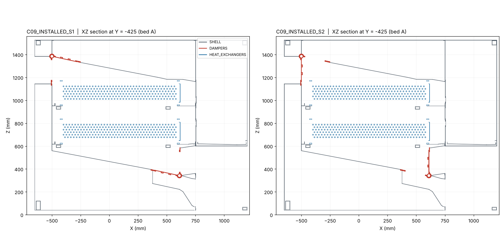
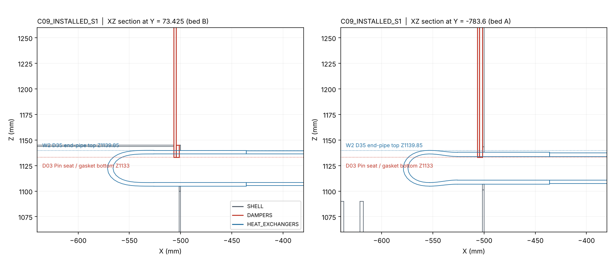

# RT4 independent review: C09 four-core shell, D03 dampers, HX interfaces and hydronics

**Reviewed:** `origin/codex/c09-four-core-integration` at `71d9ef9`, which contains D03 `a775bf8` and the four-core sync `08cbfc2`. The review branch is `claude/jolly-hopper-mndk80`.

Claim labels:
- **[V]** verified here by tool;
- **[S]** taken from an owner document;
- **[C]** calculation;
- **[E]** estimate under a stated assumption;
- **[I]** inference;
- **[R]** recommendation.

## Conclusion

**Do not release C09 for cutting yet.** C09 is not ready for detailing until two corrections are made. Wet operation is blocked.

### What holds up

- **[V]** The C09 air path follows the four-core topology the owner specified:
  - Pin enters through the vertical −X end-wall seat in the +X direction, passes down through both stages and leaves through the vertical +X Pout seat.
  - Rin rises from the floor slope, passes up through both stages and leaves through the roof-slope Rout seat towards +Z.
- **[V]** The packaged STEP files are internally consistent:
  - All hashes match.
  - Each installed state reads back as 2,920 leaves (494 shell, 230 damper and 2,196 HX).
  - The installed shell and damper groups are geometrically identical to `C09_SHELL.step` and the D03 owner states.
- **[V]** The owner's `verify_c09.py` checks (S1, S2, shell, motion, service) and `verify_sections.py` reproduce with identical JSON content once a stand-in `cad_io` is supplied.

### What fails

**F1. Hard clash that no owner check covers.** **[V]**
- In both S1 and S2, the upper D03 Pin seat and its static gasket intersect the upper-core W2 D35 return bend at the rear-wall tube crossing. This occurs in both beds.
- There are 4 pairs, of 65.9 to 273.4 mm³ each, with up to 6.85 mm penetration.
- The gap is in scope:
  - `verify_c09.py` screens dampers against the shell and the HX against the shell, but never dampers against the HX.
  - D03's own `D03_HX_CHECK.json` screens only motion and service envelopes.
- The fix is small. Raise the bottom of the seat and gasket from Z1133 to at least Z1145 (≥5 mm over the pipe top at Z1139.85), or notch them around the tube. The fix must be paired with a defined air seal around the tube at that line.

**F2. Water is blocked.** **[V/S]**
- `C09_HYDRONICS.zip` and `PORTS_BY_MODE.csv` are listed but absent from every branch.
- The 42 mm downward projections from the upper ports hit the lower-stage W2 end pipe after 20.15 mm (W1) and 26.697 mm (W2). I reproduced both values independently.
- The W1-in/W2-out port table contradicts the reversed hot-water route.

**F3. Air distribution is the main technical risk.** **[C/E]**
- The plenum depths measured from the STEP are:
  - top dividing plenum: 159 mm, tapering to a **7.5–8 mm apex** over the last ~100 mm of fin;
  - bottom plenum: 77 mm at its closed end.
- At 4,870 m³/h the header mouth velocity pressure is about 84 Pa. That is comparable to the coil resistance, so a 1-D Z-manifold model gives a face-velocity CV of **16–35 % (P)** and **16–62 % (R)**.
- This geometry is inherited from V050: the parent section heights agree to ≤0.25 mm. It is therefore a design-basis issue, not a C09 regression.
- Confidence: moderate on the direction, low on the magnitude. The magnitude hinges on the C05 air-side ΔP curve, which is not in the package.

**F4–F8. Tolerance-critical details to close before cutting.**
- 1.000 mm end gap between the lower selector shafts (F4).
- 1.212 mm swept clearance from the upper blade to the HX edge (F5).
- 2 mm face seals (F7).
- A-post shear transfer (F8).

### Verdicts

| Gate | Verdict | Condition to lift |
|---|---|---|
| Prototype detailing | **Conditional**: proceed once F1 is fixed | F1 corrected; an all-group cross-screen is added to `verify_c09.py` and rerun on S1/S2 |
| Bed-A dry cold-flow test | **Conditional** | F1 fixed; distribution instrumented per F3 with an acceptance band agreed beforehand |
| Sheet cutting | **Hold** | F1, F4, F5, F7, F8 closed; tolerance stack issued |
| Two-bed manufacture | **Hold** | Above, plus a measured distribution and leakage result |
| Live water | **Blocked** | F2: hydronics package published, eight-port mode table signed, upper-port spool conflict resolved |



## 1. Module upload verification (requested)

| Module | In repo? | Where | Integrity | Remarks |
|---|---|---|---|---|
| Shell C09 | **Yes** | `AirTransformerShell/revisions/C09/` (`71d9ef9`) | `C09_CAD_REVIEW.zip` 19,015,319 B, sha `cf9a3f00…` = manifest **[V]**; inner STEP hashes = readbacks **[V]** | Shell `0510824a…`, S1 `0edefa1f…`, S2 `1ca6f75d…` |
| Dampers D03 | **Yes, partly** | `dampers/c08-d03/` (`a775bf8`) | 22/22 inner files match `SHA256.json` **[V]**; zip sha `783b63d0…` (no external manifest) | The handoff says the zip contains D03 *source*. **It does not**: there is no `source/` and no `inputs/FOUR_HX_INSTALLED.step`. |
| HX (four-core / H00 variant) | **No owner package** | Only interface files inside the C09 zip (`interfaces/four-core-horizontal-HX/`) | C09 HX product sha `2304062c…` and installed HX file `0360e579…` match **no** committed STEP. The committed `HX/…_C05` STEP files hash differently. **[V]** | The HX geometry exists only as occurrences inside the C09/D03 installed STEP files. |
| Hydronics (four-core series) | **No** | Listed at `hydronics/four-core-series/C09_HYDRONICS.zip` (10,246,839 B, sha `c4050888…`) | Absent on all 6 remote branches **[V]** | `PORTS_BY_MODE.csv` is also absent. The owner states the P0 model was "unavailable" **[S]**. |
| Four-core sync reference | Yes | `AirTransformerShell/references/four-core-sync/` (`08cbfc2`) | — | `SYNC_BASIS.md`: two horizontal stages per bed. The red-team rev-4 single-stage skeleton is not to be used for dimensions. Accepted. |

**Scope note [I].** This round returns to **four cores** (two series stages per bed), whereas the earlier directive was a one-stage, two-HX module. `SYNC_BASIS.md` makes the four-core basis explicit, so I reviewed against it. If the one-stage prototype is still the priority, that needs an explicit owner decision. C09 does not provide it.

## 2. Reproduction

| Check | Result |
|---|---|
| Readback of S1/S2 (independent XCAF reader) | 2,920 leaves per state: SHELL 494 / DAMPERS 230 / HX 2,196 **[V]** |
| Installed SHELL group vs `C09_SHELL.step` | Identical signature, 494/494 (name, volume, bbox), S1 and S2 **[V]** |
| Installed DAMPERS vs `D03_INSTALLED_S1/S2.step` (non-reference) | Identical, 230/230 **[V]** |
| Owner `verify_c09.py` S1, S2, shell, motion, service | 266/266/239/86/14 candidates, 0 overlaps; JSON identical to the delivered evidence **[V]** |
| Owner `verify_sections.py` | `air_sections.csv` and `seam_screen.json` identical; min Rin 135.364 mm, min cheek engagement 2.0015 mm **[V]** |
| Owner `verify_c09.py hx` and `build_c09.py` | **Not reproducible.** They need `R5_WORK/…/cad_io.py`, `dampers/c08-d03/source/` and `dampers/c08-d03/inputs/FOUR_HX_INSTALLED.step`, none of which are shipped. I substituted C07's `cad_io.py` for the verify runs. |
| Independent all-group screen | SHELL×HX 124 candidates, 0 overlaps; SHELL×DAMPERS 293, 0; **DAMPERS×HX 4 candidates, 4 overlaps (F1)**; DAMPERS×DAMPERS 12 overlaps, all the documented root-seal interferences in `D03_STATIC_CHECKS.json` **[V]** |

Minor document discrepancy: `Final_Red_Team_EN.md` cites 231 host candidate pairs, while `check_shell.json` reports 239.

## 3. Findings

### F1. Upper Pin seat and gasket clash with the upper-core W2 return bend (blocker for detailing)

**[V]** `results/screen_S1.json`, `screen_S2.json` and `probe_seat_vs_endpipe_S1.json`; figure `results/fig_seat_pipe_clash.png`.

| D03 part | HX part | Overlap (mm³) | Overlap bbox |
|---|---|---:|---|
| `DAMPER_SEAT_A_UPPER_DEEP_O` | A_UPPER `W2_D35_END_PIPE` | 65.88 | X −506.5…−504.5, Y −788.0…−777.7, Z 1133.0…1139.5 |
| `DAMPER_STATIC_GASKET_A_UPPER_O` | A_UPPER `W2_D35_END_PIPE` | 98.82 | X −504.5…−501.5, same Y/Z |
| `DAMPER_SEAT_B_UPPER_DEEP_O` | B_UPPER `W2_D35_END_PIPE` | 182.26 | X −506.5…−504.5, Y 59.5…87.3, Z 1133.0…1139.85 |
| `DAMPER_STATIC_GASKET_B_UPPER_O` | B_UPPER `W2_D35_END_PIPE` | 273.39 | X −504.5…−501.5, same Y/Z |

The results are the same in S1 and S2, because these parts are static.

The mechanism:
- The D35 return bend runs along X on top of the upper core, at Z 1104.85–1139.85.
- It crosses the rear wall at X≈−500, at the H00 wall-crossing YZ (−791.575 / 73.425, 1122.35) recorded in `shell.json`.
- The vertical Pin seat flange extends 42 mm below its aperture (aperture bottom Z1174.99, flange bottom Z1133) and cuts 6.85 mm into the tube.
- B overlaps more than A because the four cores are translated copies (same orientation in both beds) while the D03 seats are near-mirrored. B's seat covers the full tube width, A's only a 10 mm chord.



Why it was missed:
- `verify_c09.py` builds S1/S2 dampers against the shell only, and the HX against the shell only.
- D03's HX check covers rotor sweeps and service volumes, not static seats.

Correction **[R]**, in this order:
1. Trim the Pin seat and static gasket to Z ≥ 1145. This leaves a ≥30 mm flange under the aperture and clears the tube by ≥5 mm. Alternatively, notch both around the tube with a ≥3 mm radial gap and a grommet.
2. Specify the air seal between the seat line and the split gland. Without it there is a P-to-wet-bay leak path around each upper W2 tube.
3. Add DAMPERS×HX (static, both states) and an all-pairs cross-group screen to `verify_c09.py`.

Confidence: high.

### F2. Water side: package missing, upper-port spool conflict, mode table contradiction (blocker for wet)

- **Upper-port drop [V].** I ran an independent 42 mm probe from the four upper terminals (`HX_PORTS.csv`, Z825, −Z). It reproduces the owner's `UPPER_DROP_LIMIT.json` exactly: first contact with the lower-core `W2_D35_END_PIPE` at 20.15 mm (W1) and 26.697 mm (W2) in both beds. The W1 probe hits the lower W1 end pipe next, at 136.697 mm. A straight Rp1¼ fitting plus a valve cannot be fitted. The upper terminals need either a re-clocked or offset outlet, or a lower-core end-pipe reroute signed by the HX owner.
- **Mode table [V/I].** `HX_PORTS.csv` lists W1 as "CS/HS into HX" for all eight terminals. The stated hot route (upper W2 → upper W1 → spool → lower W2 → lower W1) enters both coils at W2, so the table is wrong for hot mode.
  - The reversal itself is sound. It gives stage-level counterflow in both modes: P air goes down while cold water goes up, and R air goes up while hot water goes down.
  - It must nevertheless be written into `PORTS_BY_MODE.csv`, which is not in the repo.
- **Package [V].** `C09_HYDRONICS.zip` is listed in `C09_PACKAGE_SHA256.json` but absent. The P0 valve-island model is unavailable **[S]**. No valve, spool, vent or drain geometry exists in any installed state.

### F3. Air distribution: shallow tapered plenums (major, design basis)

**[V]** `results/plenum_profile_bedA.json` gives the measured profiles at bed-A centre, Y −425:

| X (mm) | −270 | −90 | 90 | 270 | 450 | 490–590 |
|---|---:|---:|---:|---:|---:|---:|
| Top plenum (roof − Z1175) | 159 | 124 | 89 | 55 | 19 | **10 → 7.5** |
| Bottom plenum (Z620 − floor) | 103 | 137 | 172 | 206 | (Rin hopper) | 8 under `F_HX_RAIL_A_612_510` |

The rough sizing at 4,870 m³/h is as follows. 4,870 m³/h is the C06/C07 design point; C09 and D03 state no four-core flow.

| Location | Area | Velocity | Velocity pressure |
|---|---:|---:|---:|
| Fin face [C] | 0.610 m² | 2.22 m/s (437 fpm) | — |
| Damper aperture [C] | 630 × 180 mm | 11.9 m/s | 84 Pa |
| Rin throat (135.4 mm) [C] | — | 15.9 m/s | 149 Pa |

The fin-face velocity is within the ≤500 fpm coil practice.

For a uniform face, the header velocity pressure should be small compared with the branch (coil) resistance **[I]**. Here they are of the same order: 84 Pa against a placeholder 60 Pa per core, or 120 Pa for two in series.

The 1-D Z-manifold model (`tools/c09_header_model.py`, `results/c09_header_model.json`) used the measured profiles and k_div 0.6–1.0, k_comb 1.8–2.2. Its results **[E]**:

| Case | CV of face velocity | min / mean | last 100 mm / mean |
|---|---:|---:|---:|
| P 4,870, 2 cores (120 Pa) | 16–23 % | 0.01–0.77 | 0.78–1.49 |
| P 4,870, 1-core resistance | 27–35 % | 0–0.66 | 0.71–1.91 |
| P 2,435, 2 cores | 11–18 % | 0.19–0.83 | 0.86–1.35 |
| R 2,435, 2 cores | 16–22 % | 0.22–0.68 | 0.50–0.72 |
| R 4,870, 2 cores | 23–35 % | 0.11–0.57 | 0.31–0.62 |

The ranges span whether the 32 mm between the HX frame top (Z1175) and the fin top (Z1143.35) acts as plenum. For comparison, the RT3 rev-4 concept with 500–700 mm plenums gave a CV of 1–2 %.

The model does not include:
- inlet-jet momentum;
- damper wakes;
- inter-stage lateral mixing, which would help the second core;
- the 40 mm HX rail shadow.

The magnitude depends most on the unreported C05 air-side ΔP.

Action **[R]**:
1. Obtain the C05 ΔP–velocity curve, adsorbent-coated, from the HX owner.
2. Rerun this model or a CFD before cutting.
3. If the predicted CV is over 10 %, add a perforated distribution plate in the top plenum (sized to roughly 0.5–1 × coil ΔP), or deepen the top apex. Even 30–40 mm at X > 450 matters.
4. In the bed-A dry test, measure a ≥10 × 4 traverse grid on both faces, both states, including the last 100 mm.

The local **F_HX_RAIL at X 490–530 sits 8 mm under the lower fin datum**, over 4 % of the face length at the outlet end. Include it in the traverse.

### F4. Lower selector shafts: 1.000 mm end gap (major, D03)

The A and B lower shafts are coaxial (X610, Z342). Their ends sit at Y −8 and −7 [S, `D03_CLEARANCE_WITNESSES.json`]. Each is located axially at its outboard bearing (shoulder plus lock ring) [S], so thermal growth closes the central gap.

**[C]** `results/c09_calcs.json`:
- **One shaft hot.** ΔT 40 K closes the gap by 0.42 mm for carbon steel and 0.62 mm for stainless 304.
- **Both shafts.** ΔT 70 K closes it by 1.46 mm for carbon steel and 2.16 mm for stainless.
- **Cut length.** ISO 2768-m tolerance at 400–1000 mm is ±0.8 mm per shaft, which alone can consume the gap.

Contact couples the two beds' selectors through friction and defeats the "independent shafts" premise.

**[R]** Use a ≥5 mm gap with a fixed separator, or a central bulkhead bearing with thrust faces. Dimension the gap in the shaft drawing, not as a CAD residue.

### F5. Upper blade sweep to HX edge 1.212 mm; tip-relief overlap 5.992 mm (major, D03)

[S] D03 reports 1.212 mm from the upper motion envelope to `AIR_EDGE_0_1054` after the 4 mm tip relief. **[V]** My independent BRep minimum distance against the C09-installed HX frame and edge members reproduces this: **1.2119 mm** for both beds. The nearest pair is blade 0 against `AIR_EDGE_0_1054`, at (−430.354, −150/685, 1176.159) versus (−430.0, ·, 1175.0). See `results/upper_envelope_to_HX.json` (`tools/upper_env_dist.py`; 964 non-fin HX members screened). The lower motion and service envelopes are >25 mm from the HX [V], consistent with D03's 57.8/154.8 mm.

The HX installed position has no stated tolerance, and frame and sheet tolerances are typically ±1 mm or more. A 1.2 mm sweep clearance is therefore not robust **[I]**.

The relief reduces the seal overlap to 5.992 mm over two 50 mm ends.

**[R]**
- Specify an HX locating datum and a tolerance.
- Hold a ≥5 mm swept clearance. Alternatively, retain the relief and prove the ≥4 mm overlap after the tolerance stack.
- Include a leakage test of the relieved ends.

### F6. Other D03 margins (minor to major)

- **Root sleeve to seat.** The running clearance is 0.603 mm at all eight seats [S/V in `D03_RUNNING_CLEARANCES.json`]. That is below plausible seat-position tolerance. Specify ≥1.5–2 mm, or accept a designed rub with a wear liner.
- **Overtravel to 80°.** The blade overlaps the Pout metal seat by 997.55 mm³ [S]. The mechanical stop therefore has to act between 77.702° and the first-contact angle. State that angle and its tolerance on the stop drawing.
- **Actuator footprint.** The installed D03 group reaches |Y| = 1014 mm, against the shell at ±850 [V]. That is 164 mm per side, or 2,028 mm overall, and service withdrawal reaches |Y| = 1144 mm [S]. Confirm the transport width, guarding and side access.
- **Seal interferences.** The documented root-seal interferences are 935–12,895 mm³ per pair, 12 pairs [V]. They are modelled as rigid overlaps. Model the seals at their compressed state or record the compression ratio, so future screens are not desensitised.

### F7. 2 mm HX face seals (major)

[S] There are four rings, each with a 41,741.78 mm² footprint, which implies a land width of about 13 mm. **[C]** A 2 mm sponge seal at 25–40 % compression gives 0.5–0.8 mm working stroke. **[I]** Flatness of a welded or sheet frame and of the HX frame over ~1 m is typically ≥1–3 mm.

**[R]** Use ≥6–10 mm closed-cell EPDM, or a bulb seal, with a compression stop. Alternatively, specify machined lands and a measured flatness. Tracer-gas or pressure-decay acceptance is required, as the owner already states.

### F8. A-post relief (major, structure)

[S] The relieved post alone keeps only **22 %** of the original weak-axis I (40,927 vs 184,292 mm⁴). The composite with the sister RHS and webs gives 419,057 mm⁴, but only under full shear transfer.

**[V]** My independent Z600 slice is in `results/c09_checks.json` → `A_post_Z600`. It reproduces the owner's section exactly:
- post + RHS + 2 webs = 1,140 mm²;
- centroid (−614.5, −808.7);
- Ixx 1,131,529, Iyy 674,337 and |Ixy| 426,474 mm⁴;
- weak principal 419,057 mm⁴.

If the adjacent dry-side and rear skins are stitched to the post, the slice gives 1,461 mm² and a weak principal of 655,053 mm⁴. That is an upper bound only and should not be relied on without a fastener specification.

**[R]** Specify the weld size and length on both relieved intervals. Run a frame check covering the actuator reactions and the transport and lifting cases before cutting.

### F9. Process and traceability (major for reproducibility)

- The build is not reproducible from the repo. Three inputs are missing: `R5_WORK` `cad_io`, the D03 `source/` and `inputs/FOUR_HX_INSTALLED.step`.
- The D03 handoff claims the source is included. It is not.
- The HX product (`2304062c…`) has no owner package.

**[R]** Publish:
1. the D03 source;
2. the four-core HX STEP as an HX owner revision, with port coordinates and the air-side ΔP curve;
3. the hydronics zip.

Then re-freeze C09 against hashed inputs.

## 4. What the round closes

These items from the earlier topology review are now closed [V/S]:
- The horizontal-coil four-core topology is in place with the user's flow directions.
- The D03 single-actuator selectors run at 0° and 77.702°.
- The B skin patch, feedback hoods and regen divider gap are corrected. The cheek engagement is ≥2.0 mm and the floor is 1.5 mm normal gauge.
- Zero shell×HX and shell×damper overlaps are reproduced.
- The 24.5 mm Pout seat offset from the fin edge holds.

## 5. Files

- `tools/`:
  - `xcaf_leaves.py`: independent reader;
  - `c09_screen.py`: all-group screen;
  - `probe_pairs.py`: F1 detail;
  - `c09_checks.py`: signatures, upper-port drop probe, A-post slice, section figure, plus a slow full envelope pass;
  - `upper_env_dist.py`: upper blade envelopes;
  - `plenum_profile.py`;
  - `c09_header_model.py`;
  - `c09_calcs.py`;
  - `fig_seat_pipe.py`.
- `results/`:
  - `screen_S1.json`, `screen_S2.json`, `probe_seat_vs_endpipe_S1.json`;
  - `c09_checks.json`, `upper_envelope_to_HX.json`, `plenum_profile_bedA.json`, `c09_header_model.json`, `c09_calcs.json`;
  - `fig_c09_section_bedA.png`, `fig_seat_pipe_clash.png`.
- `C09_RT4_FINDINGS.csv`.

Rerun from the repository root, after extracting `C09_CAD_REVIEW.zip` at the root and `D03_DAMPER_REVIEW.zip` into `dampers/c08-d03/`:

```bash
python -I AirTransformerShell/revisions/C09/RT4_REVIEW/tools/c09_screen.py AirTransformerShell/revisions/C09/cad/C09_INSTALLED_S1.step screen_S1.json
```

```bash
python -I AirTransformerShell/revisions/C09/RT4_REVIEW/tools/c09_checks.py AirTransformerShell/revisions/C09/cad dampers/c08-d03/cad out_dir
```

## 6. What would change these conclusions

- **F1** falls away only if the owner shows the installed HX in C09 is not the intended H00 product. It is the same 2,196-leaf product D03 used.
- **F3** would be downgraded by either of the following:
  - a C05 coated-core ΔP of at least about 3 × the header velocity pressure (≥250 Pa at the design flow);
  - a design flow well below 4,870 m³/h.
- **F3** would be upgraded if the R flow equals the P flow.
