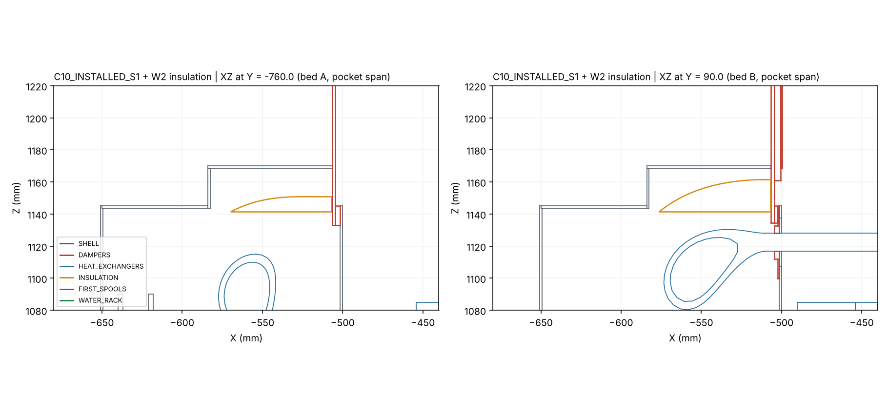

# RT5 independent review of C10: four-core prototype (H01, D04, HYD-S2)

**Scope.** This review covers `fredshuc/buildfly` branch `codex/c10-four-core-prototype`:
- Reviewed CAD and evidence: commit `a42fdb8`.
- English README: commit `82e51e3`.
- Issued ZIP: sha `ec2bdaca…`.

The review branch is `claude/jolly-hopper-mndk80`.

**Labels.**
- **[V]** verified here by a tool.
- **[S]** owner statement.
- **[C]** calculation.
- **[E]** estimate under stated assumptions.
- **[I]** inference.
- **[R]** recommendation.

## Conclusion

**C10 is a clean geometric integration, and it closes the RT4 blockers it targeted.** I reproduced it from the issued ZIP alone.

- **Geometric integration: accept.**
- **Prototype detailing: accept with four conditions** (C10-N1, N2, N4, N5).
- **Fabrication readiness: hold.**
- **Wet operation: blocked.**

### What I verified

- **[V] Integrity.** All 4 pinned owner archives and all 37 manifest members match their SHA-256. The recovered files match the RT4-era manifests:
  - `C09_HYDRONICS.zip` `c4050888…`
  - H00 core `2304062c…`
  - `FOUR_HX_INSTALLED.step` `0360e579…`
- **[V] Clean-room rebuild.**
  - I ran `prepare → build → verify S1/S2 → measure_detail → verify_service` from a fresh extraction of the ZIP. It completed in about 4 minutes.
  - Every evidence JSON is identical to the issued one, excluding hashes and timings.
  - The rebuilt shell (560), changed set (75) and S1 assembly (3,116) match the issued STEP files by geometry signature (name, volume, bounding box).
  - RT4-F9 (not reproducible) is closed.
- **[V] Independent all-group screen**, 0.001 mm³, both states. I used my own reader, not the owner's code.
  - All 10 cross-group pairings among shell, dampers, HX, rack and spools have zero overlaps.
  - Intra-group, the dampers show only the 12 documented root-seal interferences. The rack and spools have none.
- **[V] RT4 closures.**
  - **RT4-F1** (Pin seat into the W2 tube): now 3.000 mm, seat and gasket to the H01 W2 tube in both beds.
  - **RT4-F2b** (upper-port drop): replaced by horizontal H01 faces. Spools sit ≥239 mm from the lower core [S], and I found zero overlap [V].
  - **RT4-F2c** (mode table): `PORTS_BY_MODE.csv`, H01 `EIGHT_PORTS_AND_SPOOLS.csv` and HYD-S2 now agree that hot water enters at upper W2.
  - **RT4-F2a** (hydronics missing): the package is now present.

### What remains

**New in C10**
1. **C10-N1. The pocket's front closure is a removable D04 damper seat.**
   - `build.py` deletes the pocket front returns because they lie inside `DAMPER_SEAT_*_UPPER_DEEP_O`. It records the pocket as "closed by retained part".
   - The resulting joint is a 1.5 mm edge contact: 33.75 mm² on A and 77.25 mm² on B.
   - D04's own service procedure removes that seat to replace the gland halves. The joint therefore cannot be welded and needs its own gasketed design.
2. **C10-N2. The gland retainers cannot clamp near the pipes.**
   - At the openings, a 1.5 mm plate has only 9 mm (W1) or 22 mm (W2) of ligament.
   - Its studs sit only on the outer edge.
   - The seal therefore relies wholly on the unspecified boot.

**Inherited from the owner packages and confirmed here**
3. **C10-N3. Airflow distribution.**
   - The +60 mm roof removes the starved apex: model min/mean rose from about 0.0–0.8 to about 0.65–0.8.
   - It does not reduce overall non-uniformity: CV is still 20–30 % for P at 4,870 m³/h. The cause is the 159 mm mouth relative to coil resistance, not the apex.
4. **C10-N4. Most H01 vent and drain points are not in the wet bay.**
   - The vent caps sit at X −463…−449. The +X drain bosses and closures sit at X 603–618. The legacy C05 drain spigots sit at X 619–635.
   - All of these are 17–20 mm from `M302_OUTER_PANEL_*` or `AIR_SIDE_OUT_*`, with no service envelope.
   - Purging and draining are unproven.
5. **C10-N5. The water rack floats.** It is more than 60 mm from every shell and HX part and has no support.
6. **Still open from RT4:**
   - F4: 1.000 mm lower-shaft end gap.
   - F5: 1.2119 mm upper sweep, re-verified against H01.
   - F6: D03 margins.
   - F7: 2 mm face seals.
   - F8: A-post weld sizing. The register now exists, but it gives locations, not capacity.

## 1. Integrity and reproduction

| Check | Result |
|---|---|
| `INPUTS.json`: 4 owner archives | All SHA-256 match [V] |
| `MANIFEST_SHA256.json`: 37 ZIP members | All match the ZIP and the repo copies [V] |
| Issued STEP hashes against `VALIDATION_SUMMARY.json` | Match: S1 `55f43f07…`, S2 `5e547cd1…`, shell `bc7b82ca…` [V] |
| Clean-room rebuild from the ZIP only (Python 3.13, CadQuery 2.8, OCP 7.9) | All six steps rc=0; S1 and S2 PASS [V] |
| Rebuilt against issued evidence | `verify_S1/S2`, `detail_measurements`, `shell_changes`, `service_overlay_readback` and `build` identical, excluding hashes and timings [V] |
| Rebuilt against issued STEP | Byte hashes differ (STEP header timestamps). Geometry signatures are identical for shell 560, changed 75 and S1 3,116 [V] |
| Recovered RT4 inputs | `C09_HYDRONICS.zip`, H00 core and `FOUR_HX_INSTALLED.step` match the RT4-era hashes [V] |

The owner's `verify.py` now screens all 10 cross-group pairings, including every HX occurrence. This closes the RT4 process gap. Its `pass` flag does not include intra-damper, intra-rack or intra-spool screens. I ran those separately (§2).

## 2. Independent screens

`results/screen_S1.json` and `screen_S2.json` [V]:

| Pairing | Candidates (S1/S2) | Overlaps >0.001 mm³ |
|---|---:|---:|
| DAMPERS × HX | 18 / 18 | 0 |
| DAMPERS × SHELL | 321 / 321 | 0 |
| HX × SHELL | 198 / 198 | 0 |
| FIRST_SPOOLS × HX / SHELL / RACK / DAMPERS | 8 / 0 / 26 / 0 | 0 |
| WATER_RACK × SHELL / HX / DAMPERS | 0 / 0 / 0 | 0 |
| DAMPERS × DAMPERS | 657 | 12, all the documented D03 root-seal pairs |
| RACK × RACK, SPOOLS × SPOOLS | 58, 120 | 0 |

Group envelopes are in global mm [V]. The machine footprint is set by the rack:

| Group | Envelope |
|---|---|
| Shell | X −700…1200, Y ±850 |
| Dampers | Y ±1014 |
| Water rack | X −1618.5…−790.2, Y −1145…632 |

The rack therefore adds 919 mm in −X.

Targeted exact distances (`results/c10_probe_S1.json`, `upper_envelope_to_HX_C10.json`) [V]:

| Pair | Min (mm) | Comment |
|---|---:|---|
| `DAMPER_SEAT_{A,B}_UPPER_DEEP_O` → H01 `W2_D35_END_PIPE` | **3.000** | RT4-F1 closed. Nearest points (−506.5, −774.059 / 90.941, 1133.0) |
| `DAMPER_STATIC_GASKET_{A,B}_UPPER_O` → same tube | **3.000** | |
| `D04_{A,B}_WET_BOOT` → W2 tube | 0 | Designed soft-lip contact |
| D03 upper motion envelope → H01 `AIR_EDGE_0_1054` | **1.2119** | Unchanged from RT4-F5 |
| W2 additional insulation → `F_POST_-600_-825_O` | 2.000 | As owner |
| W2 insulation → `C10_B_W2_POCKET_ROOF` / A roof | 3.65 / 10.02 | |
| W2 insulation → `DAMPER_SEAT_A_UPPER_DEEP_O` | **0.500** | Crown end face to the steel seat (see N1) |
| First spools → shell; rack → shell/HX | >30; >60 / >60 | Rack has no support contact (N5) |

## 3. Findings

All locations apply to both S1 and S2 unless stated.

### C10-N1: Pocket front closure depends on a removable damper seat

- **Status:** new. **Disposition:** prototype prerequisite. **Owner:** shell with D04.
- **Observation [V]:**
  - `source/build.py::thermal_pocket` creates `C10_{bed}_W2_POCKET_FRONT_RETURN` at X −506.5…−505.
  - The post-build loop subtracts every damper solid. The return lies wholly inside `DAMPER_SEAT_{bed}_UPPER_DEEP_O` (X −506.5…−504.5), so it is deleted and logged as `inherited_pocket_closures`. The build log shows "Pocket seat junction … FRONT_RETURN … 843.75 / 1931.25 mm³".
  - What remains is an edge-to-face contact of the 1.5 mm roof and inboard return against the seat: 33.75 (A roof), 77.25 (B roof) and 37.5 mm² (each inboard return) [S/V]. The insulation crown ends 0.5 mm short of the same seat [V].
- **Mechanism [I]:**
  - The D04 README service step requires "解除该床 Pin 钢座、静垫" (releasing the Pin steel seat and static gasket) to replace the gland halves.
  - So the pocket's fourth wall is a part that will be removed in service. A weld would block that removal.
  - An unsealed butt joint lets process-inlet air through, into the wet-bay pocket, along the 0.5 mm crown gap. This is a vapour path to the coldest pipe.
- **Change [R]:** give the pocket its own shell-owned front flange: a 1.5 mm return at X ≈ −510 with a ≥10 mm land. Seal it to the seat face with a compressible gasket (≥3 mm closed-cell, 25–40 % compression), and fit the insulation crown hard against that flange.
- **Closure evidence:**
  - updated `inherited_pocket_closures` = [];
  - seat removal and refit demonstrated on the dry assembly;
  - tracer or smoke test of the pocket seams at the project's ΔP before and after one seat removal.

### C10-N2: Gland retainers do not clamp the boot near the pipes

- **Status:** new. **Disposition:** prototype prerequisite. **Owner:** shell with materials.
- **Observation [V]:**
  - `CHANGED_PARTS.csv` and `build.py::outer_glands` define each retainer half: 1.5 mm steel, 71.85 mm tall, with semicircular cut-outs of radius r+3 (63 mm W1, 50 mm W2) centred on the split line at Z 560/895.
  - The remaining ligament between the cut-out and the outer edge is **9 mm under W1** and **22 mm under W2**.
  - The six M4 studs sit 6 mm from the outer edges (Z = centre ± 66).
- **Calculation [C]:** a 1.5 mm steel strip cantilevered 66 mm from the stud line deflects about 1.9 mm under 50 kPa of boot reaction (plate strip, E = 200 GPa). That is more than a 2 mm boot can absorb.
- **Mechanism [I]:**
  - The retainer can locate the boot perimeter but cannot load the seal at the insulation circumference.
  - The weather and vapour seal therefore depends entirely on boot elasticity or bond. That is consistent with the owner's "no pipe clamping" intent, but no design for it exists yet.
- **Change [R]:**
  - Specify the boot as a moulded or bonded EPDM grommet with an integral lip on the insulation jacket, and a sealant bead to the skin.
  - Treat the retainer as a guard only, or use 3 mm with a formed edge flange.
  - Add a stud between the two holes at each split if clamping is retained.
- **Closure evidence:** spray or dye test of one gland, and boot replacement on the dry assembly.

### C10-N3: Airflow distribution — roof raise helps the apex, not the overall CV

- **Status:** RT4-F3, partly addressed. **Disposition:** prototype prerequisite (test acceptance) and fabrication hold (design decision). **Owner:** airflow with HX.
- **Observation [V]** (`results/plenum_profile_bedA.json`):
  - The top plenum is now 159 mm at X −270, falling to **67.5 mm** above the HX envelope over X 490–590. That is 99.2 mm above the fin top, matching the owner's 99.180 mm. C09 had 7.5 mm.
  - The bottom plenum is unchanged: 77 mm at its closed end. `F_HX_RAIL_A_612_510` is still 8 mm under the lower datum.
- **Estimate [E]** (`c10_header_model.json`, same 1-D model and assumptions as RT4):

  | Case | CV C09 → C10 | min/mean C09 → C10 | last 100 mm / mean C10 |
  |---|---:|---:|---:|
  | P 4,870, two cores (120 Pa) | 16–23 % → 20–30 % | 0.01–0.77 → **0.65–0.72** | 1.35–1.59 |
  | R 2,435, two cores | 16–22 % → 17–28 % | 0.21–0.68 → 0.62–0.76 | 0.64–0.77 |
  | P 2,435, two cores | 11–18 % → 14–22 % | 0.19–0.83 → 0.73–0.79 | 1.24–1.41 |

  A sweep of the apex depth from 8 to 120 mm (`c10_apex_sweep.json`) changes the CV by under 3 points. The residual is set by the header velocity pressure at the 159 mm mouth (about 84 Pa at 4,870 m³/h) against the coil resistance.
- **Inference [I]:**
  - The raise removes the starvation risk under the apex. This is robust across all cases.
  - Further roof changes will not reach ±10 %.
  - The levers that would are a distribution resistance (perforated plate sized at roughly 0.5–1 × coil Δp), a measured higher coated-core Δp, or a lower design flow.
- **Closure evidence:**
  - the C05/H01 coated-core Δp–v curve;
  - CFD or a rerun of this model with it;
  - in the dry bed-A test, a ≥10 × 4 traverse of both faces in both states, including the last 100 mm.

### C10-N4: Vent and drain features inside the module have no service route

- **Status:** inherited from H01, confirmed. **Disposition:** prerequisite for wet operation. **Owner:** HX with shell.
- **Observation [V]** (`results/vent_drain_S1.json`, all four cores):

  | Feature | X (mm) | Zone | Clearance |
  |---|---|---|---|
  | `W1/W2_VENT_CAP` | −463…−449 | Inside the rear wall (X −500), not wet bay | 17.1–18.9 mm to `M302_OUTER_PANEL_*` / `AIR_SIDE_OUT_*` |
  | `W1/W2_DRAIN_BOSS` + `CLOSURE_PROXY` | 603–618 | Inside the module | 19.9 mm to the side panels |
  | `C05_SHORT_DRAIN_SPIGOT` | 619–635 | Inside the module | — |
  | Wet-bay drain caps | −705…−691 | Wet bay | 38.6–39.1 mm to the gland membranes |

  The C10 service overlay contains no access envelope for these features. The H01 README lists venting and draining access as untested [S].
- **Mechanism [I]:** filling and purging a horizontal six-pass core needs the header-crown vents. With these features behind closed panels, about 20 mm away, the vents and drains can neither be operated nor inspected.
- **Change [R]:**
  - Route vent and drain lines (for example 6–8 mm tube) from these bosses to bulkheads in the wet bay.
  - Alternatively, define removable access panels with a wrench envelope.
  - Confirm the C05 +X spigots are factory-sealed and not part of the service drain path.
- **Closure evidence:** a fill, purge and drain trial with measured residual volume.

### C10-N5: Water rack has no load path

- **Status:** inherited from HYD-S2, acknowledged in RT-C10-06. **Disposition:** blocker for wet operation. **Owner:** hydronics with structure.
- **Observation [V]:**
  - All 36 rack occurrences are more than 60 mm from any shell or HX part, and the rack spans X −1618.5…−790.2.
  - The only physical connections are the eight first spools, ≥30 mm from the shell.
  - In the CAD, every valve, FS, Q and pipe load therefore goes through the Rp1¼ HX faces.
- **Change [R]:** an independent rack frame, tied to the machine base, with pipe clamps placed outside the 5.0 mm and 9.3 mm service margins HYD-S2 reports [S].
- **Closure evidence:** nozzle-load check (weight plus thermal plus pressure thrust), then a dry fit.

### C10-N6: Thermal margins at the W2 crown and wall crossings

- **Status:** new/inherited. **Disposition:** prototype test item. **Owner:** hydronics with materials.
- **Observation [V/S]:**
  - The crown is 25 mm, with a chamfer leaving at least 19.143 mm to the W2 tube [S].
  - It sits 2.0 mm from the A post and 0.5 mm from the Pin seat [V].
  - At the 8 inner-wall crossings, the D35 tube passes Ø45 holes, a 5 mm radial annulus [S].
- **Calculation [C]** (`results/condensation.json`):
  - Inputs: 5 °C water, D35 tube, cylindrical insulation of k 0.034–0.040 W/m·K, outer film h 5–8 W/m²K.
  - At 32 °C / 26 °C dew point, the thickness needed for a surface at or above the dew point is 11.7–19.7 mm.
  - The 19.1 mm corner passes at h = 8 (margin 2.3 K). It is marginal at h = 5 with aged foam (19.7 mm needed).
  - At 5 mm the surface is 20.4 °C, so condensation is certain at each crossing on the wet-bay side.
- **Change [R]:** accept local condensation at the crossings and provide drip paths to the wet-bay drain, or use a bonded vapour-tight sleeve through the crossings. Specify the project design dew point.
- **Closure evidence:** a cold-water soak at the design dew point, with surface temperatures logged at the A post, the B pocket and one crossing.

### Inherited items still open (unchanged by C10, re-verified)

| ID | Item | Evidence | Disposition |
|---|---|---|---|
| RT4-F4 | D03 lower shafts coaxial, 1.000 mm end gap. Thermal closure 0.42–2.16 mm; ISO 2768-m ±0.8 mm per shaft [C] | D04 README restates 1.0 mm [S] | Fabrication hold |
| RT4-F5 | Upper blade sweep 1.2119 mm to H01 `AIR_EDGE_0_1054`; 5.992 mm tip overlap | [V] this round, against H01 | Fabrication hold |
| RT4-F6 | 0.603 mm root-sleeve running clearance; 80° overtravel overlaps the Pout seat by 997.55 mm³; actuators to \|Y\| 1014 | [S/V] | Fabrication hold / improvement |
| RT4-F7 | 2 mm HX face seals (0.5–0.8 mm working stroke) | Unchanged in C10 [V] | Fabrication hold |
| RT4-F8 | A post: relieved section keeps 22 % of the weak-axis I | `A_POST_WELD_REGISTER.csv` gives 8 seams, locations only [S] | Fabrication hold until weld size and frame check |
| H01/HYD-S2 margins | Wrench axial margin 1.8 mm (tail + SW50); 5.0 mm pipe to clamp envelope; 9.3 mm FS withdrawal | [S] | Dry-fit item |

## 4. Dispositions

| Stage | Disposition | Blocking items |
|---|---|---|
| **Geometric integration** | **Accept** | None. Zero cross-group overlaps reproduced independently; clean-room rebuild identical |
| **Prototype detailing** | **Accept with conditions** | N1 pocket-to-seat joint, N2 boot specification, N4 vent and drain routing, N5 rack frame concept |
| **Fabrication readiness** | **Hold** | RT4-F4, F5, F7, F8 (weld size, frame check); N1; flat patterns and bend allowances [S]; N3 distribution decision (plate or not) |
| **Wet operation** | **Blocked** | N5 rack support; N4 vent and drain; owner signoffs for connection stacks, pressure ratings, anti-pullout and reverse hot flow. H01 `HX_SIGNOFF.json` states `live_water: HOLD` [S] |

### Confidence

| Item | Confidence | Basis |
|---|---|---|
| Integration verdict | High | |
| N1 | High | Read directly from the build source and the D04 procedure |
| N2 | High (geometry), moderate (consequence) | |
| N3 | Moderate (direction), low (magnitude) | Hinges on the unpublished coated-core Δp |
| N4 | Moderate | Panel removability not modelled |
| N5 | High | |

### What would change these conclusions

- **N3:** a measured coated-core Δp of about 250 Pa or more at the design flow, or a design flow well below 4,870 m³/h, would downgrade it.
- **N4:** evidence that `M302_OUTER_PANEL_*` are tool-free access panels with wrench space would downgrade it.
- **N1:** a D04 service sequence that does not remove the Pin seat would reduce it to a sealing detail.

## 5. Files

- `tools/`:
  - `xcaf_leaves.py`
  - `c10_screen.py`
  - `c10_probe.py`
  - `upper_env_dist.py`
  - `vent_drain.py`
  - `plenum_profile.py`
  - `c09_header_model.py`
  - `apex_sweep.py`
  - `condensation.py`
  - `fig_pocket.py`
  - `probe_pairs.py`
- `results/`:
  - `screen_S1.json`, `screen_S2.json`
  - `c10_probe_S1.json`
  - `upper_envelope_to_HX_C10.json`
  - `vent_drain_S1.json`
  - `plenum_profile_bedA.json`
  - `c10_header_model.json`, `c10_apex_sweep.json`
  - `condensation.json`
  - `rebuild_comparison.json`
  - `fig_pocket_seat.png`
- `C10_RT5_FINDINGS.csv`: the findings in the owner's requested format.



To reproduce: extract `C10_REVIEW_PACKAGE.zip` into an empty root, run the owner sequence, then for example:

```bash
python -I AirTransformerShell/revisions/C10/RT5_REVIEW/tools/c10_screen.py AirTransformerShell/revisions/C10/cad/C10_INSTALLED_S1.step screen_S1.json
```
