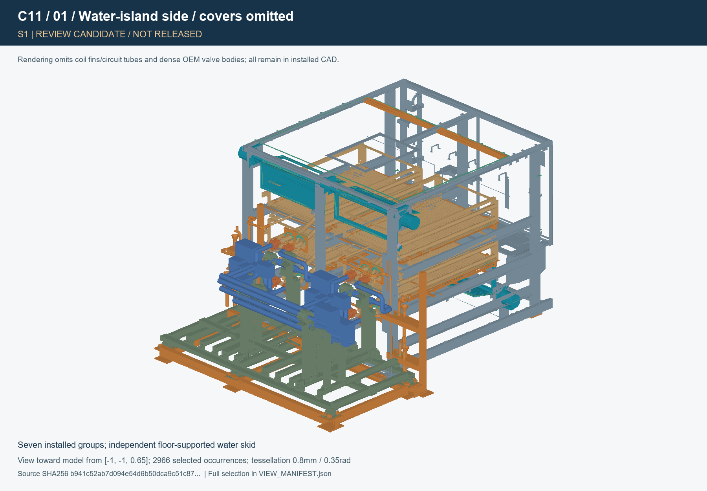

# AirTransformer C11 — Shell integration and red-team review

**Engineering review candidate / manufacturing HOLD.** This revision contains real C11 CAD and detail work. It does not close every interface and must not be treated as a manufacturing or first-water release. The C10 model and original owner archives remain preserved.

| Gate | Actual status |
|---|---|
| Installed geometry | S1/S2 built and checked; unresolved pairs listed below and in the interference register |
| Manufacturing details | 29 A3 review sheets and 200 CAD-derived flat profiles; outstanding joints/seals/service details remain HOLD |
| Dry assembly / weld/material proof | Not performed |
| Wind / leakage / condensate test | Not performed |
| First fill / pressure test / operation | Not authorised by this review package; not performed |

## Start here

1. Read [joint decisions required](C11_JOINT_RETURN_REQUESTS_EN.md), then review [open interferences](C11_OPEN_INTERFERENCES.csv), [closure matrix](C11_CLOSURE_MATRIX.csv) and [interface acceptance](C11_INTERFACE_ACCEPTANCE.csv) first. They distinguish modelled details from accepted interfaces.
2. Download the [S1 STEP archive](cad/C11_INSTALLED_S1.step.gz) and [S2 STEP archive](cad/C11_INSTALLED_S2.step.gz), then restore their byte-identical STEP files with `source/restore_cad.py`. The local delivery ZIP also contains unpacked STEP files. Reference envelopes are separate files and are not installed material.
3. Read [engineering evidence](ENGINEERING_REVIEW_EN.md), [manufacturing review PDF](drawings/C11_MANUFACTURING_REVIEW.pdf), [part schedule](C11_PART_SCHEDULE.csv) and [test/service plan](TEST_AND_SERVICE_PLAN_EN.md). Flat profiles use mm and a local origin at the profile minimum; [PROFILE_MANIFEST](drawings/PROFILE_MANIFEST.json) supplies the global transform.
4. Use the [CAD views](views/VIEW_MANIFEST.json) and [exact section manifest](drawings/SECTION_MANIFEST.json) to trace displayed parts and source SHA256. Cutaway/selected views explicitly record omitted covers; they are not evidence of clearance by themselves.

## CAD overview

This is a projection of the actual installed CAD. Covers, coil fins/circuit tubes and dense OEM valve bodies are omitted from this view only; they remain in the full STEP and geometry checks. The [view manifest](views/VIEW_MANIFEST.json) records every displayed selection and source hash.

## What changed

- **Pocket front closure:** both pockets now retain their own continuous front plate and replaceable gasket to the removable Pin seat. Hard compression stops and M4 fixings are modelled. `inherited_pocket_closures=[]`; the program no longer deletes a front wall to obtain a pass. The existing thermal crown and the B upper service route still conflict with this candidate. Those conflicts are reported, not waived.
- **Four external glands:** actual split flexible lips, slit fill, renewable splice, 6 mm guards, 5 mm backers and hard stand-offs replace the conceptual membrane/retainer arrangement. The adhesive sealing load and guard retention load are calculated separately. Six removable M4x16 screws per panel replace fixed studs. The tested radial 90 mm/outboard 20 mm proposal is not accepted: lower guards hit local H02 drain adapters/mount bolts, and upper guards have unresolved lip contact. A qualified local drain-hardware predecessor route or further guard revision is required. Blind 4 mm taps preserve 1 mm closed backer wall. Material/jacket adhesion and complete replacement access still need qualification.
- **Four core face seals:** selected 6.35 mm closed-cell silicone works at 4.45 mm nominal installed thickness. Bearing pads, locators and compression stops preserve the frozen core positions. Twenty clamps per core and their load path are present. Y-edge jaws are wider, with flush countersunk heads at the U-bend collector. All clamps react on the bottom steel frame. Left end stations have a 39 mm wide, 3.5 mm flush jaw at Y-min and an 8 mm flush jaw at Y-max, on eight gusseted bearing extensions attached to the unchanged Shell RHS. The former upper-frame long ties were rejected by continuous damper motion testing. A later distance check found the 40 mm jaw edge merely touching the condensate rail despite zero overlap volume; the final 39 mm jaw ends at X=-391 and leaves 1 mm nominal rail clearance. The four trims and final exported clearances are recorded separately. Right X-edge clamps sit 100 mm inboard of the end faces to clear shoes and vertical crosses. Continuous left bearing and a right RHS 50 x 30 x 3 mm strongback stiffen the Shell carrier. The left HX edge, conservatively screened over 652 mm, still needs coupled-frame uplift qualification or a joint collector/hold-down revision. Bolt preload alone does not establish toe force: the sleeve/stop/frame stiffness and measured contact load must be qualified. HX has not released the required clamp load; its 1,000 N fixture limit is not service capacity.
- **A-post and base:** eight 3 mm CJP preparations/fills now have gross/effective lengths, weld sequence, conditional capacities and a frame transfer/stiffness model. The A-post and sister are not cut again. The six water-island feet receive a separate floor-supported skid, bolt stacks and connections to the main base. Bolt centres are 90 x 60 mm, offset 5 mm outward within the owner's X slots from nominal 80 x 60 mm centres to clear the 60 mm risers. Custom 24 x 36 x 18 mm washers and M12x55 bolts carry the local preload. These remain candidate interfaces, not frozen drill dimensions.
- **Service and drainage:** final H02 service-hole requests are incorporated into named sheet parts; one registered fixed D05 seat hole is an explicit C11 delta. Four independent condensate traps have 164 mm effective head, cleanouts, clips, flexible connections and visible air gaps. Their YZ planes are X=-720/-680, with floor-bearing outrigger posts outside the water-island support network and collared receptors. Pressure-water discharge remains separate. Each atmospheric branch has a real fishmouth with a 0.15 mm root gap and D16.2 opening. A previous equal-radius Boolean cut silently removed no material; the corrected cut and all four exported joints are checked in `evidence/trap_joint_export_check.json`. Small service-penetration seals and wet-zone collection are still unfinished. Receptors now have welded collars on independently supported shelves; their joints and service routes still require qualification.
- **Distribution and roof:** two removable blank frames, runners, locks and pressure pickups implement the no-plate test configuration without raising the roof or moving cores. A 320-point traverse register and unmeasured pressure-loss sensitivity budget preserve rated P=4,870 m3/h. The roof has 24 removable fixings and renewable seals. Complete lower-seat/cassette and inlet-pocket removal sequences remain unproved.

## Frozen inputs and resulting assembly

[INPUTS.json](INPUTS.json) records exact archive hashes and sizes. Inputs are D05 `b91a1555…`, H02 `b0fbc5cf…`, and Hydronics C11 candidate `d1a74297…`; full hashes, not these abbreviations, control the build. The HYD-S2 crown remains an explicit installed thermal group. D05/H02/Hydronics owner evidence is retained with its original scope and limitations.

| S1 installed group | Occurrences |
|---|---:|
| SHELL | 1535 |
| DAMPERS | 270 |
| HEAT_EXCHANGERS | 2520 |
| WATER_RACK | 36 |
| FIRST_SPOOLS | 160 |
| HYD_SUPPORT | 611 |
| THERMAL | 2 |

| State | Occurrences | Cross-group combinations | Invalid occurrences | Unresolved reported pairs | Geometric result |
|---|---:|---:|---:|---:|---|
| S1 | 5134 | 21 | 0 | 560 | FAIL_OPEN_INTERFACES_OR_INVALID_SOLIDS |
| S2 | 5134 | 21 | 0 | 560 | FAIL_OPEN_INTERFACES_OR_INVALID_SOLIDS |

In each state, 16 unresolved pairs are cross-group conflicts and 544 are unclassified Hydronics-support internal pairs. The new Shell internal check reports 0 unexpected pairs. These findings remain open; they are not accepted contacts.

The Boolean reporting threshold is 0.001 mm3. This is separate from a mechanical clearance allowance. All seven groups produce 21 cross-group combinations. Checks of unchanged groups may reuse preserved results only when their exact source STEP hashes match; the current assembly occurrences are read back and their world bounding boxes compared. Every reuse is recorded in the relevant JSON check. All changed Shell interfaces are checked again. New Shell internal pairs, D05 internals, Hydronics supports, spools and H02 added material are also checked. The exact 12 D05 soft contacts are individually matched and their volumes compared with the pinned owner values. Only named, justified contacts are separated from unexpected intersections; no whole-group soft-contact waiver is used. Invalid installed solids, if any, are listed in C11_INVALID_INSTALLED_SOLIDS.csv; intersections involving them are diagnostic and cannot establish acceptance. H02 OEM valve bodies required STEP export normalization without cutting/redesign. See evidence/H02_EXPORT_NORMALIZATION.json for original/output hashes, validity and numerical dimension/volume differences; the pinned owner archive is unchanged.

Independent clean Shell rebuild: **PASS_SHELL_REBUILD_SIGNATURE**. Continuous moving-to-fixed C11 check: **CERTIFIED_GEOMETRY_CLEAR_WITHIN_SCOPE**. See the JSON evidence for scope. Neither result proves complete service, thermal or physical performance. Old development checks against C10 are explicitly labelled and do not replace the final C11 checks.

## Red-team review priorities

1. Resolve the pocket/Pin/crown/B-upper-vent geometry as one joint while retaining a real Shell wall, replaceable seal and insulation/vapour continuity.
2. Confirm core frame force capacity, stop contact stress, thermal slip and actual CG before accepting the face-clamp settings. C11_TOLERANCE_AND_THERMAL_BUDGET.csv exposes an unadjusted face-gap stack exceeding the proposed +/-0.25 mm acceptance range and an illustrative thermal/datum stack exceeding 1.5 mm travel; both remain HOLD rather than being hidden within the seal thickness.
3. Challenge the CJP fabrication access and qualification, frame-joint rigidity, local web stress convergence, floor/substrate assumptions and anchor demands. Conditional linear analysis is not a qualified weld or foundation.
4. Close every interference in the final register, including owner support internals and service hardware; do not reinterpret unexplained rigid overlaps as soft seals.
5. Complete small penetration seals, wet-zone collection, receptor support qualification and true predecessor/tool/container service routes. A seat-only extraction after assuming unverified Shell parts removed is not a complete service pass.
6. Use measured core/collector losses and fan reserve before selecting a distribution plate. Perform dry/wet tests in the supplied sequence; all result fields are intentionally unfilled.

## Rebuild and evidence

Use Python 3.12, CadQuery 2.8/OCP 7.9 and the dependency versions recorded in the runtime manifest. Set `CADQUERY_LIBDIRS` to the installed CAD library directories when needed. On restricted Windows hosts, `C11_NO_WMI=1` only disables the process-local OS-metadata query; it does not change CAD inputs.

Run `source/restore_cad.py` if using compressed repository STEP copies, then `source/prepare.py`, `source/build_shell.py`, `source/repair_hx_export.py`, `source/integrate.py`, `source/verify_integration.py S1`, `source/verify_integration.py S2`, and `source/verify_motion_delta.py`. Calculations use `source/calculations.py`, `source/structural_model.py 24`, `source/structural_model.py 48`, and `source/report_engineering.py`. Also run `source/verify_service_subset.py`, `source/datum_check.py`, `source/installed_mass_audit.py`, `source/verify_trap_spools.py`, `source/verify_trap_joints.py`, `source/verify_bottom_clamps.py`, `source/verify_jaw_trim_delta.py`, `source/tolerance_budget.py` and `source/manufacturing_registers.py` for their separately scoped evidence. Run `source/drawings.py` before `source/cad_sections.py`; `source/cad_views.py` uses the final installed readback. `source/independent_rebuild.py` copies only pinned inputs/source to a fresh tree and compares Shell signatures without development caches.

Do not set `C11_C10_CACHE` for an independent rebuild. Do not substitute earlier HX development registries for the pinned final H02 archive. Reference tools, thermal-hole proposals and mutually exclusive service envelopes are excluded from installed CAD. Rebuilding requires the preserved C10 S1/S2 and the H01/HYD-S2 archives identified by C10/INPUTS.json.

The package manifest covers source, inputs, drawings and evidence. Source timestamps/STEP metadata may differ between rebuilds; compare the documented name/count/volume/bounding-box signature rather than declaring a timestamp difference a geometric change. No physical test result is claimed in this revision.
