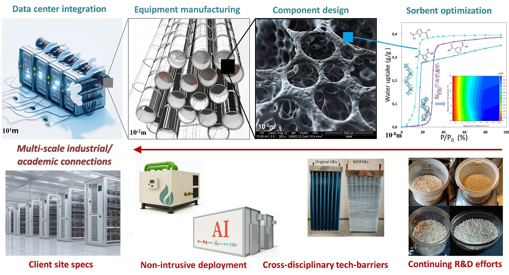

# 1. Technology

## 1.1 Novelty and breakthrough nature

### Cooling without vapour compression

Savery Tech has developed a complete AirTransformer machine at TRL6. In its 2025 EN test, the machine delivered sensible cooling at an electrical COP of 20 using 60°C waste heat. The action turns this operating capability into a repeatable industrial product through batch consistency, reliability, conformity and customer acceptance.

AirTransformer combines staged metal-organic framework (MOF) sorption with integrated heat exchange and indirect evaporative cooling. The sorbent dries the process air and is regenerated with surplus heat; a separate evaporative stage then removes sensible heat from the dried air. The cooling process uses no vapour compression. Fans and pumps are the main electrical loads, alongside controls and other required auxiliaries. Initial customers are liquid-cooled data centres and facilities with suitable waste-heat interfaces that must maintain cooling through heatwaves on constrained electricity connections. Existing cooling provision maintains continuity during installation and serves loads outside the qualified operating range.

The innovation connects three engineering levels. At material level, sorption behaviour must match the humidity and temperature encountered along the air path. At contactor level, coatings, heat-exchange surfaces and airflow passages must transfer moisture and heat fast enough to produce useful cooling. At machine level, switching, regeneration and heat recovery must sustain that service while keeping fan, pump and auxiliary electricity low. Improving one level without preserving the others can reduce the performance of the complete product.

Savery's productisation route uses CAU-series material variants and builds on its integrated-machine experience. Its 2025 heat-and-mass-exchanger application addresses staged adsorption and integrated heat exchange directly. A separate 2026 sorption-heat-pump application seeks protection for system and control architectures. These two application families, combined with manufacturing know-how and machine validation, underpin the development strategy described in Section 1.3.

The product range comprises 20 kW thermal modules and a 600 kW thermal container configuration. Liquid-cooled rack heat at 50–70°C supports regeneration in the operating mode with liquid-water recovery. Without liquid-water recovery, the engineering range extends to 40–50°C. Industrial sources such as air-compressor cooling circuits can also serve the machine when heat flow, availability and source/sink interfaces match the assigned duty.

The platform also extends to heating. Savery's 2026 heating machine uses water-vapour compression at a low pressure ratio, for which heating COP can reach 6–10. The separate, pending 2026 European application seeks protection for the associated sorption, vapour-routing and compression architecture described in Section 1.3. This extension is distinct from the cooling product qualified in this action.

### Integrated heat and mass transfer

The process-air stream passes through sorption contactors that remove water vapour. Their thermal interfaces remove adsorption heat, preserving the useful drying effect. The resulting air condition improves the driving potential for indirect evaporative cooling downstream. Water evaporates into a separate working-air stream, drawing sensible heat through the exchanger while the delivered-air path remains separate from the humid exhaust.

Contactors alternate between treatment and regeneration. A low-temperature heat supply restores sorption working capacity; coordinated switching and heat recovery prepare the next contactor while the machine continues to serve its assigned duty. The required interfaces are process air, regeneration heat, a compatible heat sink, electrical supply, water management and access for inspection and replacement.

Figure 1. Engineering chain from sorbent and contactor development to modular cooling equipment and data-centre integration; representative component photographs and illustrative integration views from Savery's 2025 application. The legacy sorption curves illustrate material development, rather than current CAU batch-test results.

The engineering advantage is the coordination of the adsorption threshold, exchanger temperature and changing humidity along the air path. A single material or an equilibrium uptake figure cannot describe that coordination. Successive stages can serve different moisture conditions; heat exchange controls the temperature seen by the sorbent; and cycle timing balances useful adsorption against regeneration. The 2025 filing seeks protection for a staged implementation coupling material selection with integrated heat exchange. [S1-1]

Useful performance also depends on pressure loss and auxiliary loads. Additional sorbent or coating thickness can increase available uptake while worsening heat transfer or fan demand. Savery therefore develops the material, coating, substrate and flow geometry together, using cooling output and resource inputs to evaluate the assembled contactor. The product specification connects these measurements to the customer's required airflow, temperature, humidity ratio and operating modes.

### Measured performance and product operating envelope

| Quantity | Value | Basis |
|---|---|---|
| Machine sensible-cooling electrical COP | 20 with 60°C waste heat; delivered sensible cooling divided by electrical input | 2025 EN measurement; test boundary defined below |
| Installed sensible-cooling electrical COP | 8–20, depending on site pumps and adjacent components | Company engineering range |
| Regeneration with liquid-water recovery | 50–70°C, including suitable liquid-cooled rack heat | Engineering operating range; heat flow and source/sink interfaces matched to duty |
| Regeneration without liquid-water recovery | 40–50°C, including suitable industrial waste-heat circuits | Engineering operating range |
| Modular cooling capacity | 20 kW thermal module; 600 kW thermal container configuration | Product specification |
| Delivered-air condition | 16–20°C; humidity ratio 9–11 g/kg dry air | Product specification, rated with corresponding inlet air, airflow and source/sink conditions |
| Electricity reduction at equal cooling, against EER3 | 62.5–85.0% at installed COP8–20 | Derived equal-duty comparison |
| Action electricity objective | 60–70% lower electricity at equivalent useful cooling | Conservative installation-qualification target |
| External make-up water | 40–60% lower at equivalent useful cooling | Installation-qualification target against the selected incumbent configuration |

Test-boundary note: the 2025 EN heat loops were connected at static pressure, excluding the circulating water pump from the test electrical input. Site comparisons include actual pumps, fans, controls, water treatment and other affected auxiliaries within the assigned cooling-service boundary. Electrical cooling COP and regeneration heat are reported separately for each rating point.

Lower external make-up and recovered liquid water are separate benefits. Qualification records withdrawals, recovered liquid, treatment losses, storage changes, discharge and internal use. Recovered liquid is initially intended for isolated, treated, non-aerosol equipment cleaning where qualified demand exists; other uses receive their own assessment. The water balance establishes usable net output and any subsequent make-up requirement.

### CAU contactors and repeatable manufacture

The CAU development work concerns a selected material route, its processing window and its integration into the contactor. It will establish how synthesis or procurement, conditioning, coating and assembly preserve the response needed by the machine. Material identity, binder fraction, coating thickness, adhesion and thermal contact determine the usable cyclic capacity after manufacture.

Qualification follows the manufactured object. Incoming-material checks establish identity and consistency. After shaping or coating, tests determine sorption response, transfer behaviour and pressure loss. Contactor tests then evaluate the actual thermal interface, switching and recovery. Finally, the machine comparison establishes whether the upgraded component maintains or improves useful cooling under the specified conditions. Qualification establishes kinetics, ageing and service life on the manufactured contactor.

The programme qualifies six traceable process batches supplying twelve reusable contactors and eighteen destructive witnesses. Independent sorption and thermal analyses, coating inspections and release measurements connect batch records to performance. Nonconforming lots are isolated, with a defined rework or rejection decision. Process or supplier changes trigger the relevant comparison against the released configuration.

Manufacturing transfer produces controlled drawings, bills of material, process instructions, tolerances, inspection methods and acceptance limits. Design-for-assembly work addresses leakage checks, repeatable interfaces, access and replacement. It also distinguishes production defects from in-service degradation so that a technician can diagnose a loss of performance and apply an appropriate repair or replacement procedure.

The tested machine provides the configuration baseline for this route. CAU contactor and control upgrades receive traceable comparison results and version histories. Product release combines the machine, component, manufacturing and installation evidence for the selected configuration.

### Finite-time design and transport-informed optimisation

Savery's design capability connects sorption equilibrium to the time available in a working machine. The useful quantity is the moisture exchanged during a complete repeatable cycle, at the actual source and sink conditions, together with the cooling delivered during that time. A long adsorption tail may add little service while delaying regeneration; an early switch can increase cycle frequency but leave capacity unused. Heat recovery also trades reduced heating demand against the time needed to prepare the next contactor.

Published work by Henninger and colleagues, co-authored by Frédéric S. Cui, used large-temperature-jump experiments on CAU-10-H and aluminium fumarate to relate adsorption progress to characteristic times and mass-, area- and volume-specific mean powers. It demonstrates why an isolated time constant is insufficient for ranking useful performance. Savery applies this approach to shaped contactors, thermal interfaces and complete operating cycles. [S1-2]

Measured temperature, humidity and pressure responses constrain a dynamic description of loading, heat transfer and flow resistance. Parameter identification supports concrete choices: coating and contact conditions, switching time, regeneration duration and recovery after contamination or ageing. The model retains the range and uncertainty of its supporting measurements. An identified parameter is used for control only when the available observations distinguish it sufficiently for the proposed decision.

Thermodynamic length provides a local description of dissipation where the measured system supports a linear-response approximation. It can guide a path that reduces unnecessary gradients for a specified transfer and cycle duration. Larger excursions, hysteresis and switching retain their calibrated nonlinear treatment. Savery uses the resulting dissipation estimates to select switching, regeneration and recovery paths that can be checked on the operating contactor. [S1-3]

Comparisons close complete-cycle balances and retain comparable initial and final sorbent loading and thermal inventories. This prevents a favourable operating fragment from moving restoration work outside the evaluation period. Useful cooling, electrical demand and regeneration heat are retained separately. The resulting design or control choice is then tested on the manufactured equipment against a defined service requirement.

### Industrial control and safe operation

The tested machine's implemented cyclic and thermal controls provide the operating baseline. The upgrade adds deployable supervisory functions, model-predictive scheduling and, where useful, a bounded reinforcement-learning layer for setpoints or cycle decisions. Independent physical limits, safety interlocks, sensor diagnostics, anomaly detection and deterministic fallback retain authority outside the learning policy. Training, calibration and final acceptance data are separated; validation covers relevant climate and load trajectories, held-out disturbances, actuator faults, sensor drift and confidence loss. Operators retain mode selection, alarms, override and safe shutdown. The development outputs are versioned embedded software, hardware interfaces, regression tests and documented recovery behaviour, with robustness assessed before a function enters a released configuration.

## 1.2 Technology maturity - TRL

### From demonstrated machine to qualified product

AirTransformer is currently a complete TRL6 machine. Its 2025 EN result establishes sensible-cooling electrical COP20 at 60°C waste heat at machine level. The EIC action builds from that maturity through manufacturing transfer, reliability, conformity and product acceptance towards TRL8. New contactors and predictive functions receive configuration-specific qualification linked to the existing machine baseline.

The progression is organised by the object being released:

| Object | Starting position | Additional evidence and decision |
|---|---|---|
| Existing integrated air machine | Complete TRL6 machine with the reported 2025 cooling test result | Controlled baseline configuration and reproducible rating methods |
| CAU contactor version | Current productisation material route | After-shaping performance, batch consistency, cyclic operation, ageing and contamination evidence |
| Product controls and embedded implementation | Existing cyclic and thermal operating baseline | Calibrated implementation, interfaces, regression, fault diagnosis and deterministic fallback |
| Industrial product configuration | Existing platform and controlled engineering changes | Manufacturing records, reliability evidence, applicable conformity file and release criteria |
| Customer installation | Application-specific source, sink, air and water interfaces | Commissioning, matched service comparisons, operating instructions and acceptance evidence |

The first work package establishes the engineering and verification baseline by M6. It connects the existing machine configuration and available measurements to the intended duty, rating conditions, uncertainty, reliability requirements and applicable product rules. This makes later evidence comparable across batches, changes and test locations.

Manufacturing work releases a controlled configuration at M12 and qualifies batches through M18. The reliability programme plans 4,000 internal endurance hours and 1,200 independent fixture-hours, with recorded ageing, contamination, failure and recovery sequences. The recorded failures, degradation and recovery results will establish service limits, maintenance intervals and corrective-work priorities for product release.

The industrial qualification unit is planned for use at M10. Five twelve-day climate/load campaigns in M10–M14 precede transport and field installation. The field programme plans 1,600 operating hours in M17–M23, followed by analysis, corrective retesting and the M24 qualification decision. A separate endurance fixture remains available while the industrial unit is onsite. This sequence preserves equipment availability for each planned activity.

The acceptance dossier brings together the released bill of materials, process and software versions, independent tests, reliability results, conformity evidence and the limits established in service. Safety-critical findings must be resolved before the affected release. Performance is reported for the configuration and conditions actually tested, including unsuccessful runs and the effect of corrective work.

### CETP, reference deliveries and industrial qualification

Savery has been awarded CETP support for its ongoing 2026–2029 programme, which targets TRL7 with HPE providing the site. This supplies an established research and integration pathway. The EIC action uses available results and adds industrial implementation, manufacturing repeatability, reliability, conformity and product qualification. Research models, heat-and-mass-transfer studies, cycle maps and digital-twin/RL research remain distinct from the EIC product outputs.

The business plan also includes early reference deliveries of the existing AirTransformer platform. These have a different purpose from qualification of the EIC-upgraded version or of a production facility:

| Programme or commercial step | Object and planned timing | Role in development |
|---|---|---|
| Early reference deliveries | Four existing-platform units across two customers in 2027 | Planned pilot/reference acceptance and customer learning |
| Initial test and preparation capability | Staged target for June 2027 | Early capability phased with mobilisation and available cash or confirmed receipts |
| CETP programme | Funded programme during 2026–2029; TRL7 target and HPE integration path | Research and integrated field development according to its own milestones |
| EIC product qualification | April 2027–March 2029; M24 target for the upgraded configuration | Repeatable manufacturing, reliability, conformity and TRL8 product evidence |
| A-stage pilot factory | Qualification planned for April 2029 | Industrial capacity for the growing commercial rollout |

Reference deliveries use an accepted configuration of the existing platform. Subsequent material, control and manufacturing changes receive their own qualification before entering a customer release. [S1-4] Initial June 2027 preparation capability is phased against available cash and confirmed receipts; the Seed round is planned to launch in September 2027 with a November 2027 target close.

The EIC sequence runs through March 2029, using the existing machine, the dedicated qualification unit and actual field installation and operation. Independent climate and endurance tests supplement conditions unavailable during the field window. The M24 dossier will identify the evidence from each route and assess it against the product requirements. Later CETP results will inform subsequent releases.

## 1.3 IP strategy

### Two new application families targeting different engineering layers

Savery's IP strategy follows the engineering features of the product. The 2025 heat-and-mass-exchanger family is the principal current AirTransformer filing. A separate 2026 application seeks protection for a sorption-heat-pump architecture with routable vapour circulation and mechanical assistance. Both applications are filed and pending.

| Application family | Filing identity and applicant | Technical contribution and product relationship |
|---|---|---|
| Heat and mass exchanger, 2025 family | French priority FR2508386, 21 July 2025; PCT extension filed 20 July 2026, record FR2026/010348; Savery Tech | Staged adsorption materials and integrated heat exchange relevant to the current air-treatment product. The PCT extension belongs to this same family. |
| Sorption heat pump comprising a routable vapour circulation device and a compression device, 2026 application | EP26301484.7, received by the EPO on 9 October 2026; applicant Savery Tech | Claims directed to system, routing and control architecture, including evaporator, condenser and vapour-network embodiments in a separate heat-pump configuration. |

The 2025 claims address multiple adsorption materials arranged along the gas flow according to decreasing water-adsorption thresholds defined at 25°C. They also address coated fins, tubes carrying a heat-transfer fluid and a system comprising at least two heat-and-mass exchangers. These features connect protection to staged drying, removal of adsorption heat and coordinated operation. The engineering value is the matching of material response and thermal conditions along the air path, with an architecture that supports regeneration and continuous useful service. [S1-1]

The 2026 filing seeks protection for a heat pump with an evaporator, condenser, at least two sorption beds and a vapour-circulation device that can be routed between branches. Further claims address a distinct compression device, serial and distributed routing, bypass states, protective control and modular arrangements. This application extends Savery's technical portfolio into heat-driven systems that coordinate mechanical assistance with the required thermal service, alongside the current air-treatment platform. [S1-5, S1-6]

Savery also owns the earlier 2019 system family, including EP3825627A1, listed as pending with Savery Tech as applicant. [S1-7]

### Product-specific freedom to operate

The protection and third-party assessment follow the material and manufacturing method actually selected. For the CAU route, the comparison covers composition, precursor and linker choices, synthesis conditions, supplier provenance, shaping, coating and the resulting contactor. System screening then covers flow paths, heat-exchanger geometry, regeneration and control in the territories where manufacture or sales are planned.

EP3350151B1 and US10696704B2, concerning methods for producing metal-organic frameworks, are specific process-screening leads associated with Kiel/Fraunhofer. Specialist review will compare the selected synthesis or supply route with the claim elements and current status of the applicable national rights in the manufacturing and sales jurisdictions. [S1-8, S1-9]

Other relevant screening leads include BASF's sorption/heat-exchanger structures, NuMat's hybrid adsorbent granules, Framergy's amorphous-MOF and substrate-related subject matter, and Montana/AirJoule's contactor and chamber arrangements. Each will be mapped against the product features, supply chain and activity concerned, with the relevant claims and proposed disposition recorded for release. [S1-10–S1-13]

Before the affected manufacturing transfer or commercial release, specialist review will document the claim elements, actual implementation, jurisdiction and proposed disposition. Where a relevant right is identified, Savery will address it through an appropriate supply or permission arrangement, a design change or a different territorial route. The assessment follows the selected CAU process and product configuration, with the route-specific disposition included in version release and the existing M12 design/manufacturing decision.

For the Europe-and-North-America rollout, Frédéric and specialist counsel will maintain the application portfolio and select follow-on territorial filings according to the intended manufacturing and sales jurisdictions. Third-party screening will cover the European and North American territories selected for each activity, with review and any necessary disposition completed before the affected manufacture, supply or sale.

### Manufacturing knowledge, software and continuing protection

Patent protection is complemented by controlled process and operational knowledge: conditioning, coating windows, tolerances, calibration, release tests, control parameters and service procedures. Supplier transfers will provide the information needed for the assigned work while defining permitted use, confidentiality, improvements and continuing access for production and replacement supply.

Employee and contractor arrangements will preserve Savery's rights to the designs, software and results needed to manufacture, maintain and improve the product. Software records will identify background components and their licences. Data access and publication review will protect confidential process knowledge while enabling the scientific and technical dissemination required by the projects.

Frédéric Cui holds the product-architecture and configuration decision, supported by specialist IP advice and the scientific board in their respective areas. Product changes are reviewed for both technical evidence and rights: a revised material, process, supplier, exchanger or control function must enter the same release record. This connects the two new application families and the manufacturing know-how to a product that can be transferred, supported and developed over successive versions.

## References for Section 1

[S1-1] Savery Tech. Heat and mass exchanger, French priority FR2508386, 21 July 2025; PCT extension filed 20 July 2026, record FR2026/010348. Submitted application text, claims pp.22–23.

[S1-2] Henninger, M., et al. (2023). Benchmarking metal-organic framework coatings from Large-Temperature-Jump experiments: Learning from trade-offs in mean powers versus characteristic times. Applied Thermal Engineering 234, 121234. https://doi.org/10.1016/j.applthermaleng.2023.121234

[S1-3] Sivak, D. A., and Crooks, G. E. (2012). Thermodynamic Metrics and Optimal Paths. Physical Review Letters 108, 190602. https://doi.org/10.1103/PhysRevLett.108.190602

[S1-4] Savery Tech. Operating forecast and development plan, operating review dated 21 October 2026, pp.1–3, especially the existing-platform reference deliveries and facility-qualification calendar on p.2.

[S1-5] European Patent Office. Acknowledgement of receipt for EP26301484.7, 9 October 2026, applicant Savery Tech; title Sorption heat pump comprising a routable vapour circulation device and a compression device. Receipt pp.1–2, physically pp.5–6 of the supplied filing record.

[S1-6] Savery Tech. European application EP26301484.7, submitted application text, 9 October 2026, claims pp.31–34 and abstract p.35.

[S1-7] EP3825627A1, System for cooling/heating by cascading adsorption/desorption; European application EP19306516.6, priority 22 November 2019. Publication and public index, accessed 3 November 2026. https://patents.google.com/patent/EP3825627A1/en

[S1-8] EP3350151B1, Method for producing metal-organic frameworks, published claims and process disclosure. https://patents.google.com/patent/EP3350151B1/en

[S1-9] US10696704B2, Method for producing metal-organic frameworks, especially claim 1. https://patents.google.com/patent/US10696704B2/en

[S1-10] US11609000B2, Air-conditioning method and device. https://patents.google.com/patent/US11609000B2/en

[S1-11] EP4598672A1, Hybrid adsorbent granules and filters made with these granules. https://patents.google.com/patent/EP4598672A1/en

[S1-12] EP3890878A2, Amorphous metal organic frameworks and methods of producing the same. https://patents.google.com/patent/EP3890878A2/en

[S1-13] US20250043971A1, Latent energy and water harvesting system. https://patents.google.com/patent/US20250043971A1/en
