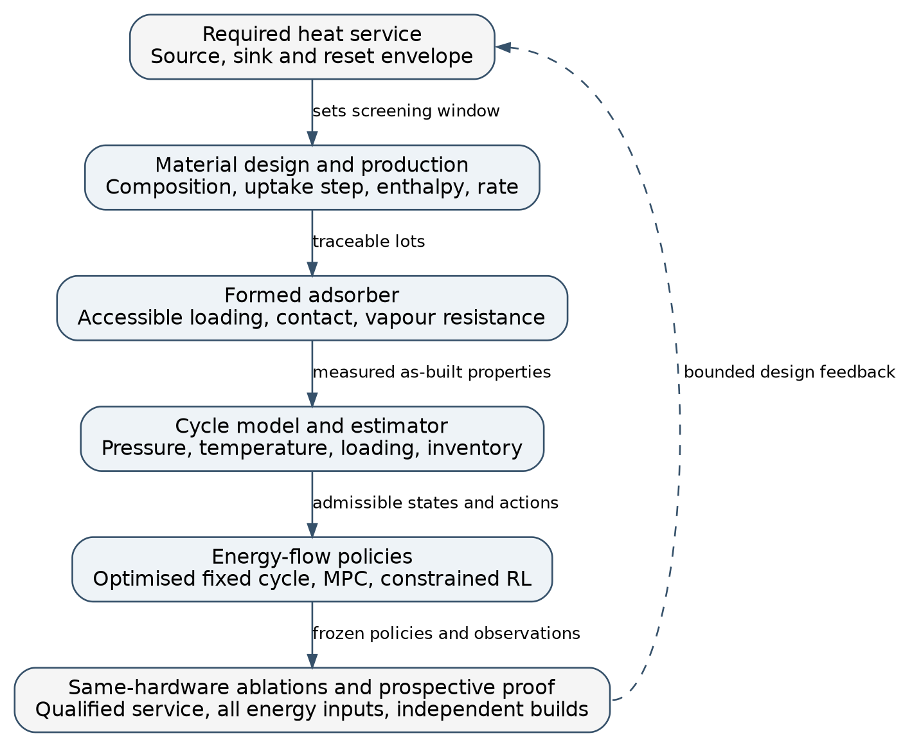

# 1. Excellence

## 1.1 Objectives and ambition

### The research question

Can a water-based adsorption heat transformer extend its useful operating envelope when the sorbent, its manufacturing history, the shaped contactor and the allocation of thermal and mechanical energy are designed together? The research concerns heat upgrading from variable low-grade sources. A warm liquid loop can supply heat to evaporate water and regenerate a sorbent. The machine must deliver a separate, higher-temperature water service while returning its adsorbent and water inventories to their starting conditions. A material may appear regenerable on an equilibrium chart yet deliver too little heat within the available time. Conversely, mechanically moving more vapour may increase measured throughput while losing the advantage at the machine boundary. These two failures make the materials and operating questions inseparable.

The application provides a demanding boundary condition for materials research. Direct heat exchange is appropriate when the source is already warm enough for a useful sink. A low return can also absorb lower-temperature cycle heat before final temperature lift. Warm-liquid-cooled data centres and suitable industrial streams provide candidate sources, with variable temperature, flow and time of availability. A 45 °C source and 70 °C supply illustrate a later integration case in Section 2. The laboratory programme in Section 3 uses a separately specified source, rejection and useful-water envelope. The research tests whether a reproducibly manufactured adsorber and a controlled vapour path can operate within that envelope. It does not infer site performance from nominal cooling-loop temperatures.

### Materials state of the art

**Conventional adsorbents define distinct compromises.** Silica gel, zeolites, salt-based composites and metal–organic frameworks (MOFs) all bind water, but their usable capacities are governed by the pressures and temperatures at both ends of the cycle. Silica gel provides a mature, comparatively broad adsorption response and can regenerate at moderate temperature under suitable pressure conditions. The accessible loading difference can be small at the low water activities that characterise a demanding temperature lift. Hydrophilic zeolites such as 13X bind water strongly in a region where silica gel may take up little. Their low residual loading can be difficult to reach with a weak regeneration source. The consequence is limited working swing even when the material has high total uptake. Zeotypes such as silicoaluminophosphates should be assessed separately from 13X. Changing framework composition changes the equilibrium profile and the practical regeneration window [3, 8].

Hygroscopic salts and salt-in-porous-matrix composites add hydration or solution formation to the available mechanisms. Large uptake and hydration heat can be attractive. The physical state of the salt matters to cycle repeatability. Deliquescence, redistribution, swelling or crystallisation can change the vapour path and heat contact as the material hydrates. A porous host can help retain the active phase and preserve geometry, while host mass and blocked pore space reduce effective storage per kilogram of composite. These alternatives motivate comparison by usable loading difference, energy and rate on a declared cycle. A single saturation capacity or regeneration temperature cannot represent an entire sorbent family [3, 13].

**Water-stable MOFs open a chemically tunable design space.** Unlike conventional porous materials, advanced MOFs can exhibit highly uniform pore sizes and cooperative adsorption effects, resulting in an exceptionally steep or nearly vertical isotherm at specific humidity and temperature ranges. Such sharply defined uptake thresholds are crucial for realising multistage sorption cycles, because each stage can be tuned to capture and release water in a different window. The same principle matters in a single heat transformer. A suitably placed step can provide substantial working capacity across a modest pressure change. A step misplaced by a small amount, or broadened by batch variation, can prevent one half-cycle from reaching the desired loading. A steep step is therefore a design opportunity and a constraint on both manufacturing precision and operation.

Water-stable aluminium carboxylates provide practical reference platforms. MIL-160 illustrates how linker chemistry and pore geometry can be used to make a hydrophilic water adsorbent for heat reallocation [4]. CAU-10-H provides a benchmark for a stepped response with a water-dependent structural change. Diffraction and other measurements constrain the structural interpretation in that material [5]. Related CAU-10-X results show that functional groups change water affinity and adsorption mechanisms [6]. Aluminium fumarate, MIL-160, CAU-10-H and the zeotype TiAPSO have been tested in a common study of kinetics and hydrothermal stability. That comparison matters because the apparent rates depend on test geometry and thermal resistance as well as the sorbent [8]. CAU-23 provides an example of material development for very low driving temperatures in a cooling cycle. It does not qualify the same driving temperature for delivery of 70 °C heat [9]. KMF-1 supplies a quantitative example of why the step matters. At 30 °C, the published isotherm rises by about 0.39 g water per g MOF over approximately 0.13–0.20 relative pressure [10]. That is a powder-scale isotherm increment at a specified temperature, with no implied cycle swing for a shaped adsorber.

**Composition, water organisation and available energetics.** The initial interaction of water with polar groups, accessible coordination environments and framework hydroxyls sets the conditions for the first occupied sites. Subsequent water–water interactions can produce clusters and a cooperative filling transition. In MOF-303, single-crystal diffraction at successive loadings and calculations resolved the sequence of water structures and supported multivariate modification of the early binding environment [7]. This is direct precedent for chemical tuning of a stepped isotherm. It also shows why the uptake curve cannot be derived simply by adding the isolated contributions of ligand functional groups. Pore geometry, accessible site arrangements, local hydrogen-bond networks and framework deformation can all change with composition and loading.

Within the aluminium carboxylate platform, the mixed-linker strategy is to fine-tune hydrophilicity and pore structure by incorporating linkers with complementary polarity. An isophthalate/furandicarboxylate series provides an established reference. The end members and a physical mixture separate the behaviour of a multicomponent crystal from averaging over two phases [11]. A controlled feed ratio alone cannot establish that the desired linkers occupy a single phase in the intended proportions. Local environments may be disordered, preferential incorporation can occur, and a distribution of water affinities can broaden the step. A useful design variable is the measured solid composition, connected to phase identity and sorption response. Similar care applies to mixed-metal and doped variants. Coordination changes, counterions, defects, charge compensation and secondary phases may shift or broaden an uptake step. The direction of the shift must be measured. An apparent change in hydrophilicity does not establish a dopant site or an oxidation state. The project will pursue this lever where chemistry and available observations support it.

Isotherm position and steepness describe where loading changes. Loading-dependent adsorption enthalpy describes a different aspect of the interaction. Strong initial binding may be valuable at low activity yet increase the burden of returning to a low residual loading. Cooperative filling may provide substantial uptake at a favourable chemical potential. Adsorption/desorption hysteresis can also consume the pressure or temperature margin available for regeneration. A water-induced change in diffraction is evidence of structural response. Whether it creates an independent kinetic state requires separate tests against spatial transport, thermal lag and water-population explanations [5–7, 12]. For design purposes, the material fingerprint must therefore contain both sorption branches, usable working swing, differential heat, rate and cycling stability. Surface area and equilibrium uptake alone do not determine the deliverable heat.

**Synthesis and repeatable research production.** Bench-scale synthesis protocols do not translate directly to larger production batches. Changes in heating and cooling rates, mixing and local supersaturation can change the balance of nucleation and growth. A material with the same nominal recipe can then have a different particle-size distribution, phase fraction, defect population or incorporated composition. Linker incorporation may depend on precursor dissolution and solution chemistry. Larger particles may ease some handling operations yet lengthen diffusion paths. The synthesis study therefore treats measured product composition, particle morphology and adsorption properties as responses to process history. Keeping the same average yield while the uptake step or apparent rate drifts would be a failure of the production window.

Post-synthesis operations are equally consequential. Washing removes unreacted precursors and pore-blocking species. Solvent exchange and thermal or vacuum activation determine how much pore volume becomes available and how much water or solvent remains at the reference dry state. Aggressive activation can damage sensitive frameworks or introduce avoidable process energy. Water-rich or lower-temperature routes can be attractive where they give comparable quality, but the route must still be assessed for residence time, solvent recovery, usable yield and safe handling. The process target is repeatable cycle-relevant quality after activation, with the dry yield and conditioning procedure documented. This connects synthesis directly to the uncertainty that the shaped component and its controller must tolerate.

**Shaping changes the material the cycle actually sees.** Three complementary adsorber and interface classes span distinct transport regimes. Freeze-granulated structured granules provide a pathway to robust adsorbers for closed, low-pressure operation where rapid pressure swings and low parasitic losses are essential. Conductive composite adsorbers target deliberate enhancement of effective heat conduction while preserving sorption accessibility, which is decisive when finite temperature differences dominate irreversibility. Thin-film MOF coatings on microchannel heat exchangers shorten diffusion distances and can offer close thermal contact. Across these classes the technical question is which interface gives useful water and heat flux at an acceptable cost in inactive mass, pressure drop and stability.

Granulation makes powders handleable and can create a permeable packing. Slurry solids content, binder chemistry, viscosity, droplet or pellet size and drying history govern pore accessibility and strength. A smaller granule may improve intraparticle access but produce a tighter bed or entrain fines. Freeze granulation can preserve pathways that would close during dense agglomeration. The binder and its curing or drying history can change both accessible capacity and wet-cycle mechanics. Performance must be measured on both the active-material and total-shaped-mass bases. A granule that retains powder uptake can still perform poorly if contact to the exchanger is weak or the bed is thick.

A conductive phase, such as a graphite network in a composite, can increase effective conductivity. Its fraction and orientation matter, as do local contact resistance and the length of the heat path to the coolant. Densification can improve contact and mechanical strength while reducing permeability and increasing vapour pressure drop. A thick monolith may then become mass-transfer limited even if its temperature is more uniform. A metal support or conductive additive also adds sensible heat that must be charged and discharged. Thin or coated architectures move these trade-offs again. A thin layer can respond quickly, while limited areal loading, binder-blocked pores, delamination, contact resistance and the exchanger's own thermal mass can reduce cycle output. Published frequency-response work on aluminium fumarate coatings demonstrates the need to resolve different heat and mass transport resistances experimentally [14]. The project develops the granular and conductive routes. Coatings and microchannels remain a scientific comparator and, where available, a diagnostic reference coupon.

**From equilibrium performance to a usable component.** The sorbent must be selected for the pressures and temperatures experienced in the device rather than for a large equilibrium capacity at an arbitrary humidity. Heat released during adsorption raises local temperature, shifts the local equilibrium loading and reduces the remaining driving force. During desorption, heat supply and evacuation must restore that loading window at useful rate. The finite pressure difference available across the vapour manifold and porous structure couples the two stages of the problem. Material advantage survives shaping only if the device can take up and release the required water before heat and mass transfer slow the stroke or switching costs dominate. Transport maps are therefore design constraints rather than post-hoc explanations. Effective contact resistance, water-vapour accessibility, permeability and phase-specific rates establish whether a steep-isotherm material can be exploited without paying a loss that erases its theoretical gain.

### System and control state of the art

Vapour-compression heat pumps can upgrade low-grade heat using electrical work. Full-lift water-vapour compression has distinct challenges at low absolute suction pressure. Low density increases swept volume, leakage and clearance can erode volumetric efficiency, and near-saturated vapour requires control of carry-over and inlet state. These are equipment-map constraints and vary with size, compressor type and operating point. Solution absorption heat transformers demonstrate heat upgrading by thermal drive but require solution concentration and circulation control. Water/LiBr and solid salt heat transformers have different mass and phase balances. They establish useful comparators for architecture choice rather than a single benchmark for a MOF bed [13, 16].

Passive adsorption heat transformers are the direct predecessor. Experiments have demonstrated closed water-vapour machines with two adsorbers, an evaporator and a condenser [15]. A calibrated full-scale dynamic study of a silica-gel/water prototype used the model to explore upgrading from 90 to 110 °C, with 25 °C condensation heat rejection. It found that internal vapour mass recovery and heat recovery can alter thermal efficiency and specific heating power [17]. Its evidence establishes existing dynamic modelling and recovery strategies. The temperature regime and model-derived optimisation do not demonstrate a MOF machine at the present conditions. Mechanical assistance also has prior art. Booster-assisted thermochemical-cycle analysis illustrates pressure ratio as a lever for heat lift, and compressor-assisted sorption studies consider its use in stabilising delivery [16, 18]. A recent preprint also reports a hybrid two-bed adsorption–compression system with a different sorbent and a hotter source [20]. The advance sought here is the attributable, prospective demonstration of when these levers pay off in a system with independently produced, shaped and characterised MOFs. It is bounded by this comparison and the tested envelope.

The sorbent, vapour mover and branch compressor are selected as a coupled system. The sorbent uptake step is matched to the machine's thermal and pressure windows, so each actuator operates in a region where sorbent thermodynamics and machine dynamics are jointly favourable. The vapour mover is intended to maintain useful flux as the natural pressure difference falls. The branch compressor is intended to alter the effective adsorption boundary condition when passive pressure cannot sustain useful lift. Both devices can change local pressures, temperatures and losses. Their functions are hypotheses to separate experimentally, rather than an assertion that the mover changes only kinetics or that the compressor changes only equilibrium.

**State estimation and control are structural requirements.** Two physical facts make the digital twin and hierarchical control structural components of the machine. First, sorbent loading, the state variable that determines where the machine sits in its thermodynamic cycle, cannot be measured directly inside sealed, dynamically actuated chambers. It must be inferred continuously from pressure, temperature, and flow information at the boundaries. Without that inference, the controller cannot make informed switching decisions and cannot distinguish degradation from ordinary operating-point drift. Experimental nonlinear model predictive control with moving-horizon estimation already exists for a silica-gel adsorption chiller [19]. The scientific opportunity is to establish which state estimates are sufficient when different contactors, pressure assistance and partially reset strokes interact.

Second, the nested timescale structure separates fast pressure and actuator transients, stroke-scale water and heat transfer, and slower inventory and ageing changes. Fixed recipes can suffice near repeatable conditions. Economic model predictive control (MPC) can plan through changes in demand and optimise transitions using a model and constraints. Reinforcement learning (RL) may add value when delayed consequences of an action are hard to capture with a tractable receding-horizon policy. Examples include whether to spend electrical work now or preserve water and thermal headroom for a later stroke, and whether a slowly changing contactor should use a different switching policy. Those are measurable hypotheses. A well-tuned MPC with the same state and action information is the necessary benchmark. RL will take energy-flow and timing decisions under constraints, with any gain attributed against that benchmark.

### Central proposition and objectives

The central proposition is that advanced sorbents act as **boundary-condition modulators in a thermodynamic cycle**. They reshape the effective path available to the machine by altering the temperature, vapour pressure and loading at which water can be exchanged. Shifting the isotherm step selects the vapour fugacity window in which water becomes stabilised in the pores. Shaping changes the effective resistances through which vapour, heat and mechanical work can act on that window. Control determines which parts of the available state space are traversed and how much resource is spent to deliver and reset the service. The advance is an experimentally validated way to design and manufacture this coupled system for a specified operating envelope.

Thermally coupled tandem cycles and mechanically assisted split-lift cycles illustrate two distinct ways of managing the same path constraints. In tandem sorption, one stage can use part of the heat released by adsorption or condensation to drive regeneration or evaporation in another stage, if temperature, timing and quantity are matched. Matching different uptake steps can make that heat reuse possible. The split-lift route uses targeted mechanical work on a vapour branch to change the attainable pressure and temperature trajectory. The shared principle is to allocate a limited energy input to the part of a path where it enables useful water transfer. Heat cascading and vapour compression are different interventions, with different energy accounts. The proposed module tests the water-based heat-upgrading case, its internal switching and coupling, and separately bypassable circulation and pressure assistance. Multiple heat-coupled stages and alternative service modes inform model comparison and interpretation. They are extensions beyond the hardware validation.

| Objective | Scientific output and advance | Reference and verification | Section 3 link |
| --- | --- | --- | --- |
| **O1. Define cycle-relevant material energetics and reproducible production.** | A measured composition–process–property map with usable swing, differential enthalpy, kinetics, hydrothermal response and lot uncertainty. | Reference material, end members and selected physical mixture. Independent syntheses, phase/composition tests, isotherms, calorimetry and ageing. | T2.1–T2.3, D2.1–D2.2 |
| **O2. Preserve and exploit material performance through shaping.** | Two manufacturable contactor windows and design rules for accessibility, conduction, pressure drop and stability. | Same material across granular and conductive routes, powder and reference coupons, as-built transport and mechanical measurements, and common machine interfaces. | T3.1–T3.3, D3.1–D3.2 |
| **O3. Establish predictive non-equilibrium descriptions and separate the physical mechanisms.** | Identifiable constitutive relations and a measured frontier for passive transport, circulation and pressure assistance. | Equilibrium and transport-only models, competing internal-state models, matched interventions, bypass ablations and prospective whole-history predictions. | T4.1–T4.3, T6.1–T6.2, D4.1–D4.2 |
| **O4. Test state-based energy allocation and validate the integrated design at TRL 4.** | State estimation and three comparable policies, with a qualified operating envelope and reproducible evidence for coupled design. | Optimised fixed cycle and economic MPC against constrained RL. Matched service, full reset and independent batches under withheld histories. | T5.1–T5.3, T6.3–T6.4, D5.1, D6.2 |

O1 and O2 test whether the material and its manufacturing route jointly widen the operating margin compared with the reference. O3 tests the separate kinetic and thermodynamic contributions of assistance. At fixed boundary conditions, circulation should increase usable flux or shorten the stroke at a declared water transfer and lift. At matched qualified service, the balance should show the electrical cost of that change. Branch compression should extend the feasible lift or lower the required source condition at a common useful duty. If the passive comparator cannot meet that duty, the evidence is a feasibility extension rather than a savings percentage. O4 asks whether state estimation and predictive scheduling, and then learned control beyond MPC, improve sustained resource use or feasibility in specific dynamic regimes. A benefit must survive the whole-machine accounting and uncertainty tests.

**Ambition and scale.** The hardware ambition is qualified 10 kW heat delivery at the nominal laboratory point, with a useful service that persists through repeated switches. The scientific ambition is to explain and predict how that point and its neighbours depend on materials, manufacturing and policy. A conditional planning calculation in Section 1.2 sets the mechanical scale. Qualification may reveal a lower common duty or a restricted window, in which case the programme still measures what limits performance and where the next design change should act. A high-capacity powder with insufficient desorption, a conductive contactor with excessive pressure loss and a compressor that adds lift with excessive parasitics each yield a different design result.

**Call and SRIA.** MAT61 seeks open-ended industrial technology breakthroughs up to TRL 4 and a credible pathway to the Destination's industrial impact [1]. This action contributes a knowledge base for design and manufacturing that can be reused beyond the first device. IAM4EU P#12, predicting performance and lifecycle of materials, is the primary fit [2]. Measured chemistry, production histories and shaped properties enter multiphysics predictions that are checked under withheld service histories. P#6 applies to engineered sorbent–carrier interfaces for thermal energy management, with heat contact, permeability and mechanical integrity as functional component properties. P#11 supports reuse through documented materials and process data. P#14 connects measured resource and lifecycle inputs to early Safe and Sustainable by Design (SSbD) choices. The physical materials advance lies in reproducible composition and performance after forming. Digital prediction and data traceability allow that advance to travel across research production, component manufacture and device development. The project ends with laboratory validation of the integrated chain. Section 2 gives the industrial uptake and energy-application pathway.

## 1.2 Methodology

### Experimental logic and interfaces

The programme combines top-down modelling with bottom-up experiment. System requirements define the fugacity, temperature, loading and time windows to screen. Independent measurements determine which compositions and shaped components are compatible with those windows. Dynamic tests update the model and control constraints. Finally, the frozen design and policies are challenged on independent builds and complete unseen histories. Each level returns evidence to the previous one. A failed pressure intervention can indicate inadequate manifold conductance, excessive sensible cycling or a poorly placed sorption step. Tests at the material and component levels determine which change is justified.

{width=82%}

| From | To | Interface needed for a predictive comparison |
| --- | --- | --- |
| Synthesis and independent characterisation | Forming, modelling and device design | Lot identity, actual phase and composition, dry yield, dry-state protocol, both sorption branches, loading-dependent heat and rate, ageing and uncertainty. |
| Formed contactor | Model and integrated machine | As-built geometry, active/binder/carrier mass, effective conductivity, contact resistance, vapour permeability and accessibility, pressure drop and mechanical response. |
| Instrumented rig | Model and control | Control volumes, calibrated observations, vapour and water inventories, measured boundary histories, realised actuator limits and delay, heat and work flows. |
| Validated model and estimator | Policy development and experimental proof | State/action/observation definitions, uncertainties, reproducible parameter set, feasible domain and computation budget. |
| Qualified policy | Prospective comparison and design feedback | Frozen code and constraints, permitted information, commanded and realised actions, overrides, fallback and complete service/reset records. |

### Material design and reproducible production

Savery and IRCELYON will define the screening window from the evaporation, regeneration, rejection and useful-heating conditions. The state at the sorbent is described using absolute vapour pressure and measured local temperature. Feed formulation is an input. The measured product is the independent variable used to infer composition–property relationships. A well-characterised water-stable reference and end-member compositions anchor the first series. Controlled ratios of complementary linkers, and selected metal or defect variants where they are chemically plausible, give a tractable search space. A physical mixture can test whether an apparent shift is simply the sum of two phases. PXRD, composition analysis and particle characterisation document phase, actual incorporation and morphology. A diffraction pattern alone cannot establish homogeneous occupation or a specific defect. Use selected additional chemical or structural measurements when the result will discriminate between interpretations.

Within each series, IRCELYON measures adsorption and desorption isotherms at several temperatures. The cycle card records the step location and width, operating working capacity, repeatability and hysteresis. A width can be defined by a fixed fraction of the local loading increment, with the endpoints and interpolation disclosed. Loading-resolved calorimetry constrains the heat released in the relevant loading interval. Isosteric estimates from nearby equilibrium temperatures provide a cross-check within a branch when the equilibrium and phase assumptions apply. Measurements compare apparent uptake and release rates after explicit preparation and reset. The initial and final states, amount of water exchanged and mass reference are recorded. Thus a larger dry-basis capacity can be rejected for slow release or high residual loading, while a lower-capacity material may be retained for a more useful step position and faster cycling.

Savery operates the synthesis from exploration through research production on one nominal 5 kg line. The sequence is twelve nominal compositions with three independent 20 g preparations each, four compositions with three independent 100 g confirmations each, and two finalists supporting six 600 g process-development batches. Three separate 200 g batches support mechanism tests. The production recipe is selected at M12 from confirmed candidates so the 36 planned nominal 5 kg lots can run while mechanistic work continues. The production series concerns one selected new recipe and provides material to six disjoint route/assembly groups. Lot identity is retained through all forming operations. The bulk series and the smaller screens are separate evidence levels.

At each scale, the process record covers precursor history and concentrations, addition order, temperature ramp and hold, pH or modulation where used, mixing, residence time and recovery. After reaction, Savery records solid recovery, washing and solvent exchange, activation conditions, residual content checks and dry yield. IRCELYON independently measures the properties that define release to forming and the model. A scale change can preserve yield while changing incorporation or rate. Such a change is tested with repeat isotherms and dynamic observations on independently prepared batches. The transfer criterion is reproducibility of the functional fingerprint within a declared window. WP7 uses the accompanying material, solvent and energy inventories to identify where a higher-quality or lower-burden route is warranted.

The mechanism experiments use two selected chemistries, two thicknesses, two thermal-contact conditions and two preparations across three independent blocks, giving 48 reset-separated histories. Preparation from opposite sides of the uptake transition tests whether nearly the same mean loading and temperature produce different subsequent behaviour. Residual spatial gradients and unequal thermal histories can cause differences even without a new material state. Thickness and thermal-contact interventions separate those alternatives. Selected diffraction or water-sensitive spectroscopy is used only if it provides an observation that can distinguish the mechanisms. A planned ageing screen on 24 coupons at 500 cycles each tests changes in uptake, rates and phase or mechanical integrity under declared conditions. These tests bound drift and candidate selection. They do not establish years of service life.

### Shaping and characterisation of the as-built adsorber

Fraunhofer IKTS will develop two forming windows within a common cartridge and metering interface. The granular route uses controlled dispersion, binder formulation, granule size and drying to retain accessible pores and a permeable packing. Freeze granulation provides a way of decoupling droplet formation from dense drying, with the resulting distribution and strength measured. The conductive route uses a composite or structured monolith with a deliberately short conductive path to the exchanger. It varies conductive phase, compaction or geometry and interface preparation within the measured permeability and mechanical limits. Freeze granulation and conductive composites are manufacturing routes with different state-dependent bottlenecks. A contact or compaction change may move the limiting process from heat to vapour transport, which the tests must resolve.

Characterise powder before forming, the shaped material after activation, and the assembled interface. Compare accessible loading on an active-dry-MOF basis and a total-shaped-mass basis. If the binder also takes up water, measure an appropriate blank or explicitly bound its contribution. Record thermal resistance from sorbent through carrier, effective conductivity along the relevant path, pressure drop under calibrated vapour-flow conditions and contact stability. Thickness and flow interventions determine whether the effective time constant follows the bed scale, particle scale or exchanger response. Coupon tests allow the team to identify the physical origin of a change before full hardware comparison. The 24 forming lots provide variation in manufacture. The twelve complete two-bed sets constitute the separate integrated design, with four material–route cells and three disjoint powder and assembly groups. Carrier hardware can be reused after documented checks. Independent material groups retain their own lots and process records.

Report powder, shaped sorbent, carrier and complete assembly masses separately. At the bed level, compare effective adsorption and desorption rate, finite-time working swing and heat transferred to water. At the machine level, report cycle-averaged qualified power, not just the transient peak. A route is released to the integrated test when its measured transport and manufacturing window supports the necessary duty and uncertainty budget. A route that retains high uptake but loses pressure head or available heat transfer returns to the shaping design rather than being rescued by additional controller tuning.

### From chemical potential and transport to a cycle model

The physical model treats the adsorber as a coupled heat and water transport system. Let $w$ denote water mass per unit active dry sorbent mass, $f_v$ the vapour fugacity, and $a_v=f_v/f_{sat}(T)$ the activity relative to saturation at local temperature. At low absolute pressure, $p_v/p_{sat}(T)$ is the working approximation, with absolute pressures used throughout. On an isothermal reference path, the change in vapour chemical potential relative to saturated vapour is

$$
\mu_v(T,f_v)-\mu_{sat}(T)=RT\ln a_v.
$$

The step is a rapid change in equilibrium loading over this chemical-potential window. Its temperature dependence, branch and width are measured. Across non-isothermal paths the temperature dependence of the reference potential is retained. For a reversible equilibrium branch, an approximate isosteric heat can be checked from $q_{st}=-R[\partial\ln f_v/\partial(1/T)]_w$. This relation is not applied across unresolved hysteresis or different phases. The finite-window thermal contribution uses the measured heat of adsorption over the actual swing. The cycle balance also includes sensible heat of the sorbent, binder, carrier, fluid and hardware, and does not count sorption enthalpy twice.

The distributed model resolves bed heat transfer, spatial vapour transport and local uptake. A useful starting balance for a fixed porous region, using consistent bulk-volume quantities, is

$$
\frac{\partial(\varepsilon\rho_v)}{\partial t}+\nabla\cdot\mathbf j_v=-\rho_b\dot w.
$$

Here $\varepsilon$ is the accessible gas volume fraction, $\rho_v$ is gas density, $\mathbf j_v$ is vapour mass flux and $\rho_b$ is active dry sorbent mass per bulk volume. The local uptake term is a sink during adsorption and a source during desorption. A starting kinetic closure is $\dot w=k_{eff}(w^*(T,f_v)-w)$, with an independently constrained effective rate and the appropriate equilibrium branch. A lumped coefficient cannot be assumed to remain constant across specimen geometry, contact or history. Momentum closure uses measured conductance or permeability in its valid pressure and flow domain. The heat balance resolves effective conduction, gas enthalpy transport, the sorption source and heat exchanged with carrier and coolant. One formulation uses a sensible-energy state with a sorption term $\rho_b h_{ads}\dot w$, with $h_{ads}$ positive in J/kg water for exothermic uptake. An equivalent total-enthalpy formulation incorporates bound-water energetics in the state and omits that explicit source. Components use one convention consistently.

Each evaporator, condenser, vapour volume and adsorber has a water and energy balance. Valves connect measured pressure states, with dead volume, leakage, realised switching and actuator maps accounted for. In the adsorption branch the compressor does work on vapour delivered to the adsorber. Its effect on available lift is coupled to suction state, sorbent equilibrium, absorption of compression heat at the appropriate boundary, desorption and full reset. The lower-temperature side remains metered. Where theory compares a tandem arrangement, an interstage heat term leaves one control volume and enters the next. The receiving stage must be cold enough, have adequate heat capacity and require the heat at the time it is available. In whole-machine accounting internal exchanges cancel. A favourable cascade in a diagram cannot substitute for a feasible exchanger or a cycle that closes.

**Thermodynamic geometry and mechanism discrimination.** Here geometry refers to thermodynamic state space, with coordinates such as temperature, vapour chemical potential, adsorbed loading and boundary states, as well as the physical geometry of the adsorber. The physical move is to treat a shift in hydrophilicity as chemical-potential engineering, then to ask which finite-time trajectories can reach the useful states. With heat rate $\dot Q$ flowing from a warmer body at $T_h$ to a cooler one at $T_c$, the interface entropy-production term is $\dot Q(1/T_c-1/T_h)$. Near local isothermal equilibrium, a molar transfer rate $\dot n$ down a chemical potential difference $\Delta\mu$ contributes $\dot n\Delta\mu/T$. Temperature and chemical-potential gradients, valve throttling, mixing, dead-volume filling and heat leakage each affect the loss budget. In a validated near-equilibrium domain, measured transport coefficients can support a local positive-semidefinite dissipation form. A single quadratic metric is not assumed over sharp steps, large pressure differences or switching. The comparison there uses the integrated balance with an explicit uncertainty and boundary.

The candidate descriptions share the same input histories and observation mappings. A first model combines equilibrium uptake with distributed heat and vapour transport. A second may distinguish water populations with different relaxation rates. An extended model can add a structural or other internal state when there is an independent constraint on what that state represents. Near-equilibrium calibration, thickness and contact interventions, and opposite preparation histories are used before selecting the state. A more complex model must improve withheld trajectories beyond what measured thermal lag and spatial transport explain. If two descriptions predict equally well, retain the simpler model for control and report the remaining non-identifiability. A local loop $\oint\mu_v\,dn_w$ can be used as a consistency diagnostic. Its interpretation as dissipation requires isothermality, complete state recovery and a specified work and matter boundary. It is neither independent evidence from the same measured signals nor a substitute for machine resource use.

### Bypass ablation and nominal design point

The machine is a single nominal 10 kW mechanical module with two interchangeable adsorber beds, one closed water-vapour circuit, evaporator and condenser functions, and metered thermal interfaces. Two beds alternate adsorption and regeneration. The passive path provides the same-hardware reference. Development ablations switch between four configurations with the same defined service and sensors wherever feasible.

| Configuration | Enabled assistance | What the contrast can establish |
| --- | --- | --- |
| 0 | Both actuators bypassed | Passive transport, pressure decay, baseline losses and feasible lift. |
| 1 | Vapour mover only | Effect on useful flux, stroke duration and power at specified conditions, with mover work included. |
| 2 | Selective adsorption-branch compression only | Change in feasible lift or required source conditions, with work, heat and reset reconciled. |
| 3 | Both interventions | Interaction and net operating value after losses and constraints. |

The 32 development ablations test the separate contributions and their interaction before the final policy comparison. Measure local pressures, temperatures, realised actuator use and water transfer so the interpretation is more specific than a change in heat output alone. The natural pressure difference can decline toward the end of a stroke. Its consequences depend on equilibrium, contact and vapour conductance. Mechanical circulation and branch compression are distinguishable by their intended roles and by the observed pressure and flux trajectories, even though the actuators share a path. When an active configuration improves capacity at the same boundary, report the capacity difference. For savings or resource comparisons, repeat at matched qualified service with equivalent initial and final inventories.

The nominal laboratory boundary is 55 °C source, 25 °C rejection and useful water heated from 65 to 70 °C. These temperatures and duty are design conditions. The planning inventory is two beds with 10 kg active dry MOF each. For a 600 s full cycle per bed, the sizing calculation uses a 0.15 kg/kg swing, 2.8 MJ per kilogram of exchanged water and an assumed 0.75 fraction of gross adsorption heat reaching the useful interface. These inputs give

$$
\bar P_{use}\approx\frac{2(10\,\mathrm{kg})(0.15)(2.8\,\mathrm{MJ/kg})(0.75)}{600\,\mathrm{s}}
=10.5\,\mathrm{kW}.
$$

With 0.08 kg/kg and the other assumptions unchanged, the estimate is 5.6 kW. These are sizing sensitivities. Measured loading-dependent enthalpy, usable swing, exchanger and switching losses determine qualified power. At 10 kW and a 5 K water rise the useful-loop flow is about 1.72 m³/h. The S3 thermal ratio of 0.40 sizes an aggregate source loop of about 25 kW, counting evaporation and regeneration. It does not predict the application’s heat recovery. For a saturation-pressure scale check, pure water at 25 and 50 °C gives about 3.17 and 12.35 kPa respectively [21]. These are reference pressures for liquid/vapour reservoirs. The adsorber pressure at a given temperature and loading follows its own measured equilibrium and dynamic response. The pressure train is screened from bypass to a candidate ratio of 3, subject to suction state, capacity, moisture and the measured equipment map. The initial 200–300 m³/h order of magnitude concerns vapour volume near the stated evaporator condition, rather than useful-water flow or a fixed actuator procurement specification.

### Models, estimation and energy-flow control

The model stack is built in three layers. A high-fidelity offline model supports mechanism exploration and closure generation. A reduced operational twin supports real-time state estimation and predictive control. A fast, physically constrained surrogate supports rollout-heavy policy training and uncertainty propagation where it earns its place. The calibration chain is the key methodological safeguard. The operational twin is anchored in physical component data before surrogate training. The high-fidelity model checks the regimes in which reduced coordinates are sufficient. Cross-fidelity checks compare complete trajectories, boundary energy and water balance, service and reset. Regularisation of the uptake step preserves its local slope and usable capacity within measurement uncertainty. Model speed is measured on the deployment hardware against the control interval.

State estimation infers bed-average loading and condensate or evaporator inventory from boundary pressure, temperature and flow, with the measured inputs and an observation model that includes sensor and actuator dynamics. Early tests ask whether mean states suffice for switching, service and reset, or whether temperature gradients, a retained population or slow health parameter improve decisions. Structural observability is assessed for the candidate topology and excitation. Practical identifiability is checked with measured noise, parameter correlations, sensitivity and withheld interventions. Estimate accuracy is reported against independent or bounded reference quantities where available. A reconstructed loading is not treated as directly measured. Observability can deteriorate near saturation or when two effects give the same boundary signal. The estimator therefore reports uncertainty and signals out-of-domain conditions to the controller.

HPE Galway will implement the three policies on the same permitted observations, state estimate, boundary forecasts, timing and actuator domain. The fixed policy is optimised offline for the declared development cases, with a reproducible schedule and permissible switches. Economic MPC uses the reduced model and an explicit horizon to schedule heat input and switching while limiting electrical assistance. The horizon and terminal conditions must represent recoverable inventories, so the controller cannot improve its short-term cost by borrowing unaccounted heat or water from the next cycle. MPC receives adequate tuning and a feasible fallback. It is a research comparator with its own physical interpretation and deployment evidence.

Constrained RL has a distinct research role. It learns a policy for allocating admissible thermal input, vapour circulation, branch pressure assistance and switching time. The hypothesis is that history-dependent actions or longer-term allocation improve resource use in specified regimes beyond what the tuned MPC can achieve within the same deployment constraints. Examples include preserving regeneration headroom across an uncertain source dip, acting selectively on a steep uptake region, and avoiding repeated costly resets under slow degradation. Evaluation separately reports performance in near-steady regimes, source/load reversals and boundary disturbances. Ageing-related robustness is tested within observed or declared perturbations. It does not imply prediction of field lifetime.

The common objective penalises unmet qualified service, thermal and electrical resources, and infeasible terminal inventories. For an admissible history, its illustrative scalar form is

$$
J=c_h Q_{src}+c_e W_{elec}+c_u Q_{unmet}+\Phi(x_{end},x_{start}).
$$

Here the cost weights use a common declared basis, with sensitivities to relative source/electric value and explicit reporting of the underlying resource vector. The terminal term enforces or penalises deviation from the required cycle state. In operation, pressure, temperature, inventories and safe equipment states take precedence over cost. Training uses experimentally calibrated scenarios and domain variation consistent with uncertainty in contact, uptake and actuator maps. The final histories are withheld from policy design. The safety layer clips or rejects inadmissible actions independently of the learned policy. Hardware-in-the-loop (HIL) tests cover sensor loss, delay, unsafe requests, out-of-envelope inputs and transition to a conservative fixed policy or a safe stop. The machine interlocks remain independent. Log policy versions, predicted confidence, overrides, actual actuator actions and fallback. A benefit under simulation alone cannot support the integrated control claim.

### Prospective validation and interpretation

The proof strategy uses the machine as its own reference, then changes material, shaping and policy in a blocked comparison. Early work commissions the passive path and establishes calibrated measurement closure. Component and actuator ablations precede the main matrix. Model and policy development may use the early observations, including planned physical tuning histories. Before the prospective campaign, freeze the prediction and parameter procedure, observation mappings, permitted information and policy versions. The split withholds complete preparation, operation and reset trajectories and protects independent assembly evidence from fitting. Time samples and successive strokes within a run are correlated. They cannot be shuffled into independent training and test records.

The main matrix crosses reference and selected new MOF, two forming routes, three policies, four withheld boundary/history challenges and three independent powder and assembly blocks. This gives 144 planned eight-hour histories, each with two hours of setup and stabilisation, four hours of service and two hours of reset. The four challenges include the nominal 55/25/70 °C point with a withheld preparation, a load sequence, an edge-of-domain disturbance and an order-reversed history. The 32 development ablations are separate. A small later transfer series changes the delivery temperature within the same heat service. Reserved correction runs carry distinct identifiers and retain the failed or superseded prospective prediction. Policy order is counterbalanced by block and condition order rotated. Interleaved reference checks identify drift between runs.

Qualified useful heat is the integral of the useful-water enthalpy rise within predeclared temperature and duty tolerances. Useful water at an insufficient temperature, curtailed duty and recovery periods are logged separately. The performance vector includes useful heat, aggregate source heat, electrical work, rejected heat, water transfer, feasible lift, specific useful heating power, unmet duty and durability evidence. Specify whether power is per active dry sorbent, formed mass, bed or complete module, and use cycle-averaged figures with the interval given. Report thermal ratio $Q_{use}/Q_{src}$ separately from electrical energy intensity $W_{elec}/Q_{use}$. If exergy is compared, use one declared reference environment and compute stream exergy from measured temperatures and flows. The simplified factor $1-T_0/T$ applies to heat delivered isothermally at a declared temperature. Heat and electricity are not treated as interchangeable in the physical balance.

Meter evaporation and regeneration heat, useful and rejected heat, leaks or bounded residuals, pumps, valves, vapour machinery, pressure assistance, control, startup and full reset. Rig thermal-bath electricity imposes boundary conditions and is recorded separately from heat crossing the machine boundary. An external heat sink or later useful return stream has a separately defined role. Conservation is checked across the same control volume and all cycle segments. Initial and final stored heat and water inventories must agree within the predeclared 2% criteria or be corrected with a documented bound and propagated uncertainty. The design gates for cycle mass and energy residuals are 2% and 5%, respectively, and the target expanded useful-heat uncertainty is at most 5%. An unresolved residual blocks an efficiency claim. It does not erase the record of failure.

A configuration unable to deliver the nominal 10 kW service is reported with its feasible capacity. For resource comparisons a declared common duty, down to 5 kW under S3, may be used once all compared cells have requalified. A paired gain requires qualified service and an uncertainty interval excluding zero. Group-level comparisons use independent build blocks as the replication basis, with repeated histories paired within them and metering covariance propagated. With three independent paired groups, the nominal 95% Student interval half-width is about 2.48 times the observed standard deviation of group differences before additional metering effects. Small gains may therefore remain unresolved. The evidence distinguishes a wider feasible envelope, a resource saving at matched service, and an effect too small to resolve. A negative or mixed result locates the constraint and identifies whether material design, manufacturing, transport, actuation or control should change next.

### Interdisciplinarity, prior basis and open science

The work combines materials chemistry, process engineering, thermal and vapour transport, dynamical systems and control. Savery owns synthesis, the single research production line, hardware and integrated energy accounting. IRCELYON coordinates materials science and independently constrains thermodynamics, kinetics, ageing and phase evidence. IKTS owns shaping and manufacturing windows. UPorto translates measured material and component properties into identifiable non-equilibrium models and estimation. HPE Galway develops and deploys fixed, MPC and RL policies under the common comparison. The shared state and measurement contract means a finding at one scale can change a decision at another. For example, a controller cannot treat a slow response as depletion when measured shaping and contact variation provide a competing explanation.

Published reference isotherms, water-filling studies, coating measurements, adsorption heat-transformer experiments and controller tests establish feasibility for individual methods [4–11, 14–19]. They set benchmarks and limits for the proposed measurements. The proposed multicomponent production series, as-built performance and complete integrated comparison remain project research. No reference result serves as an achieved machine KPI. The scope is 36 months with one laboratory module and a TRL 4 endpoint.

Reproducibility is central to the comparative proof. Experimental protocols, benchmark datasets, calibrated model versions and validation scripts are maintained in version-controlled repositories from project start. The month-4 data management plan in WP1 defines access, identifiers, repositories and release rules. The project applies Findable, Accessible, Interoperable and Reusable (FAIR) practices. Materials and cycle records use open documented formats, absolute pressures and common units, with sample lineage and uncertainty. Code and model releases record versions, provenance, permitted information and reproducible reference tests. Cleared data, protocols, analysis and model interfaces will be shared through suitable trusted repositories and publications, with rights-sensitive recipes and implementation details under controlled access where needed. Publish negative cases and precision limits alongside successful outcomes. The six planned scientific submissions and other dissemination measures are specified in Section 2.

The research uses no human or biological subjects, and no sex- or gender-dependent variables enter the material chemistry, thermodynamic boundaries, equipment or control hypotheses. AI robustness is addressed through common information constraints, physical validation, independent safety controls and traceable evaluation. Resource and safety considerations in materials design use measured solvent, activation, yield, forming and degradation data. Water as the working fluid does not eliminate lifecycle or handling burdens, which are reported at the appropriate boundary.

### References

1. European Commission. *Horizon Europe Work Programme 2026–2027, Part 7: Digital, Industry and Space*, Decision C(2026) 6687/2, 29 September 2026, pp. 36–38 and 74–75. [Work programme](https://research-and-innovation.ec.europa.eu/document/download/87a8c19b-2643-49ec-8d07-37781ceb516e_en).
2. Innovative Advanced Materials for the EU. *Strategic Research and Innovation Agenda*, November 2024, pp. 31–32 and 47–52. [SRIA](https://www.iam-i.eu/wp-content/uploads/2025/02/SRIA-Innovative-Advanced-Materials-for-Europe.pdf).
3. Henninger, S. K., et al. New materials for adsorption heat transformation and storage. *Renewable Energy* **110**, 59–68 (2017). [DOI](https://doi.org/10.1016/j.renene.2016.08.041).
4. Cadiau, A., et al. Design of hydrophilic metal organic framework water adsorbents for heat reallocation. *Advanced Materials* **27**, 4775–4780 (2015). [DOI](https://doi.org/10.1002/adma.201502418).
5. Fröhlich, D., et al. Water adsorption behaviour of CAU-10-H: a thorough investigation of its structure–property relationships. *Journal of Materials Chemistry A* **4**, 11859–11869 (2016). [DOI](https://doi.org/10.1039/C6TA01757F).
6. Solovyeva, M. V., et al. Water vapor adsorption on CAU-10-X: effect of functional groups on adsorption equilibrium and mechanisms. *Langmuir* **37**, 693–702 (2021). [DOI](https://doi.org/10.1021/acs.langmuir.0c02729).
7. Hanikel, N., et al. Evolution of water structures in metal-organic frameworks for improved atmospheric water harvesting. *Science* **374**, 454–459 (2021). [DOI](https://doi.org/10.1126/science.abj0890).
8. Velte, A., et al. Adsorption dynamics and hydrothermal stability of MOFs aluminium fumarate, MIL-160 (Al), and CAU-10-H, and zeotype TiAPSO for heat transformation applications. *Applied Thermal Engineering* **227**, 120336 (2023). [DOI](https://doi.org/10.1016/j.applthermaleng.2023.120336).
9. Lenzen, D., et al. A metal-organic framework for efficient water-based ultra-low-temperature-driven cooling. *Nature Communications* **10**, 3025 (2019). [DOI](https://doi.org/10.1038/s41467-019-10960-0).
10. Cho, K. H., et al. Rational design of a robust aluminum metal-organic framework for multi-purpose water-sorption-driven heat allocations. *Nature Communications* **11**, 5112 (2020). [DOI](https://doi.org/10.1038/s41467-020-18968-7).
11. Schlüsener, C., et al. Solid-solution mixed-linker synthesis of isoreticular Al-based MOFs for an easy hydrophilicity tuning in water-sorption heat transformations. *Chemistry of Materials* **31**, 4051–4062 (2019). [DOI](https://doi.org/10.1021/acs.chemmater.9b00617).
12. Ma, C., et al. Microscopic kinetics of water adsorption in metal–organic frameworks. *Nano Letters* (2025). [DOI](https://doi.org/10.1021/acs.nanolett.5c00343).
13. Cudok, F., et al. Absorption heat transformer: state-of-the-art of industrial applications. *Renewable and Sustainable Energy Reviews* **141**, 110757 (2021). [DOI](https://doi.org/10.1016/j.rser.2021.110757).
14. Frequency response analysis for the determination of thermal conductivity and water transport in MOF adsorbent coatings for heat transformation. *International Journal of Heat and Mass Transfer* (2021). [Publisher record](https://www.sciencedirect.com/science/article/pii/S0017931021000247).
15. A double-bed adsorptive heat transformer for upgrading ambient heat: design and first tests. *Energies* **12**, 4037 (2019). [DOI](https://doi.org/10.3390/en12214037).
16. Zeng, T., et al. Thermodynamic analysis of mechanical booster pump-assisted sorption thermochemical heat transformer driven by low-grade heat for building applications. *Frontiers in Energy Research* **11**, 1236436 (2023). [DOI](https://doi.org/10.3389/fenrg.2023.1236436).
17. Engelpracht, M., et al. Towards optimal adsorption heat transformers for heat upgrading: learnings from a validated full-scale model. *Applied Thermal Engineering* **255**, 123871 (2024). [DOI](https://doi.org/10.1016/j.applthermaleng.2024.123871).
18. Compressor-assisted sorption heat transformer for stable heat output in industrial application. *Energy Conversion and Management* **343**, 120202 (2025). [DOI](https://doi.org/10.1016/j.enconman.2025.120202).
19. Optimal operation of adsorption chillers: first implementation and experimental evaluation of a nonlinear model-predictive-control strategy. *Applied Thermal Engineering* (2019). [Publisher record](https://www.sciencedirect.com/science/article/abs/pii/S135943111831620X).
20. Performance characteristics of a hybrid adsorption-compression heat transformer for industrial high-temperature heat supply. SSRN preprint (2026). [Preprint record](https://papers.ssrn.com/sol3/papers.cfm?abstract_id=7090988).
21. NIST Chemistry WebBook. *Water*, Antoine equation parameters and phase-change data. [Thermophysical data](https://webbook.nist.gov/cgi/cbook.cgi?ID=C7732185&Mask=4).
