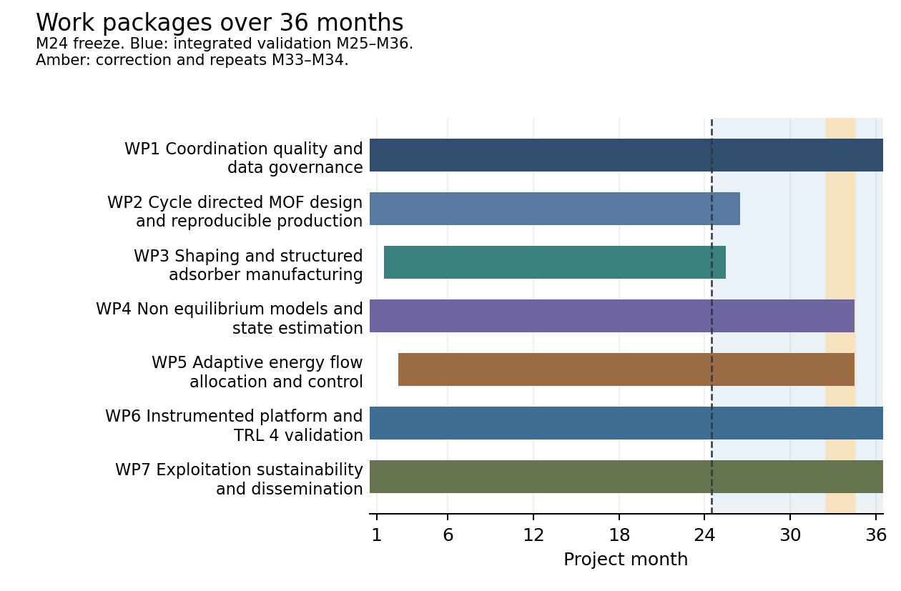
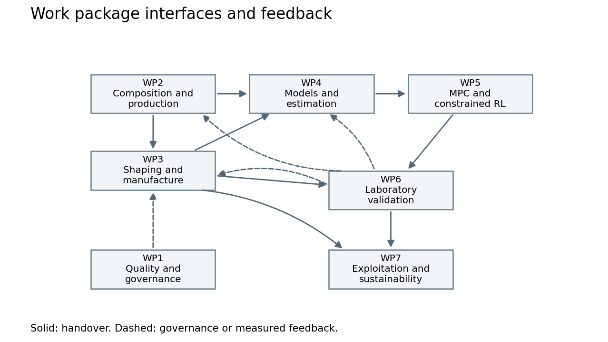

# 3 Quality and efficiency of the implementation

## 3.1 Work plan and resources

### Work plan and scientific integration

The five participants will execute a 36-month laboratory programme that connects multicomponent metal–organic framework (MOF) composition and reproducible production to shaping, non-equilibrium transport, state estimation, and model predictive control (MPC) and constrained reinforcement learning (RL). The programme will test whether composition, transport architecture and the allocation of energy flows must be designed together to extend an attainable heat-transformation service. It will deliver experimentally supported design rules and a laboratory validation at technology readiness level (TRL) 4. The duration is a resource-design choice. The project contains seven work packages (WPs), 224 person-months (PM) and a recommended eligible-cost budget of EUR 2,487,225.

WP2 and WP3 create controlled changes in material energetics and transport. WP4 determines what internal state and constitutive description the machine needs. WP5 tests how a controller should allocate heat, vapour conductance, pressure assistance and switching time. WP6 subjects those interventions to one complete mass, energy and service boundary. WP1 controls the interfaces, data and resources; WP7 converts measured findings into manufacturing and exploitation evidence. Composition tuning and RL are research interventions with falsifiable effects. Neither is assumed to succeed in advance.

The work starts in parallel. Savery will release the service and measurement contract at M2, a virtual rig and cartridge interface at M4, and an instrumented reference rig at M8. UPorto will start conservation models at M1, using existing reference-MOF data. HPE will begin fixed-cycle and MPC development at M3 on the reference simulator. IKTS will start reference-powder shaping at M2. New compositions and structures will replace these baselines through controlled releases. Material development therefore cannot delay the start of the platform, modelling or control work.

Two feedback reviews, at M10 and M18, will return measured regeneration, heat-transfer, conductance and observability limits to composition and process selection. M24 is the common hardware, model and policy freeze. M25–M36 provides twelve months for integrated comparison, including first prospective tests in M25–M32, correction and repeated tests in M33–M34, and transfer checks and evidence consolidation in M35–M36. A two-month correction allocation is explicit work, rather than unassigned float. A delay before M24 must leave at least nine months for integrated validation and pass a revised rig-capacity calculation.

The principal dependency chain runs from the service contract through composition screening, production confirmation, shaping windows, production release and cartridge qualification to the M24 freeze. A parallel chain connects the reference rig to identification, reduced models, policies, hardware-in-the-loop (HIL) qualification and metering closure. Both are required at M24. The editable schedule distinguishes these gate dependencies from the overlapping exploratory tasks. Monthly technical boards address changes; six resource reviews reconcile work, PM, facility hours and costs.

The implementation will contribute directly to the Innovative Advanced Materials for the EU (IAM4EU) Strategic Research and Innovation Agenda through interoperable material records (P#11), predictive material-performance models (P#12), and traceable sustainability assessment (P#14). WP2–WP3 supply composition, manufacture and property records; WP4–WP6 link them to operational performance; WP7 applies the resulting inventories and limits. This mapping concerns the design, production and use of advanced materials and does not require a field demonstrator. [S2–S3]

Figure 3.1 Work package timing. The task-level editable schedule also shows early reference work, the M24 freeze and the M33–M34 correction period.

Figure 3.2 Material and digital feedback loops converge on laboratory validation. WP1 controls releases and resources; WP7 uses validated manufacture and performance records.

### Primary service and scale derived from the experiment

The primary service will be low-temperature heat upgrading in a closed water-vapour adsorption system. The nominal laboratory test will deliver 10 kW to a water stream heated from 65 to 70 °C, with a 55 °C source and a 25 °C rejection boundary. This service makes heat allocation, finite-rate sorption and pressure assistance directly measurable. It also avoids a second machine function. Eight transfer histories at an adjacent delivery temperature will test a bounded extension of the same service after the primary comparison.

The initial inventory will be two beds with 10 kg active dry MOF per bed. A planning working swing of 0.15 kg-water/kg-MOF, a loading-averaged adsorption enthalpy of 2.8 MJ/kg-water, a 600 s full cycle for each bed and a 0.75 useful-heat fraction give 10.5 kW average useful heat. Each bed changes role approximately halfway through that cycle. These values size the apparatus; they are not measured material performance. A swing of 0.08 kg/kg would give only 5.6 kW under the same assumptions. WP2 will replace the assumed swing and enthalpy with measured, loading-dependent values before final duty selection.

At 10 kW and a 5 K useful-water temperature rise, the design flow is approximately 1.72 m³/h. An assumed thermal ratio of 0.4 implies approximately 25 kW aggregate source heat, including both evaporation and regeneration. These estimates specify the order of magnitude of the thermal loops. Initial vapour-train design will investigate approximately 200–300 m³/h near a 50 °C evaporator and pressure ratios from bypass to 3, subject to the measured suction state, water flow and actual equipment map. The pressure train is not treated as secured equipment. The passive bypass will remain available even if pressure assistance is not worthwhile.

The scale is one 10 kW mechanical module. In this plan, a module is one complete, metered two-bed heat-transformation unit, with common pressure housings, thermal loops and vapour machinery. It will accept twelve replaceable adsorbent sets. Two chemistries (reference and selected new MOF), two shaping routes (granular and conductive structured) and three independent batch/assembly groups give four physical configurations and twelve sets. Each set contains 20 kg active dry MOF, requiring 240 kg across all sets installed sequentially. Four reusable carrier/interface pairs serve the single module; independent repetitions do not require twelve new machines. Three independent 60 kg reference-production batches supply both reference routes, with a further 20 kg for development. Four kilograms from the unused margin of reference batch A also support early shaping, giving 24 kg development feed and approximately 20.4 kg recovered active MOF; the independent final sets retain their allocated material. Savery will synthesise 36 independent 5 kg lots of the selected material and allocate six whole lots to each of six disjoint 30 kg groups. At 85% process recovery they yield 153 kg active MOF: 120 kg for validation, 9 kg for retained characterisation and 24 kg for archive, process loss and rework. Each validation group is disjoint from the others. The measured active fraction determines the additional binder and substrate mass.

### Quantified experimental progression

Exploration will cover twelve nominal compositions, each from three separate 20 g syntheses. Four compositions will advance to three separate 100 g confirmation syntheses each. Two finalists will supply six 600 g process-development batches for 24 independent forming lots. Three further 200 g batches support mechanism experiments. A production recipe will be chosen from the confirmed finalists at M12, allowing bulk research production in M13–M23, with M24 for final forming and qualification while detailed mechanism work continues to M18. Independent cartridge groups A, B and C will be released by M19, M21 and M23 for final forming and acceptance. Together with final production, the new-MOF output plan is 186.12 kg across 93 syntheses. The reference purchase is 200 kg. These stages concentrate expensive full-machine tests on selected materials rather than expanding all factors into a full synthesis-by-process-by-control factorial.

The two principal forming routes probe distinct physical limits: a permeable granule bed and a conductive composite or monolithic adsorber. The study retains the material–cycle logic of structured granules and conductive structures, while using conventional coated or commercial reference coupons only where needed for a diagnostic comparison. A third coating-development programme is not resourced. This choice gives two substantial manufacturing routes and preserves a quantitative material-to-transport interface.

The measurement plan includes 108 exploratory and 36 confirmation isotherms, 24 loading-resolved calorimetric profiles, 48 reset-separated mechanism histories and 288 lot-property profiles. The mechanism histories combine thickness, thermal-contact and preparation interventions to distinguish distributed transport from additional water-population or framework states. Twenty-four ageing coupons receive 500 cycles each on a separate apparatus. A profile, sampled time point or repeated cycle is not counted as an independent synthesis or manufacturing replicate.

The main rig has 2,104 planned hours. These comprise 160 commissioning hours, 120 reference checks, 32 four-hour actuator-ablation histories, 72 four-hour controller-development histories, 144 eight-hour prospective histories, 24 eight-hour correction/repeat histories and eight eight-hour transfer histories. The primary matrix requires 1,152 rig-hours. Booking 180 hours per month in M25–M32 provides 1,440 hours, leaving 288 hours of capacity within that period. The later 192 hours of repeated tests and 64 hours of transfer checks are scheduled separately. Instrument occupancy and paid staff effort are different quantities; automation does not create free personnel or unbooked facility capacity.

### Fair comparison and complete thermodynamic boundary

The final comparison crosses all four physical configurations with three policies: an optimised fixed cycle, economic MPC and constrained RL. Four previously unseen complete boundary/history challenges and three independent assembly groups produce 144 histories. A final run includes four hours of service, two hours of complete reset and two hours for setup and stabilisation. The entire metered history is retained. The proposed eight development and four final challenge definitions include steady, ramped, order-reversed, source-varying and coupled load/boundary conditions. Complete histories, a disjoint batch/assembly group and terminal states are withheld. Random splits of correlated time samples are not validation.

All policies will have the same admissible actions, measured signals, estimator, actuator limits and declared boundary forecasts. The fixed-cycle policy will receive offline optimisation. MPC will receive adequate horizon, cost and constraint tuning. RL will control energy-flow allocation and timing through an explicit action policy, with a safety filter and fixed-policy fallback. The 5,000 CPU-hour control allocation provides up to 1,500 hours to each strategy and 500 hours for integration; RL may also use the separately costed GPU allocation. Actual tuning use and algorithm-specific compute are reported. Each strategy receives six physical development histories per configuration. HIL qualification precedes live deployment. Final tuning stops at M24.

The primary resource vector is measured aggregate drive heat, electrical work and qualified delivered heat. Economic comparison uses the same declared heat/electricity prices and unmet-service penalty, with price sensitivity reported separately. Resource totals include source heat to evaporation and regeneration, useful and rejected heat, heat leaks, pump and valve power, vapour circulation, branch compression, control electronics, startup and complete reset. Rig thermal-bath electricity used to impose a source or rejection boundary is logged as laboratory energy and reported separately; the machine-boundary comparison counts heat crossing those interfaces and includes its own pumps, preventing double counting of the same imposed source heat. Any application-equivalent heat-rejection or source-circulation load is stated explicitly. Heat is not assumed free merely because it could later originate as waste heat.

The heat-service integral counts only water delivered within the specified temperature and duty tolerance. Initial and final water and stored-energy inventories must agree within a predeclared 2% of the working transfer and cycle heat, or the residual and uncertainty must be explicitly corrected and bounded. Cycle mass and energy residual targets are 2% and 5%, respectively, and expanded useful-heat uncertainty is at most 5%. Reset energy and duration remain part of every comparison. A configuration that cannot deliver the same service is assigned a different feasible domain; it does not receive a forced energy-saving percentage. A common-duty comparison, down to a predeclared 5 kW, is permitted only after the service and inventory criteria are re-applied to every included cell. Its lower capacity remains a reported result.

Local chemical work and any inferred dissipation remain distinct from whole-machine resource use. UPorto will compare candidate models through the same physically constrained observation mappings. An additional state is retained only if it improves withheld history and boundary predictions beyond transport and thermal explanations. A local water-potential/loading work loop is a derived consistency test, not independent evidence from the same signals; calling it dissipation requires the applicable isothermal, storage and reset conditions. Prospective predictions remain frozen even when later correction is needed.

Policy order will be blocked across independent assembly groups. Paired effects will first be calculated at group level and combined with propagated measurement uncertainty. A gain requires an uncertainty interval excluding zero while service remains qualified; interaction effects and negative results are reported. Three independent groups establish repeatability but do not guarantee detection of a small effect. For example, a 95% paired t interval with three groups has a half-width of about 2.48 times their observed standard deviation; at 5% between-group scatter its half-width is about 12.4% of the baseline. The project will report this precision limit and avoid treating 144 correlated run histories as 144 independent material replicates.

### Scientific interfaces and change control

| Interface | Provider to accepting partners | Release months | Data/model contract and acceptance |
| --- | --- | --- | --- |
| IF1 | SAV,IRC to IKTS,UP,SAV | M3 provisional; M9, M18 and M24 releases | Savery releases powder, batch IDs, dry yield and process history. IRCELYON releases measured composition, phase, adsorption thermodynamics, rate, ageing and uncertainty linked to the same sample IDs. Acceptance: IKTS accepts mass/processability; UPorto accepts identifiable constitutive/observation fields; Savery checks the cycle window. |
| IF2 | IKTS to SAV,UP | M4 interface; M10 coupons; M18 windows; M24 as-built | Forming-lot/cartridge IDs; binder and MOF mass fractions; dimensions in m; active/shaped/substrate masses separately; conductivity W/(m K), permeability m2, contact resistance m2 K/W; mechanical properties and covariance. Acceptance: Savery accepts mechanical/thermal/vapour fit; UPorto accepts parameter provenance and variance. |
| IF3 | SAV to IRC,IKTS,UP,HPE | M2 boundary; M4 virtual rig; M8 measured; M16/M22 updates | Topology and control-volume IDs; SI boundary histories; calibrated sensor transfer functions; actuator realised limits/delay; bypass state; W and J by heat/electric channel; liquid and adsorbed inventories. Acceptance: UPorto verifies closure and observable quantities; HPE checks executable I/O, timing and fallback authority. |
| IF4 | UP to HPE,SAV | M4 simulator; M10 model; M22 ROM; M24 freeze; M34 assessment | State/action/observation definitions; model and estimator hashes; calibrated/earned domain; uncertainty and observation mappings; timestep, solver hardware and 99th-percentile timing. Acceptance: HPE runs contract and real-time tests; Savery tests declared observability and boundary reconstruction. |
| IF5 | HPE to SAV,UP | M12 baselines; M24 qualified policies; M34 comparison | Policy and tuning-data manifests; forecasts/constraints; safety-filter/fallback version; HIL outcomes; deployment timing; commanded/realised actions, overrides and reward/cost logs. Acceptance: Savery accepts actuator and interlock compatibility; UPorto checks common estimator and prospective split. |

Every interface will use SI units, absolute vapour pressure, explicitly defined dry-MOF and total-shaped-mass bases, separate single-bed and full-machine identifiers, and separate instantaneous and cycle-integrated quantities. Water loading uses kg-water/kg-active-dry-MOF; molar enthalpy uses J/mol-water. Mixture composition reports nominal feed and measured product separately. Every release includes uncertainty and covariance where identifiable, provenance, valid operating domain, an owner, an accepting partner and a machine-readable version. Provisional files can change; the M24 versions are frozen. A later change requires a reason, its affected runs, a resource consequence and a new version. No corrected result replaces an original prospective prediction.

### Table 3.1a List of work packages

| Work package No | Work Package Title | Lead Participant No | Lead Participant Short Name | Person-Months | Start Month | End month |
| --- | --- | --- | --- | --- | --- | --- |
| WP1 | Coordination quality and data governance | 1 | SAV | 18 | 1 | 36 |
| WP2 | Cycle directed MOF design and reproducible production | 2 | IRC | 43 | 1 | 26 |
| WP3 | Shaping and structured adsorber manufacturing | 3 | IKTS | 39 | 2 | 25 |
| WP4 | Non equilibrium models and state estimation | 4 | UP | 37 | 1 | 34 |
| WP5 | Adaptive energy flow allocation and control | 5 | HPE | 29 | 3 | 34 |
| WP6 | Instrumented platform and TRL 4 validation | 1 | SAV | 45 | 1 | 36 |
| WP7 | Exploitation sustainability and dissemination | 1 | SAV | 13 | 1 | 36 |

### Table 3.1b Work package description

#### Work package 1

Work package number: WP1. Work package title: Coordination quality and data governance.

**Objectives.** Maintain scientific integration, auditable resources and controlled data and software releases.

**Description of work.** Lead: SAV; M1–M36; 18 PM.

**T1.1 Coordination and technical decisions.** M1–M36; lead SAV. Input and dependency: Signed work plan and partner role sheets; technical releases from every WP. Savery chairs 36 monthly technical boards and six six-monthly resource reviews, maintains a decision register and resolves interface changes with the affected WP leads. Each partner supplies a named deputy, effort record and quarterly forecast. Scientific changes require a stated test, resource consequence and versioned disposition. Acceptance: Six review records reconcile task, WP and partner totals; no unresolved interface change enters a frozen test; each critical action has an owner and due month. Effort: SAV 5, IRC 0.5, IKTS 0.5, UP 0.5, HPE 0.5 PM; total 7 PM.

**T1.2 Data quality and reproducibility.** M1–M36; lead SAV. Input and dependency: Initial sample and signal schemas from T2.1, T3.1 and T6.1, then measured datasets and executable models. The data officer and the five technical leads implement one sample-to-cartridge-to-run identifier chain, a unit dictionary, access classes, calibration records and model/controller registries. Publish a data management plan by M4 and revise it at M18 and M36. Audit one sample-to-result chain per partner at six reviews, including failed runs and non-public background access. Acceptance: Every released run resolves material batch, forming lot, cartridge, calibration and controller/model versions; raw records remain immutable; all holdout access and deviations are logged. Effort: SAV 3, IRC 1, IKTS 1, UP 1, HPE 1 PM; total 7 PM.

**T1.3 Resources and operational readiness.** M1–M36; lead SAV. Input and dependency: Personnel slots, facility calendars and equipment cost bases; workload and risk updates. Partners produce five access and staffing sheets, maintain six rolling FTE and facility-capacity forecasts and check that charged work is unique to this action. The M2 operational review verifies synthesis staff, the kilogram production route, laboratory hosting, pressure-system responsibility and digital access. Reforecast costs at each six-monthly review. Acceptance: All five operating sheets identify accountable staff, equipment owner, eligible charge method and booking capacity; unresolved gaps trigger the risk actions before dependent work starts. Effort: SAV 2, IRC 0.5, IKTS 0.5, UP 0.5, HPE 0.5 PM; total 4 PM.

#### Work package 2

Work package number: WP2. Work package title: Cycle directed MOF design and reproducible production.

**Objectives.** Test composition as a means of shifting cycle-relevant energetics and establish reproducible powder production.

**Description of work.** Lead: IRC; M1–M26; 43 PM.

**T2.1 Composition exploration and cycle fingerprints.** M1–M9; lead IRC. Input and dependency: Nominal heat service and boundary envelope from T6.1; baseline powder and reference structure. IRCELYON researchers explore 12 nominal compositions in two water-stable framework families, using mixed-linker and limited mixed-metal variants where synthesis permits. Savery prepares three genuinely separate 20 g syntheses per composition, giving 36 batches and 0.72 kg. Savery records feed and measured composition, phase identity, activation, yield and solvent use. IRCELYON measures three-temperature isotherms on all 36 batches. UPorto and Savery use the resulting fingerprints to rank operating windows; IKTS checks process compatibility. Acceptance: Downselect four compositions by M9 using a declared score for usable swing, loading-dependent heat, rate and stability; a phase mixture is labelled as such; at least one tunable composition must show a reproducible fingerprint change beyond combined uncertainty, or the claimed composition mechanism is returned for revision. Effort: SAV 4, IRC 7, IKTS 1, UP 1 PM; total 13 PM.

**T2.2 Reproducible production and mechanistic measurements.** M4–M18; lead IRC. Input and dependency: T2.1 fingerprints and the early T4.1 transport model; provisional T3.1 forming needs. Savery prepares 12 independent 100 g confirmation batches for four compositions and six 600 g process-development batches for two finalists. A further three 200 g batches support mechanism discrimination. IRCELYON obtains 36 confirmation isotherms, 24 loading-resolved calorimetric profiles and 48 reset-separated dynamic histories covering two chemistries, two thicknesses, two thermal contacts, two preparations and three batch blocks. Use selected diffraction and, only if discriminating, water-sensitive spectroscopy. Calibrate the instrument and vapour path separately. Select one production recipe at M12 from the confirmed finalists so that the 180 kg campaign can run in M13-M23; detailed mechanistic measurements continue to M18. The two-chemistry mechanism blocks use disjoint samples from the existing independently synthesised confirmation/process batches; the three extra 200 g batches supplement targeted observations and are not relabelled as six independent batches. Acceptance: Deliver two traceable powder candidates and uncertainty-qualified constitutive cards by M18; explain composition and scale effects separately; qualify Savery’s single 5 kg line. Record released dry mass per lot, full turnaround including cleaning, and QC rejection before releasing the campaign. Effort: SAV 5, IRC 8, IKTS 1, UP 1 PM; total 15 PM.

**T2.3 Validation batches and ageing.** M10–M26; lead SAV. Input and dependency: M12 production recipe decision in T2.2; progressively qualified T3.2 process windows and operating stresses from T6.2. Savery produces 36 independent batches on one 5 kg line of the selected new MOF and allocate six disjoint groups of six batches, three groups to each shaping route. At 85% recovered MOF yield, 153 kg provides 120 kg for validation cartridges, 9 kg for retained characterisation and 24 kg for archive, losses and rework. The planning case assumes 5 kg released dry powder and 32 occupied hours per batch, including cleaning and turnaround. At 180 available line-hours per month in M13–M23, the campaign needs 1,152 of 1,980 hours. At M12 Savery recalculates the batch count from measured output and availability. Baseline powder comprises three independent 60 kg supplier-production batches plus 20 kg development stock. IRCELYON tests 24 material-route-batch-stress coupons for 500 cycles each on a separate ageing apparatus, with pre/post fingerprints and three inspection points. Release independent groups sequentially, with A by M19, B by M21 and C by M23, for final forming and qualification by M24. Acceptance: By M24 all six new-material cartridge groups retain independent batch provenance; within a selected recipe, cycle-working-capacity coefficient of variation is at most 10%, and retained capacity after 500 coupon cycles is at least 90%, or the failure domain and recovery plan are explicitly released. No achieved ageing performance is assumed. Effort: SAV 7, IRC 5, IKTS 1, UP 2 PM; total 15 PM.

#### Work package 3

Work package number: WP3. Work package title: Shaping and structured adsorber manufacturing.

**Objectives.** Compare two transport regimes and establish reproducible manufacturing windows and cartridge interfaces.

**Description of work.** Lead: IKTS; M2–M25; 39 PM.

**T3.1 Two shaping routes and interface specification.** M2–M10; lead IKTS. Input and dependency: Reference powder available at M1, the provisional T2.1 fingerprints and T6.1 cartridge envelope. IKTS develops freeze-granulated or gently extruded granules for a permeable bed, and a low-temperature conductive composite or monolithic structure for heat-transfer-limited operation. Use two candidate chemistries, two routes and three process settings per route, with two separately formed 150 g-MOF lots per setting: 24 forming lots consuming 3.6 kg MOF. Measure accessible uptake, binder fraction, dimensions, bulk density, permeability and mechanical integrity. Savery releases an interchangeable thermal and vapour interface at M4. An existing reference-granule process supplies the early rig by M6; this baseline does not wait for experimental route downselection. Acceptance: Two routes have buildable coupons by M10; retain at least 80% of powder working capacity per dry-MOF mass as a target and report capacity per total shaped mass and volume as well; process settings and rejected lots remain traceable. Effort: SAV 1, IRC 2, IKTS 8, UP 1 PM; total 12 PM.

**T3.2 Manufacturing windows and transport parameters.** M8–M18; lead IKTS. Input and dependency: T3.1 lots, refined powder cards and the independently calibrated T4.1 model. Characterise 24 forming lots and a small set of reference-powder coupons using 12 measurement profiles per lot, giving 288 lot-property profiles. Bound heat conduction, interfacial contact, vapour permeability, effective mass transfer, strength and dimensional spread. UPorto separates intrinsic kinetic parameters from geometry-dependent closures. Downselect one process window for each route using measured useful power and auxiliary-loss estimates rather than surface area alone. Acceptance: M18 process windows state temperature, pressure/shear, binder, yield and tolerances; the model can use their parameters with uncertainty; reject a window that only raises peak uptake while losing service feasibility or increasing net resource use. Effort: SAV 1, IRC 2, IKTS 10, UP 2 PM; total 15 PM.

**T3.3 Independent cartridges and quality release.** M16–M25; lead IKTS. Input and dependency: T2.3 batch groups, T3.2 windows and the fixed T6.1 interface. Manufacture twelve complete two-bed cartridge sets: two chemistries times two routes times three independent assembly blocks. Each set contains 20 kg active dry MOF across two 10 kg beds. A set is a matched pair of replaceable bed internals, not a second machine. Qualify mass, dimensions, thermal contact, conductance, attrition and leak-compatible assembly. Savery provides the one reusable 10 kW mechanical module, pressure housing and metering; IKTS supplies the shaped internals and production travellers. Acceptance: Release all twelve sets and as-built cards by M24, with M25 reserved for correction; do not mix validation-group powder with development material; the first cartridge per route meets the agreed interface and metering conditions before the remaining lots are built. Effort: SAV 2, IRC 1, IKTS 8, UP 1 PM; total 12 PM.

#### Work package 4

Work package number: WP4. Work package title: Non equilibrium models and state estimation.

**Objectives.** Discriminate mechanisms, identify a sufficient operational state and validate predictive transfer with frozen models.

**Description of work.** Lead: UP; M1–M34; 37 PM.

**T4.1 Conservation models and identifiable experiments.** M1–M10; lead UP. Input and dependency: Reference MOF data and early bench topology, then measured T2.1 and T3.1 cards. UPorto starts a distributed heat-and-mass balance model on the reference material at M1. Compare equilibrium/transport, water-population and additional internal-state descriptions with common observation mappings and physically bounded parameters. Design the 48 mechanism histories to separate thermal-contact, thickness and preparation effects. HPE receives a runnable reference simulator and common state/action/observation schema by M4; Savery qualifies actual actuator and sensor dynamics. Acceptance: M10 model release closes mass and energy numerically, preserves non-negative dissipation in its stated domain and documents which parameters the available observations can identify; model complexity increases only when withheld whole histories discriminate it. Effort: SAV 2, IRC 1, IKTS 1, UP 7, HPE 1 PM; total 12 PM.

**T4.2 Reduced models and state estimation.** M6–M22; lead UP. Input and dependency: T4.1 candidate models, T2.2 dynamic records and T6.2 interventions; T3.2 transport maps. Build a control model with a declared minimum sufficient state, an estimator and predictive intervals for each physical configuration. Test at least three estimator structures and three model orders using whole-run partitions. Predict heat, water inventory and internal temperatures under held-out preparation and boundary blocks. HPE checks computational cost and deployability; material and shaping leads test the interpretation of inferred states. Acceptance: By M22 the selected ROM and estimator meet a five-second supervisory step with 99th-percentile solve time below one second on declared hardware; on development holdouts, heat prediction NRMSE is at most 10% of rated duty, inventory error is at most 5% of measured swing, and 90% predictive intervals have stated empirical coverage. Failure narrows the earned domain rather than hiding extrapolation. Effort: SAV 2, IRC 2, IKTS 1, UP 9, HPE 2 PM; total 16 PM.

**T4.3 Prospective prediction and model correction.** M18–M34; lead UP. Input and dependency: M22 models, M24 frozen policies and the sealed T6.3 validation manifest. Freeze model form, fitting rules and observation mappings before the four final challenge histories are released. Use independently designated calibration specimens, while reserving batch group C, the four boundary histories and their terminal states from fitting. Compare complete-trajectory errors and cycle totals. Diagnose failures during M31-M34 with a versioned correction branch; original prospective results remain unchanged and correction claims use the reserved rerun histories. Acceptance: Deliver M34 predictive-transfer evidence with separate results for cross-batch, cross-history and cross-boundary tests; any adapted parameter is labelled as calibrated, and no validation set is silently reused as training. Effort: SAV 1, IRC 1, UP 6, HPE 1 PM; total 9 PM.

#### Work package 5

Work package number: WP5. Work package title: Adaptive energy flow allocation and control.

**Objectives.** Test whether constrained RL adds value beyond a well tuned fixed policy and economic MPC under common information and limits.

**Description of work.** Lead: HPE; M3–M34; 29 PM.

**T5.1 Control baselines and common information.** M3–M12; lead HPE. Input and dependency: Reference simulator at M4, T6.1 actuator limits and a shared training-data manifest. HPE implements an optimised fixed-cycle policy and economic MPC before new MOFs arrive. Both can use the same sensors, state estimator, permitted actuator range and declared boundary forecasts later available to RL. Fix an economic objective using measured drive heat, all electrical work and qualified heat delivery, with a common unmet-service penalty. Each strategy receives six full development histories per physical configuration and a declared, comparable tuning-compute allowance. Acceptance: M12 baseline release includes tuned fixed-cycle schedules, an MPC implementation, objective and forecast contracts, and reproducible tuning logs; the fixed baseline may optimise offline but cannot access final challenge histories. Effort: SAV 1, UP 2, HPE 4 PM; total 7 PM.

**T5.2 Constrained RL for energy flow allocation.** M8–M24; lead HPE. Input and dependency: T5.1 baseline, T4.2 ROM/estimator and measured process and actuator uncertainties. Train a constrained RL policy to allocate source heat, regeneration timing, heat recovery, vapour circulation and branch pressure assistance. Use twenty training seeds and up to one thousand simulated episodes per seed for each of four physical configurations, within 1,500 CPU-hours of the 5,000 CPU-hour control allocation and a separately costed 1,000 GPU-hours. A model-based safety filter enforces temperature, pressure, flow and service constraints; a watchdog returns to the qualified fixed policy. Test 36 normal/fault histories for each of three policies in HIL, giving 108 tests. Acceptance: M24 deployment candidate has zero unresolved hard-limit violations in HIL, deterministic fallback, complete logs and bounded real-time inference. RL has an explicit scientific test against MPC; deployment is conditional on safety qualification, not on presuming a savings gain. Effort: SAV 2, IRC 1, IKTS 1, UP 3, HPE 8 PM; total 15 PM.

**T5.3 Closed loop comparison and transfer.** M20–M34; lead HPE. Input and dependency: Qualified policies from T5.2 and the physical T6.3 protocol; identical allowed measurements and forecasts. Deploy all three policies on the four physical configurations. Freeze tuning at M24 and run the 144 final whole-history tests with blocked order across independent assembly groups. Compare economic cost, electrical and thermal inputs, delivered-service error and feasibility. Evaluate RL-minus-MPC interaction with material and shape; use eight reserved transfer runs at an adjacent hot-water setpoint only after the primary dataset is complete. Acceptance: Report effect sizes and uncertainty by independent batch/assembly block. Retain MPC as the deployment recommendation if RL is equivalent, less robust or more resource-intensive; the tested RL mechanism and its domain remain substantive scientific outputs. Effort: SAV 2, UP 1, HPE 4 PM; total 7 PM.

#### Work package 6

Work package number: WP6. Work package title: Instrumented platform and TRL 4 validation.

**Objectives.** Measure complete heat transformation histories and determine material, shaping, actuation and control contributions in the laboratory.

**Description of work.** Lead: SAV; M1–M36; 45 PM.

**T6.1 Early instrumented reference platform.** M1–M8; lead SAV. Input and dependency: Existing reference MOF and published thermophysical relations; the primary 10 kW hot-water service. Savery engineers build one reconfigurable 10 kW two-bed laboratory module with two 10 kg-MOF bed internals, measured source, rejection and useful-heat circuits, a calibrated vapour path, a bypassable vapour mover and branch compressor. Commission on reference granules by M8 using 160 rig-hours. The M4 topology and instrument release lets modelling and control proceed in parallel. Meter all heat inputs and outputs, each electrical feeder, liquid-water inventories, pressure, temperatures and commanded/realised actuation. Acceptance: At M8, calibrations and blank/reference tests target cycle energy residual within 5% of accounted input, mass residual within 2% of transferred water and 95% expanded useful-heat uncertainty at most 5%; unresolved residuals suspend gain claims and trigger re-instrumentation. Effort: SAV 10, UP 1 PM; total 11 PM.

**T6.2 Actuator ablation and component iterations.** M7–M22; lead SAV. Input and dependency: T6.1 qualified rig; development cartridges and progressively updated models/policies. Run 32 complete four-hour ablation histories across passive, circulation-only, compression-only and combined modes to separate transport and pressure effects. Allocate 120 further rig-hours to repeated reference checks and 72 four-hour controller-development histories across four physical configurations and three policies. Complete two component-iteration cycles by M16 and M22, correcting metering, heat leaks, contact or conductance before validation hardware is frozen. Acceptance: M22 readiness pack identifies useful service, feasible actuator domain, parasitic-loss floor and a measured reference baseline. If active assistance loses its net benefit, preserve bypass comparisons and test the resulting feasibility domain without a fabricated energy-saving percentage. Effort: SAV 8, IRC 1, IKTS 1, UP 1, HPE 1 PM; total 12 PM.

**T6.3 Blinded integrated comparison.** M23–M34; lead SAV. Input and dependency: T3.3 independent cartridge sets; frozen models, estimator and policies; M24 validation manifest. Use four physical cells (reference/new MOF times granule/conductive structure), three policies, four unseen complete boundary/history challenges and three independent assembly blocks: 144 eight-hour runs, including four hours service, two hours reset and two hours setup/stabilisation. Schedule first comparisons in M25-M32. Reserve twenty-four additional eight-hour histories for faults, declared model correction and replication in M33-M34. Verify service equality, inventory closure and full reset before any paired saving calculation. Acceptance: Primary evidence reports service feasibility and the complete thermal/electrical boundary for all cells. At nominal 55 C source, 25 C rejection and 70 C hot-water delivery, test the 10 kW design point; if a cell cannot meet it, report its feasible duty and restrict matched-input comparisons to a predeclared common duty, down to 5 kW, with capacity differences reported separately. Effort: SAV 10, IRC 1, IKTS 2, UP 2, HPE 2 PM; total 17 PM.

**T6.4 Evidence consolidation and TRL 4 assessment.** M31–M36; lead SAV. Input and dependency: All prospective results, failure/correction logs and manufacturing records. Complete eight eight-hour transfer histories at an adjacent delivery temperature, retain three independent nominal replications per physical cell from the primary dataset, and reconcile every reported KPI to raw signals. Produce a laboratory TRL 4 evidence file for the material-component-control chain, including the qualified operating domain, independent repeatability, uncertainty, reproducible analysis and remaining scale-up limitations. No site demonstrator is built. Acceptance: At M36, technical leads can reproduce the principal comparisons from released data and code; evidence supports validation in a laboratory only, and failed configurations or claims remain visible. Effort: SAV 4, IKTS 1 PM; total 5 PM.

#### Work package 7

Work package number: WP7. Work package title: Exploitation sustainability and dissemination.

**Objectives.** Translate measured results into protected exploitable outputs, manufacturing evidence and bounded environmental and economic assessments.

**Description of work.** Lead: SAV; M1–M36; 13 PM.

**T7.1 Early dissemination exploitation and communication plan.** M1–M6; lead SAV. Input and dependency: Scientific objectives, background inventory and partner exploitation interests. Savery prepares a distinct plan by M6 with four result families, target users, ownership interfaces, publication review and a communication calendar. Materials, manufacturing, modelling/control and system evidence each receive a named exploitation owner. Define six research-output submissions, three public technical events and six bounded adopter requirements interviews over the action, subject to normal later activity approvals. Acceptance: M6 plan is separate from the M4 data management plan, identifies audiences and actions, and protects unpublished recipes, patent matter and commercial background. Effort: SAV 2 PM; total 2 PM.

**T7.2 Manufacturing sustainability and economic boundaries.** M7–M32; lead SAV. Input and dependency: Measured batch yields, solvent/material inputs, process windows and integrated energy balances. IRCELYON and IKTS supply production and forming inventories; UPorto and Savery assess four physical configurations per qualified kWh of delivered heat and per reusable cartridge. Quantify material demand, solvent use, yield, cycling life and full thermal/electrical inputs. Compare current laboratory manufacture and two explicitly projected production scales without claiming industrial performance or an ISO-certified lifecycle assessment. Acceptance: M32 assessment gives functional unit, allocation, data quality, electricity/source-heat assumptions and sensitivity to life and yield; a net-benefit claim excludes neither regeneration/reset nor auxiliaries. Effort: SAV 2, IRC 1, IKTS 1, UP 1 PM; total 5 PM.

**T7.3 Protected results and subsequent development.** M12–M36; lead SAV. Input and dependency: T7.1 plan, technical releases, measured validation and partner background declarations. Update exploitation and communication at M18 and M36. Hold three technical exchange events, prepare six research-output submissions, complete six adopter requirement interviews and maintain four exploitable-result records. Savery leads the subsequent whole heat-recovery equipment/system route; IKTS supports manufacturing transfer, while UPorto and HPE define model/control reuse. Each partner reviews access rights before disclosure; neither patents nor downstream commercial performance are presumed. Acceptance: M36 route assigns result owner, access terms, next evidence and resources needed beyond TRL 4. Scientific and exploitation claims remain bounded by measured results; no additional beneficiary or site demonstrator is implied. Effort: SAV 2, IRC 1, IKTS 1, UP 1, HPE 1 PM; total 6 PM.

### Table 3.1c List of Deliverables

| Number | Deliverable name | Short description | Work package number | Short name of lead participant | Type | Dissemination level | Delivery date (in months) |
| --- | --- | --- | --- | --- | --- | --- | --- |
| D1.1 | Data management plan and schema | Initial data management plan, access classes, units, identifiers and holdout governance; updates at M18 and M36. | WP1 | SAV | DMP | PU | 4 |
| D2.1 | Composition and production fingerprint dossier | Constitutive data, independent batch evidence and two qualified powder candidates. | WP2 | IRC | R | SEN | 18 |
| D2.2 | Validation production and ageing evidence | Savery batch and allocation records for 36 planned 5 kg lots; IRCELYON coupon-ageing data with uncertainty and limits. | WP2 | SAV | R | SEN | 26 |
| D3.1 | Manufacturing windows and cartridge interface | Two forming routes, measured transport and quality windows. | WP3 | IKTS | R | SEN | 18 |
| D3.2 | Independent validation cartridge release | Twelve two-bed cartridge sets and as-built quality cards. | WP3 | IKTS | DEM | SEN | 24 |
| D4.1 | Control model and estimator release | Executable model, estimator, observation mapping, domain, intervals and timing evidence. | WP4 | UP | OTHER | SEN | 22 |
| D4.2 | Predictive transfer and mechanism assessment | Redacted reproducible findings with frozen and corrected predictions distinguished. | WP4 | UP | R | PU | 34 |
| D5.1 | Qualified fixed MPC and RL policies | Three policies, tuning manifest, constraints, fallback and 108-test HIL evidence. | WP5 | HPE | OTHER | SEN | 24 |
| D6.1 | Instrumented reference platform and boundary | Calibrated rig, reference protocol and full boundary/instrument contract. | WP6 | SAV | DEM | SEN | 8 |
| D6.2 | Integrated laboratory validation and TRL evidence | Complete matrix, independent repetitions, losses, uncertainty, failures and laboratory-readiness evidence; public redacted subset through D7.3. | WP6 | SAV | R | SEN | 36 |
| D7.1 | Dissemination exploitation and communication plan | Separate early plan with audiences, outputs, ownership and communication actions. | WP7 | SAV | R | PU | 6 |
| D7.2 | Manufacturing environmental and economic assessment | Measured inventory and resource assessment with bounded scale-up assumptions. | WP7 | SAV | R | SEN | 32 |
| D7.3 | Public results and protected exploitation roadmap | Six research-output submissions, three events, adopter synthesis and four exploitable-result routes, redacted before publication. | WP7 | SAV | R | PU | 36 |

PU: public, after background/IP review. SEN: sensitive, restricted to the applicable grant-access conditions. OTHER: executable data/model/software package. Only interface, review and validation outputs are formal deliverables; routine boards and working records remain internal.

### Table 3.1d List of milestones

| Milestone number | Milestone name | Related work package(s) | Due date (in month) | Means of verification |
| --- | --- | --- | --- | --- |
| MS1 | Operational ownership and measurement contract | WP1,WP2,WP3,WP6 | 2 | Five staffing/access sheets; responsible synthesis staff and kilogram route identified; primary service, measurement boundary and unit dictionary approved. |
| MS2 | Reference rig qualified | WP4,WP5,WP6 | 8 | Reference rig operates; numerical and experimental closure checks meet stated uncertainty limits or a dated corrective plan suspends gain claims. |
| MS3 | Compositions selected with independent batches | WP2,WP3,WP4 | 9 | Four composition candidates ranked using 36 independent syntheses; measured composition/phase and cycle fingerprints available; no claim of successful chemical tuning without an uncertainty-resolved effect. |
| MS3A | Production recipe and capacity decision | WP2,WP3,WP6 | 12 | Savery qualifies dry output and full turnaround of its 5 kg line; 36 lots at 32 h require 1,152 of 1,980 assumed hours in M13–M23. Reserve lots by route and group for A/B/C release at M19/M21/M23. |
| MS4 | Two process windows and sufficient state selected | WP2,WP3,WP4 | 18 | Two shaping windows and two material candidates qualified; transport closures measured; at least one model can predict reserved development histories with a declared domain. |
| MS5 | Control and validation freeze | WP3,WP4,WP5,WP6 | 24 | Twelve two-bed sets and three policy releases accepted; independent group C and four complete challenge histories remain unfitted; HIL constraints/fallback pass; reference nominal service and metering qualify. |
| MS6 | Prospective dataset complete | WP4,WP5,WP6 | 32 | 144 complete eight-hour histories logged or each failed cell explicitly reported; service and inventory eligibility applied before cost differences are computed. |
| MS7 | Correction and repeat decision closed | WP4,WP5,WP6 | 34 | Twenty-four reserved runs accounted for; original and corrected-model predictions separated; RL/MPC recommendation based on paired independent-block results. |
| MS8 | Laboratory evidence and exploitation release | WP6,WP7 | 36 | Principal results reproducible; TRL 4 claim matched to laboratory evidence and earned domain; four result-owner routes and complete resource account accepted. |

### Table 3.1e Critical risks for implementation

| Description of risk (likelihood and severity) | Work package(s) involved | Proposed risk-mitigation measures |
| --- | --- | --- |
| R1 Single-line throughput or saleable dry yield falls short. Likelihood H, severity H. Trigger: At M12 the demonstrated dry output, complete turnaround or downtime prevents six independent 30 kg allocations by M23, or shaped recovery falls below 75%. Impact: Novel-composition and independent-batch claims fail. | WP1,WP2 | Savery tests the recipe, tracks rejected lots and schedules catch-up on the same line. IRCELYON characterises released lots; IKTS verifies recovery. Reforecast using six times the rounded-up lot count per 30 kg group. Continue reference-material work if new material release slips. Time/cost consequence: Up to 3 months within pre-M24 work; defined cost exposure EUR30k direct, requiring partner confirmation before release. |
| R2 Shaping loses accessible capacity or conductance. Likelihood M, severity H. Trigger: Less than 80% powder working capacity, more than 10% lot CV, excessive attrition or a vapour pressure loss that prevents the common service at M10/M18. Impact: A transport route cannot sustain useful duty. | WP3,WP6 | Reduce binder or compaction, shorten diffusion length, or reopen one of the three already tested settings; retain both granule and conductive routes as comparative experiments even if one has a narrow earned domain. Time/cost consequence: One manufacturing iteration in M19-M24; up to EUR15k direct from the defined cartridge/rework work, with reduction elsewhere if needed. |
| R3 Models are non-identifiable or do not transfer. Likelihood H, severity H. Trigger: Two mechanisms remain equivalent across thickness/contact/history tests, or heat NRMSE exceeds 10% rated duty on whole-run holdouts at M18/M22. Impact: Mechanism attribution and adaptive-model reliability weaken. | WP2,WP4 | Use the simplest sufficient state, add the bounded independent structural/population observation already budgeted, and restrict the predictive domain; corrections get a new version and unused repeat histories. Time/cost consequence: Up to 2 months and EUR10k direct equivalent effort/access, using the existing observation allocation. |
| R4 RL does not outperform economic MPC. Likelihood M, severity M. Trigger: At M32 the paired independent-block uncertainty interval includes zero benefit, constraint reliability is worse, or inference exceeds its timing limit. Impact: Incremental RL benefit is unsupported. | WP5,WP6 | Retain the RL-versus-MPC result and causal action/log analysis; deploy MPC while reporting where RL is useful, equivalent or dominated. Do not retune on final challenges. Time/cost consequence: No critical-path delay or extra budget; analysis remains in T5.3. |
| R5 Auxiliary electricity cancels useful gains. Likelihood H, severity H. Trigger: Metered active-mode cost/exergy exceeds passive operation at equal service, or compression/circulation consumes the predicted margin at M16/M22. Impact: Net resource advantage or attainable service shrinks. | WP4,WP6 | Map bypass, circulation-only and compression-only domains; reduce pressure/conductance losses or duty; report feasible service and separate drive heat/electricity instead of a net-saving claim where services differ. Time/cost consequence: One component iteration, up to 2 months and EUR15k direct within T6.2 and defined consumables. |
| R6 Rig or pressure/vapour equipment is late. Likelihood M, severity H. Trigger: M4 specification cannot secure a 10 kW module with approximately 25 kW source duty and 200-300 m3/h vapour train, or M8 metering qualification slips by more than 1 month. Impact: Identification and final validation windows contract. | WP5,WP6 | Keep digital and coupon work active on reference data; use the same-budget modular low-pressure train and qualify metering first; absorb at most two months before M24 and protect at least nine months integrated validation. Time/cost consequence: Up to 2 months and EUR20k direct rental/iteration exposure; M25-M36 window is not consumed without a revised capacity check. |
| R7 Key staff or facilities are unavailable. Likelihood M, severity H. Trigger: A role exceeds its reserved monthly FTE, a named deputy is absent, or instrument access falls below 80% of the booked capacity for two months. Impact: Synthesis, model or validation throughput slips. | WP1-WP6 | Redistribute effort among the already budgeted staff slots of the five partners, cross-train deputies and move routine measurement blocks within the same partner infrastructure. No assumed free labour or facility. Time/cost consequence: Up to 2 months and EUR15k direct equivalent effort/access; role or access failure remains a pre-submission capacity gap. |
| R8 Cost rates rental availability or cost eligibility differ. Likelihood H, severity H. Trigger: Personnel rates increase by more than 0.70%, reference powder exceeds approximately EUR201/kg, or combined quotes/eligibility changes consume the EUR12,775 headroom. Impact: Recommended work cannot be funded within EUR2.50m. | WP1,WP6 | Replace assumptions with partner cost sheets, consolidate standard equipment rentals, cut non-critical extra sweeps/events first and protect independent batches, three policy comparisons and reset accounting. No budget reserve is booked. Time/cost consequence: The 10 kW recommendation is EUR2,487,225. All personnel +5% plus the defined EUR274k equipment/facility/compute base +10% requires EUR2,612,600; EUR112,600 total-cost reductions would be required. No contingency is booked. |
| R9 Water inventory or thermal closure biases comparisons. Likelihood M, severity H. Trigger: Energy residual exceeds 5%, mass residual exceeds 2%, or terminal inventory/stored-heat mismatch exceeds 2% of cycle transfer/heat. Impact: Apparent gain may be stored energy or measurement error. | WP2,WP4,WP6 | Pause comparative gain claims, run blanks and calibration, extend and meter reset, or report only bounded feasibility/transfer. Preserve rejected records. Time/cost consequence: Up to 1 month and six of the 24 reserved rerun histories; costs included in repeat/calibration allocations. |
| R10 Powder yield or 500-cycle life misses qualification. Likelihood M, severity H. Trigger: Recovered production MOF below 75%, group-level supply below 20 kg per assembly, or more than 10% capacity loss in coupon ageing. Impact: Independent set production and lifecycle inference are at risk. | WP2,WP3,WP7 | Use the 24 kg nominal retained/spare allocation, reduce destructive tests, adjust the tested process window and report short-life limits. Do not pool separate validation groups or erase the ageing failure. Time/cost consequence: Up to 2 months and EUR10k direct equivalent rework; no new endurance claim or larger prototype is introduced. |

H, M and L denote high, medium and low. Cost exposures are overlapping conditional estimates, not additive allocations or a booked reserve. Existing work may absorb a change only after its affected scope is identified; additional eligible expenditure must remain within the ceiling.

### Table 3.1f Summary of staff effort

| Participant Number/Short Name | WP1 | WP2 | WP3 | WP4 | WP5 | WP6 | WP7 | Total Person-Months per Participant |
| --- | --- | --- | --- | --- | --- | --- | --- | --- |
| 1/SAV | **10** | 16 | 4 | 5 | 5 | **32** | **6** | 78 |
| 2/IRC | 2 | **20** | 5 | 4 | 1 | 2 | 2 | 36 |
| 3/IKTS | 2 | 3 | **26** | 2 | 1 | 4 | 2 | 40 |
| 4/UP | 2 | 4 | 4 | **22** | 6 | 4 | 2 | 44 |
| 5/HPE | 2 | 0 | 0 | 4 | **16** | 3 | 1 | 26 |
| Total Person Months | 18 | 43 | 39 | 37 | 29 | 45 | 13 | 224 |

### Recommended budget in EUR

| Participant | Personnel | Travel | Equipment use | Other goods/services | Direct | Indirect | Total |
| --- | --- | --- | --- | --- | --- | --- | --- |
| SAV | 468,000 | 12,000 | 134,000 | 163,780 | 777,780 | 194,445 | 972,225 |
| IRC | 216,000 | 12,000 | 6,000 | 36,000 | 270,000 | 67,500 | 337,500 |
| IKTS | 320,000 | 10,000 | 12,000 | 72,000 | 414,000 | 103,500 | 517,500 |
| UP | 220,000 | 10,000 | 18,000 | 28,000 | 276,000 | 69,000 | 345,000 |
| HPE | 234,000 | 6,000 | 4,000 | 8,000 | 252,000 | 63,000 | 315,000 |
| Total | 1,458,000 | 50,000 | 174,000 | 307,780 | 1,989,780 | 497,445 | 2,487,225 |

Bold PM values in Table 3.1f identify the WP leader.

The task model contains 224 PM: Savery 78, IRCELYON 36, IKTS 40, UPorto 44 and HPE 26. Personnel costs are EUR 1,458,000 at planning employer-cost rates of EUR 6,000, 6,000, 8,000, 5,000 and 9,000 per PM, respectively. These blended rates are working assumptions and will be replaced with eligible partner cost sheets; they disclose no individual salary. The direct-cost model also includes EUR 174,000 equipment use, EUR 50,000 travel and EUR 307,780 other goods/services. The generated budget table is the authoritative category reconciliation.

All cost lines are linked to work. Reference powder, synthesis reagents, 24 forming lots, twelve independent 20 kg-active-MOF internals and four reusable mechanical carrier/interface pairs have separate mass and cost bases. Savery's reusable housing/interface parts and IKTS's shaped internals are distinct deliverables. The production-material allowance uses EUR250/kg output: yield-adjusted linker EUR90, metal precursor EUR20, modifier EUR30, net solvent EUR45, process consumables EUR35 and sample/QC supplies EUR30. The reference-powder bulk allowance is EUR150/kg. These are cost-design assumptions, with no vendor quotation or undisclosed formula implied. The budget also includes 41 MWh of laboratory utilities at EUR180/MWh, estimated from 2,104 rig-hours and approximately 19.5 kW whole-history average electrical input. Existing instruments carry an explicitly assumed remaining depreciation/use basis; if fully depreciated, that amount cannot be retained as an eligible cost. Most Savery equipment use is a planning rental, including baths, the metered skid and the vapour train. Rental offers and the required pressure/flow envelope remain to be verified. Facility-hour targets identify the capacity required. Staff, consumables and equipment use are charged once; a routine external instrument service is not silently treated as free internal access.

The recommended allocation is EUR 972,225 Savery, EUR 337,500 IRCELYON, EUR 517,500 IKTS, EUR 345,000 UPorto and EUR 315,000 HPE. Relative to the initial allocation, Savery increases by EUR252,225 and IRCELYON decreases by EUR142,500. IKTS and HPE increase by EUR17,500 and EUR15,000, while UPorto decreases by EUR55,000. The 10 kW module basis raises the original EUR2.40 million design target by EUR87,225 while keeping the recommendation below EUR2.50 million. It funds larger powder quantities and internals, suitable thermal/vapour equipment use and actual laboratory energy; the 224 PM and 44 modelling PM are retained. The standard actual-cost RIA planning basis applies a 100% funding rate and 25% indirect costs to eligible direct costs, excluding subcontracting and any overhead-inclusive internal recharge. The read topic text contains no specific lump-sum exception; the submission-session financial form and eventual grant rules will be checked before Part A is frozen. [S2, S4]

The recommendation leaves EUR12,775 of unallocated headroom below EUR2.50 million; the original EUR100,000 planning space has largely been used by the 10 kW scale correction. No reserve is an eligible cost line. A 5% increase in all personnel rates raises the total to EUR2,578,350. Combining it with a 10% increase in the defined EUR274,000 equipment/facility/compute base raises the total to EUR2,612,600, requiring EUR112,600 of total-cost reductions before adoption. Reference-powder cost of EUR200/kg, considered alone, raises the total to EUR2,499,725; new-MOF production consumables of EUR300/kg, considered alone, raise it to EUR2,498,475. These changes cannot both be absorbed. This cost sensitivity is a material pre-submission condition: actual partner rates and powder/equipment offers must close within the ceiling before resources are represented as agreed. Corrections first remove optional additional sweeps and non-critical purchases; independent batch evidence, the three policy comparison and reset accounting are protected.

### Six month FTE profile

| Participant | M1–6 | M7–12 | M13–18 | M19–24 | M25–30 | M31–36 | Peak monthly FTE |
| --- | --- | --- | --- | --- | --- | --- | --- |
| SAV | 2.85 | 2.64 | 2.12 | 2.02 | 1.63 | 1.73 | 3.62 |
| IRC | 1.40 | 1.77 | 1.44 | 0.79 | 0.39 | 0.20 | 2.15 |
| IKTS | 1.05 | 1.84 | 1.75 | 1.19 | 0.45 | 0.39 | 2.35 |
| UP | 1.34 | 1.95 | 1.38 | 1.39 | 0.78 | 0.50 | 2.36 |
| HPE | 0.44 | 1.10 | 0.76 | 1.02 | 0.59 | 0.42 | 1.21 |

The monthly effort profile is derived by spreading each task's allocated PM over its active months, then aggregating by partner and six-month phase. Role-level planning shares and maximum simultaneous FTE are also checked. Multiple fractional researchers or technicians are specified where one individual could not cover the peak. These are funded role slots, not named commitments. Before submission, the partners must confirm the staff identities or hiring routes, deputies and facility reservations that support those slots. The M2 readiness review verifies that operational access is in place. No FTE or cost is charged again under another action.

### Table 3.1g Subcontracting costs items

| Participant Number/Short Name | Cost (€) | Description of tasks and justification |
| --- | --- | --- |
| 1/SAV | 0 | No action task is planned for subcontracting. Routine instrument access/calibration purchases do not transfer research-task responsibility. |
| 2/IRC | 0 | No action task is planned for subcontracting. Routine instrument access/calibration purchases do not transfer research-task responsibility. |
| 3/IKTS | 0 | No action task is planned for subcontracting. Routine instrument access/calibration purchases do not transfer research-task responsibility. |
| 4/UP | 0 | No action task is planned for subcontracting. Routine instrument access/calibration purchases do not transfer research-task responsibility. |
| 5/HPE | 0 | No action task is planned for subcontracting. Routine instrument access/calibration purchases do not transfer research-task responsibility. |

### Table 3.1h Purchase costs items major equipment costs

| Participant Number/Short Name | Cost (€) | Justification |
| --- | --- | --- |
| 1/SAV | 24,000 | Thermal bath rental. Two 25 kW-class thermal boundary units for 20 months at 75% use; 10 kW module planning rental, no quote. |
| 1/SAV | 48,000 | Instrumented test skid rental. 10 kW useful-heat module, approximately 25 kW source heat; project-exclusive planning rental, not a reservation. |
| 1/SAV | 36,000 | Vapour mover and branch compressor rental. 10 kW module vapour train, approximately 200-300 m3/h at design suction; actual pressure/flow map and quote unconfirmed. |
| 1/SAV | 15,000 | DAQ and electrical metering rental. Planning rental with calibration; project-exclusive use. |
| 1/SAV | 5,000 | Sensor asset eligible depreciation. Assumed eligible asset cost; remaining useful life and ownership to verify. |
| 1/SAV | 6,000 | Synthesis line equipment use. Provisional share of single 5 kg line depreciation; verify asset basis, remaining useful life and actual use.. |

SAV equipment use totals EUR 134,000, or 28.63% of its personnel costs, exceeding the template’s 15% threshold. Other participants are below it: IRC 2.78%, IKTS 3.75%, UP 8.18% and HPE 1.71%. All equipment costs remain in the resource workbook. The threshold applies to equipment costs, not all purchases. Recoverable VAT is excluded; no procurement or asset availability is represented as committed.

## 3.2 Capacity of participants and consortium as a whole

### Complementarity and operational ownership

The consortium covers the complete laboratory chain through five participants in France, Germany, Portugal and Ireland. Savery owns the system-level question, component interfaces and complete measurement boundary. IRCELYON provides cycle-relevant material thermodynamics and independent characterisation. IKTS translates powders into reproducible structured adsorbers. UPorto provides dynamic transport models, model discrimination and state estimation. HPE Galway owns economic MPC, constrained RL and the HIL-to-hardware control chain. No sixth beneficiary, affiliated entity or associated partner is included in this resource design.

Savery will coordinate the programme and provide cycle architecture, thermal and vapour integration, instrumented operation and exploitation of the resulting heat-recovery equipment and systems. Frédéric Cui is the proposed scientific coordinator, subject to confirmation of the Horizon signatory and formal effort. The resource design provides 12 PM of scientific coordination, 30 PM of integration engineering, 20 PM of experimental technical work and 4 PM of project/data support. Two fractional engineering and technical slots permit overlap between commissioning and testing. The critical access requirement is a named laboratory host with responsibility for the low-pressure water-vapour system, utility circuits and the 2,104-hour rig programme. Previous Savery engineering work is relevant background; neither its product dimensions nor previous performance claims are used as proof for this new 10 kW experiment. Savery also performs all synthesis, from exploratory batches to production. It assigns 12 PM to synthesis research and operation. Its single 5 kg line must deliver 180 kg of released dry powder. Planning assumes 32 hours per production lot including cleaning and turnaround, and 180 available hours per month in M13–M23. Production requires 1,152 of 1,980 line-hours. The 57 smaller syntheses add 612 instrument-hours. At M12 Savery will verify the dry yield, full cycle and available hours, and account for any development work sharing the production window. At 4 kg of released powder per lot, each 30 kg group would require eight lots, giving 48 lots and 1,536 production hours at the same turnaround.

IRCELYON leads WP2 scientific coordination and provides compositional and phase analysis, adsorption thermodynamics, calorimetry, rate and history measurements, and coupon ageing. Its 36 PM cover scientific leadership (6 PM), materials and sorption researchers (20 PM), and laboratory technicians (10 PM). It returns measured fingerprints to Savery for recipe selection and links each result to the original batch ID. The ATARI team and analytical facilities document relevant expertise. Project staff and instrument access require confirmation. [S5]

Fraunhofer IKTS will lead the two shaping routes, manufacturing windows, transport-property measurements, quality consistency and cartridge release. Its published MOF powder-processing work includes granulation, extrusion and monolithic structures, including water-sorption applications. This is direct technical support for the assigned role, while project-specific process settings and achievable retained capacity remain to be tested. IKTS has agreed in principle to participate; the personnel, equipment and cost bases remain to be agreed. The 40 PM comprise 6 PM scientific leadership, 24 PM process research and 10 PM technical manufacture. Named low-temperature forming, property and quality facilities must support 720 planned internal instrument-hours and the specified routine external access. Savery supplies powder to IKTS, and IRCELYON supplies the matched characterisation records. [S6]

UPorto will link material constitutive data, measured geometry and complete cycle dynamics. Its 44 PM comprise 8 PM scientific leadership, 30 PM dynamic-model research and 6 PM research software engineering. The programme requires expertise in distributed adsorption transport, reduced models, practical identifiability and state estimation. Public university records support adsorption-process modelling as relevant background; the specific team and reserved staff capacity remain to be identified. The proposed resources include costed compute assets, 20,000 CPU-hours, 2,000 GPU-hours and reproducible data services. UPorto will accept material/transport cards, expose common observation mappings, supply the executable simulator early and release a real-time model and estimator with a declared earned domain. [S7]

HPE Galway will provide industrial control research and software integration, with 6 PM scientific leadership and 20 PM control/HIL research. Its assignment is to formulate and test energy-flow allocation policies, including constrained RL, against competent fixed and MPC baselines. The cost model includes 5,000 CPU-hours, 1,000 GPU-hours, a HIL compute asset and 108 HIL tests. Public HPE evidence establishes a Galway R&D presence; it does not confirm this project's named RL team, reserved compute or dedicated control effort. The required capacity sheet must identify the responsible control researcher, deputy, deployment hardware and permitted software/data access. HPE supplies an industrial adoption perspective without creating a data-centre demonstration site or promising access to customer systems. [S8]

### Access capacity and measures for reliable execution

Each participant will provide a concise access sheet that names the relevant staff, facility owner, booking period, permitted work and eligible charging method. The scientific unit, submitting legal entity and participant identification code (PIC) will be checked independently. IRCELYON's unit name is distinct from the eventual CNRS or university signatory; Fraunhofer IKTS is the performing institute within the verified submitting entity; HPE Galway identifies a team/site rather than a verified legal person. Administrative completion does not stop technical design, but an unresolved legal or operational gap cannot be presented as a secured resource.

Every WP lead has an accountable counterpart at the next interface and a funded deputy route. Common material cards, immutable raw records, documented observation mappings and executable controller manifests make knowledge transferable across personnel changes. The M2 access review and six-monthly FTE checks test actual capacity against the work programme. Missing synthesis capacity or a facility deficit triggers a costed alternative within the same five participants, while preserving early reference-platform and digital work. Access to a synchrotron or a new external research team is not on the critical path.

Open science is implemented through reusable metadata, preregistered challenge definitions, executable analysis and publication of an appropriately redacted dataset and negative results. Raw private recipes, background patent matter, individual payroll and partner commercial information receive restricted access. Publication review checks ownership and access rights before release; Git repository visibility does not define disclosure permission. The scientific experiment has no inherent sex or gender variable in material response. Recruitment and technical participation will use inclusive criteria, and the adopter interviews will address operator effort, maintenance and training requirements. These activities are proportionate to a laboratory industrial-technology programme and do not create an unresourced social-science work package.

### Industrial contribution and exploitation

Savery and HPE connect physical heat-recovery architecture with usable control software and an industrial requirements perspective. IKTS supplies a manufacturing route that can be transferred after laboratory validation. The academic partners retain defined routes for constitutive knowledge, material fingerprints, transport models and estimation methods. Four result families will have ownership and access records: composition/production fingerprints, shaped-adsorber process windows, models/control software and integrated validated design rules. Jointly generated results will be handled through agreed access and ownership terms rather than presumed ownership by the coordinator.

The commercial route for Savery is whole heat-recovery equipment and subsequent integrated thermal services, including energy-as-a-service or cooling-as-a-service where supported by later evidence. Sale of MOF powder or isolated cores is not the proposed minimum product. WP7 will identify the additional scale, durability, manufacturing and application evidence required for that route. Within this action, the industrial contribution supports credible use of the research results while the physical evidence remains laboratory TRL 4.

### References for implementation facts

S2. European Commission, Horizon Europe Work Programme 2026–2027, Part 7, Decision C(2026) 6687/2, topic MAT-PROD-61, pp. 74–75. [Official source](https://ec.europa.eu/info/funding-tenders/opportunities/docs/2021-2027/horizon/wp-call/2026-2027/wp-7-digital-industry-and-space_horizon-2026-2027_en.pdf)

S3. IAM4EU Strategic Research and Innovation Agenda, November 2024, P#11, P#12 and P#14, pp. 47–49. [Official source](https://www.iam-i.eu/wp-content/uploads/2025/02/SRIA-Innovative-Advanced-Materials-for-Europe.pdf)

S4. European Commission, Horizon Europe Work Programme 2026–2027, General Annexes A and G. [Official source](https://ec.europa.eu/info/funding-tenders/opportunities/docs/2021-2027/horizon/wp-call/2026-2027/wp-15-general-annexes_horizon-2026-2027_en.pdf)

S5. IRCELYON, ATARI team thermodynamics and calorimetry capabilities, and chemical/textural analysis facilities. [Official source](https://www.ircelyon.univ-lyon1.fr/team/atari/) and [Official source](https://www.ircelyon.univ-lyon1.fr/facility/analyse-chimique-texture/)

S6. Fraunhofer IKTS, Shaping of MOFs through powder-technological processes. [Official source](https://www.ikts.fraunhofer.de/en/departments/structural_ceramics/processes_and_components/shaping/cr_shaping_of_MOFS.html)

S7. UPorto LSRE-LCM, Cyclic Adsorption Processes, mathematical modelling, simulation, optimisation and control. [Official source](https://lsre-lcm.fe.up.pt/areas/1)

S8. HPE, Galway R&D centre announcement, 2 October 2023. [Official source](https://www.hpe.com/us/en/newsroom/press-release/2023/10/hewlett-packard-enterprise-creates-more-than-150-roles-at-new-cloud-rd-center-in-galway-ireland.html)
